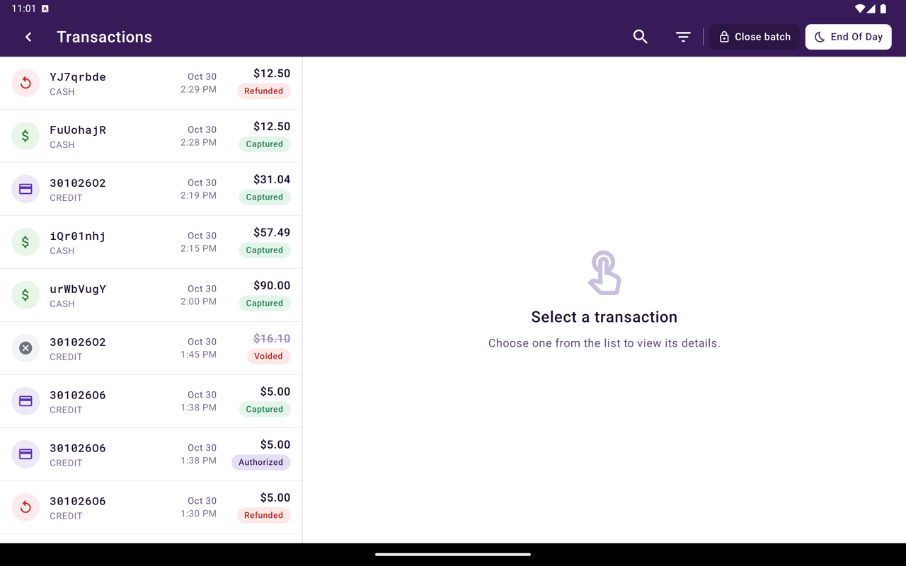

**Transactions** liste les paiements, les remboursements et les paiements en espèces. De là, vous ouvrez un paiement pour l'annuler, le rembourser ou le réimprimer, vous fermez le lot ou vous lancez la fin de journée.

## Avant de commencer

- Ouvrir **Transactions** exige la permission **Manage Transactions**. Sans elle, Taliup POS affiche plutôt un message de permission. Demandez à un gestionnaire de modifier votre rôle dans Taliup HQ.
- La liste affiche les transactions prises sur ce terminal. Avec la permission **View All Terminal Transactions**, elle affiche tous les terminaux de votre entreprise.
- La liste vient de Taliup HQ : elle exige une connexion.

## Ouvrir Transactions

- Depuis Accueil, touchez **Transactions**.
- Sur l'écran [Vente ouverte seulement](/fr-CA/taliup-pos/register/open-sale-only), touchez **Options** → **Voir les transactions**.

<Frame caption="liste Transactions avec colonnes ID, Date/heure et Total.">
  
</Frame>

## Ce que la liste affiche

Chaque ligne affiche :

- Une courte référence du paiement. Sur les caisses WEB-SRM, c'est le numéro de transaction imprimé sur le reçu.
- Le mode de paiement, comme le type de carte et ses quatre derniers chiffres, **CASH** ou **CARTE-CADEAU ····1234**.
- La date et l'heure, et le montant. Le montant d'un paiement annulé est barré.
- Une icône du mode de paiement, colorée selon le statut (par exemple capturé, autorisé, annulé ou remboursé).

En mode paysage, la liste et les détails du paiement choisi s'affichent côte à côte. Choisissez un paiement pour voir ses détails. En mode portrait, toucher un paiement ouvre les [Détails de la transaction](/fr-CA/taliup-pos/transactions/details).

## Rechercher et filtrer

- Touchez l'icône de recherche et tapez une référence, une carte ou un montant.
- Touchez l'icône de filtre pour ouvrir **Filtrer les transactions** (plage de dates, **Statut**, **Type de transaction**, **Mode de paiement**, **Statut de règlement**). Voir [Recherche et filtres](/fr-CA/taliup-pos/transactions/search-and-filters).

## Actions sur cet écran

| Action | Où | Guide |
|---|---|---|
| **Fermer le lot** | Au bas de la liste en portrait, dans la barre d'application en paysage | [Fermer le lot](/fr-CA/taliup-pos/transactions/close-batch) |
| **Fin de journée** | À côté de **Fermer le lot** | [Rapport de fin de journée](/fr-CA/taliup-pos/transactions/end-of-day) |

## Suivis courants

<CardGroup cols={2}>
  <Card title="Annuler" href="/fr-CA/taliup-pos/transactions/void">
    Annuler un paiement capturé non réglé.
  </Card>
  <Card title="Rembourser (retour)" href="/fr-CA/taliup-pos/transactions/refund">
    Remboursement total ou partiel d'un paiement réglé.
  </Card>
  <Card title="Réimprimer" href="/fr-CA/taliup-pos/transactions/reprint">
    Imprimer de nouveau la copie du marchand ou du client.
  </Card>
  <Card title="Détails" href="/fr-CA/taliup-pos/transactions/details">
    Statut, historique, terminal et actions offertes.
  </Card>
  <Card title="Fermer le lot" href="/fr-CA/taliup-pos/transactions/close-batch">
    Régler le lot de cartes ouvert.
  </Card>
  <Card title="Fin de journée" href="/fr-CA/taliup-pos/transactions/end-of-day">
    Prévisualiser, générer et imprimer un rapport quotidien pour un ou plusieurs appareils.
  </Card>
</CardGroup>
