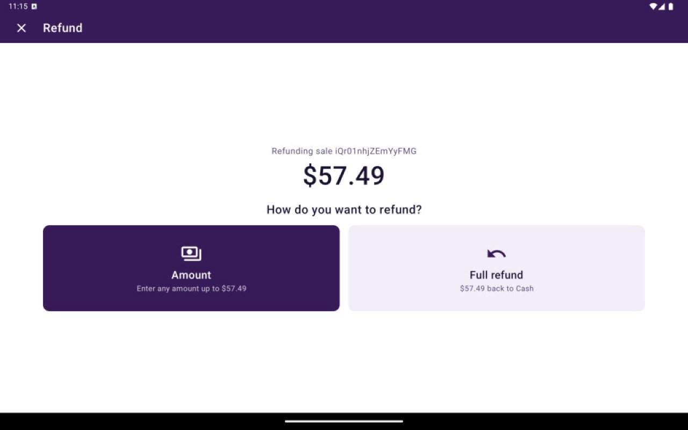
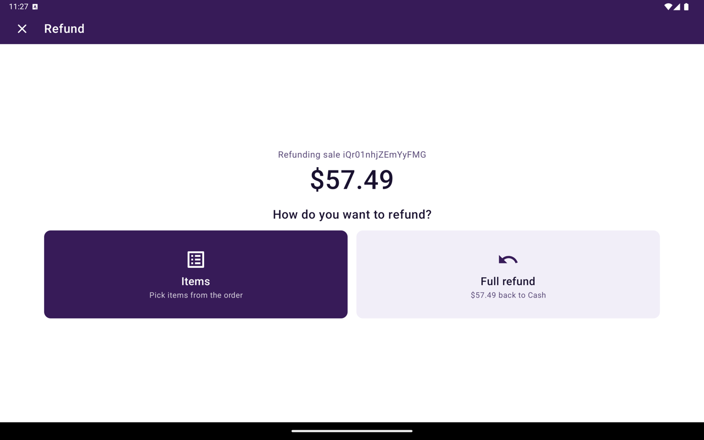
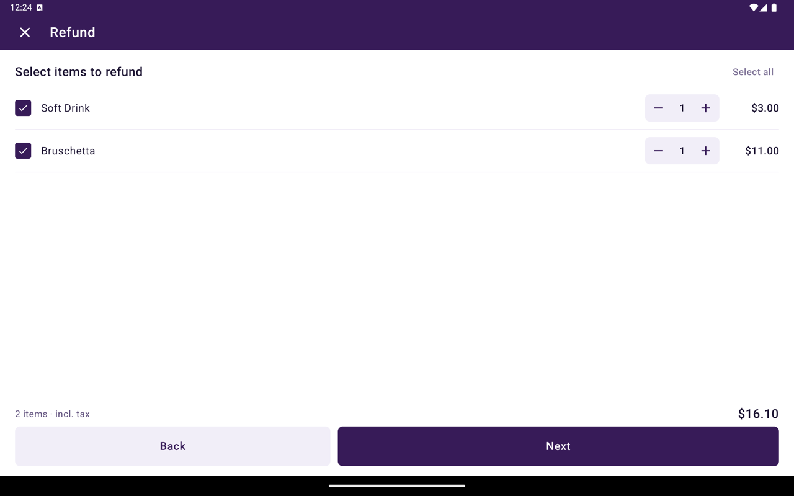

Dans Détails de la transaction, les remboursements commencent par **Retour**. Vous pouvez rembourser le montant complet, un montant personnalisé ou des articles sélectionnés — selon la vente d'origine.

<Frame caption="Remboursement. Montant permet de saisir n'importe quel montant jusqu'au total restant. Remboursement complet renvoie le tout sur le mode de paiement d'origine.">
  
</Frame>

## Avant de commencer

- Vous avez besoin de la permission de gérer les transactions.
- **Retour** apparaît lorsque le paiement est admissible (par exemple réglé/capturé avec un montant encore remboursable, ou déjà partiellement remboursé).
- Les options partielles sont masquées pour les commandes de table — utilisez **Remboursement complet** dans ce cas.
- Sur un appareil [WEB-SRM](/fr-CA/taliup-pos/web-srm), **Montant** est remplacé par **Articles** pour que la note de crédit fiscale puisse lister les lignes retournées.
- Si **Retour** est absent, le paiement est peut-être déjà entièrement remboursé/annulé, ou votre rôle ne peut pas gérer les transactions.

## Démarrer un retour

<Steps>
  <Step title="Ouvrir le paiement">
    Allez à Accueil → **Transactions** et ouvrez la vente.
  </Step>
  <Step title="Appuyer sur Retour">
    Appuyez sur **Retour**.
  </Step>
  <Step title="Choisir comment rembourser">
    Sur **Comment voulez-vous rembourser ?**, choisissez l'un des parcours ci-dessous.
  </Step>
</Steps>

## Remboursement complet

1. Appuyez sur **Remboursement complet**. La tuile affiche le montant restant et le mode de paiement d'origine (par exemple **57,49 $ retourné sur Cash**).
2. Sur **Confirmer le remboursement**, saisissez le **Nom sur le reçu** lorsque demandé.
3. Appuyez sur **Rembourser** et terminez les invites de l'appareil.
4. Taliup POS traite le retour et réimprime habituellement une copie marchand avant de revenir à la liste.

## Remboursement partiel (montant)

Affiché lorsque la vente n'est pas sur WEB-SRM.

<Steps>
  <Step title="Choisir Montant">
    Appuyez sur **Montant**. La tuile affiche **Entrez un montant jusqu'à** le total encore remboursable.
  </Step>
  <Step title="Saisir le montant">
    Saisissez un montant supérieur à zéro et pas plus élevé que le total restant. Appuyez sur **Suivant**.
  </Step>
  <Step title="Confirmer">
    Saisissez le **Nom sur le reçu** lorsque demandé, puis appuyez sur **Rembourser**.
  </Step>
</Steps>

## Remboursement partiel (articles)

Affiché sur WEB-SRM lorsque la commande liée a des lignes (et n'est pas une commande de table).

<Frame caption="Remboursement sur WEB-SRM. Articles remplace Montant pour choisir des lignes de la commande.">
  
</Frame>

<Steps>
  <Step title="Choisir Articles">
    Appuyez sur **Articles**.
  </Step>
  <Step title="Sélectionner les articles">
    Sur **Articles à rembourser**, appuyez sur **Tout sélectionner** ou choisissez des lignes individuelles, puis appuyez sur **Suivant**.

    <Frame caption="Articles à rembourser. Tout sélectionner ou choisir des lignes, puis Suivant.">
      
    </Frame>
  </Step>
  <Step title="Confirmer">
    Le WEB-SRM exige un **Nom sur le reçu** pour la note de crédit fiscale. Saisissez-le, puis appuyez sur **Rembourser**.
  </Step>
</Steps>

## Remboursements de carte-cadeau et fidélité

- Un remboursement sur une vente payée par carte-cadeau retourne sur la même carte. Voir [Cartes-cadeaux](/fr-CA/taliup-pos/register/gift-cards).
- Un remboursement complet annule les points de fidélité gagnés sur la vente. Voir [Fidélité](/fr-CA/taliup-pos/register/loyalty).

## Dépannage

| Situation | Quoi vérifier |
|---|---|
| Seulement **Remboursement complet** est disponible | Les commandes de table n'offrent pas **Montant** ni **Articles** |
| **Suivant** désactivé à la saisie du montant | Le montant doit être &gt; 0 et ≤ le montant encore remboursable |
| Pas de bouton **Retour** | Non admissible, déjà entièrement retourné, ou permission de gérer les transactions manquante |
| Message de permission | Demandez à un gestionnaire ou mettez à jour le rôle dans Taliup HQ |

## Connexe

- [Annulation](/fr-CA/taliup-pos/transactions/void) — pour les annulations non réglées
- [Détails de la transaction](/fr-CA/taliup-pos/transactions/details)
- [Réimprimer](/fr-CA/taliup-pos/transactions/reprint)
