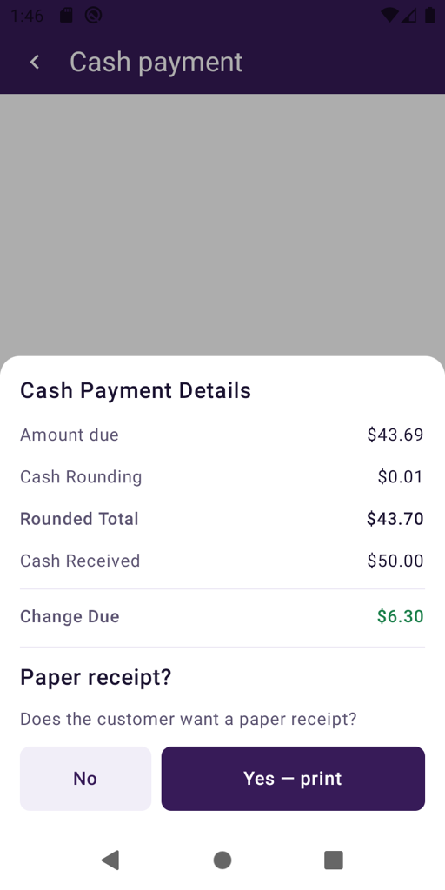
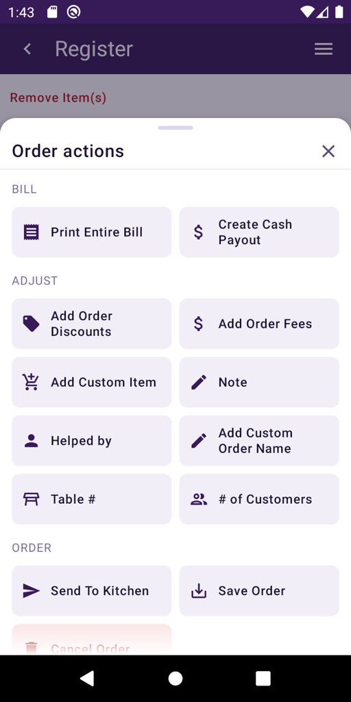
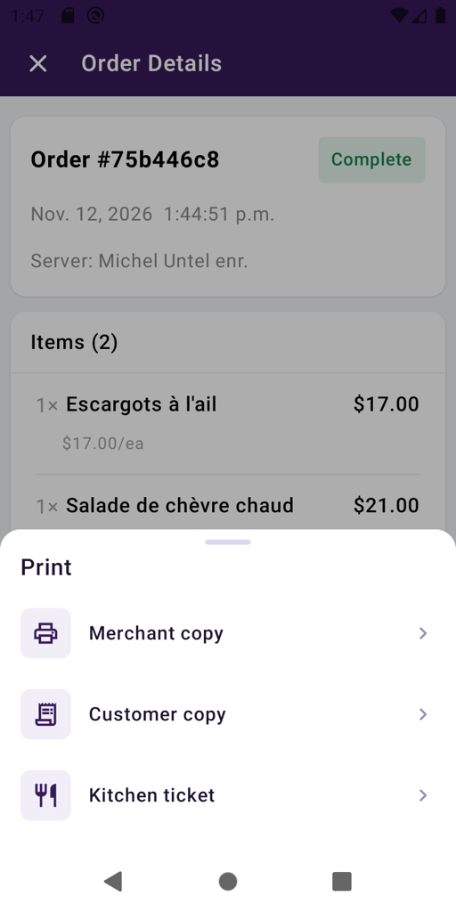
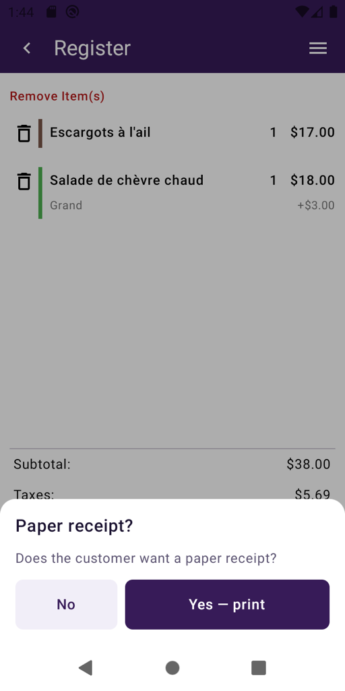
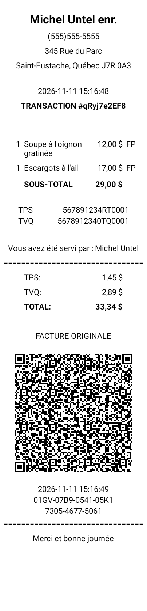

Sur un appareil inscrit au WEB-SRM, chaque addition et chaque reçu est transmis à Revenu Québec avant d'être imprimé. Le document imprimé porte le numéro de transaction et le code QR attribués par Revenu Québec.

Les documents fiscaux s'impriment toujours en français, quelle que soit la langue de l'appareil.

## Demander un reçu papier

Après un paiement, Taliup POS demande **Reçu papier?** — **Le client souhaite-t-il un reçu papier?**

- **Oui — imprimer** imprime le reçu.
- **Non** inscrit le reçu auprès de Revenu Québec sans l'imprimer.

La même question apparaît quand vous enregistrez une commande. Elle remplace le choix habituel **Aucun reçu** / **Papier** / **Courriel**. Voir [Reçu client](/fr-CA/taliup-pos/register/customer-receipt).

<Frame caption="Question du reçu papier après un paiement comptant.">
  
</Frame>

## Additions et reçus de clôture

L'addition est la facture temporaire remise au client avant le paiement. Le reçu de clôture s'imprime au paiement de la commande.

| Document | Comment le produire |
|---|---|
| Addition | Dans la **Caisse**, ajoutez les articles, ouvrez ☰ → **Imprimer la facture complète**. La commande reste ouverte. |
| Reçu de clôture d'une addition | **Commandes** → la commande → **Ouvrir la commande**, puis encaissez. Le reçu fait référence à l'addition. |
| Reçu de clôture sans addition | Dans la **Caisse**, ajoutez les articles et encaissez. |

Pour ajouter des articles après l'impression de l'addition, rouvrez la commande depuis **Commandes** avec **Ouvrir la commande**, ajoutez les articles et imprimez de nouveau l'addition.

<Frame caption="Actions de commande dans la Caisse. Imprimer la facture complète est sous Facture.">
  
</Frame>

## Copies du client et du marchand

Réimprimez une addition ou un reçu depuis **Commandes** → la commande → **Imprimer**.

| Choix | Imprime | Mention |
|---|---|---|
| **Copie du client** | Une reproduction pour le client | **REPRODUCTION** |
| **Copie du marchand** | Un duplicata pour vos dossiers | **\*\*\* COPIE DU COMMERÇANT \*\*\*** / **NE PAS REMETTRE AU CLIENT** |

Une copie est identique à l'original : même numéro de transaction, même date, mêmes montants. Revenu Québec est avisé qu'une copie a été produite.

<Frame caption="Menu Imprimer dans les Détails de la commande.">
  
</Frame>

## Enregistrer une commande sans imprimer

**Enregistrer commande** garde la commande ouverte et la transmet à Revenu Québec comme addition. Servez-vous-en pendant que le client commande encore.

<Steps>
  <Step title="Enregistrer la commande">
    Dans la **Caisse**, ouvrez ☰ → **Enregistrer commande**.
  </Step>
  <Step title="Papier ou non">
    À la question **Reçu papier?**, touchez **Non** pour enregistrer sans imprimer, ou **Oui — imprimer** pour imprimer l'addition.
  </Step>
</Steps>

Pour ajouter à une commande enregistrée, ouvrez **Commandes** → la commande → **Ouvrir la commande**, ajoutez les articles et enregistrez de nouveau. Chaque enregistrement fait référence au précédent.

<Frame caption="Enregistrer commande demande si le client veut du papier.">
  
</Frame>

## Numéro de table et nombre de clients

Sur une commande au comptoir, inscrivez la table et le nombre de clients depuis les **Actions de commande** :

- ☰ → **Table #** : 5 caractères au plus, puis **Enregistrer**.
- ☰ → **# de clients** : de 1 à 999, puis **Enregistrer**.

L'addition et le reçu impriment **TABLE #** suivi du numéro. Avec la [gestion des tables](/fr-CA/taliup-pos/tables) activée, prenez les commandes de table depuis **Tables** : elles portent leur propre table et nombre de clients.

## Pourboires

Le client ajoute un pourboire sur l'écran de paiement, lors d'un paiement par carte. Les pourboires s'activent dans Taliup HQ; Accueil → **Paramètres** → **Général** → **Préférences** → **Pourboires** indique s'ils sont activés. Voir [Pourboires](/fr-CA/taliup-pos/register/tips). Le reçu imprime le pourboire sous **POURBOIRE**, séparément du total.

## Arrondi en argent comptant

Les paiements en argent comptant sont arrondis aux 5 cents près. Les paiements par carte ne le sont pas.

Le récapitulatif du paiement comptant affiche l'arrondissement en espèces et le total arrondi. Le reçu imprime l'arrondi sous **Ajustement** et le total arrondi sous **MONTANT DÛ**.

## Mentions imprimées

| Mention | Document |
|---|---|
| **FACTURE ORIGINALE** | Addition |
| **PAIEMENT REÇU** | Reçu de clôture payé |
| **REPRODUCTION** | Copie du client |
| **\*\*\* COPIE DU COMMERÇANT \*\*\*** / **NE PAS REMETTRE AU CLIENT** | Copie du marchand |
| **NOTE DE CRÉDIT** | Remboursement. Voir [Annuler, corriger et rembourser](/fr-CA/taliup-pos/web-srm/cancel-and-correct). |
| **Facture corrigée** | Reçu qui remplace un reçu corrigé |
| **AUCUN PAIEMENT** · **FACTURE ANNULÉE** | Addition annulée |
| **PROBLÈME DE COMMUNICATION** | Produit hors ligne, en attente de transmission. Voir [Travailler hors ligne](/fr-CA/taliup-pos/web-srm/offline). |
| **ARGENT COMPTANT**, **CARTE DE CRÉDIT**, **AUTRE MODE DE PAIEMENT** | Mode de paiement |
| **Ajustement**, **MONTANT DÛ**, **POURBOIRE** | Arrondi en argent comptant, montant dû, pourboire |

Les options d'un article s'impriment sur leur propre ligne sous l'article, avec leur prix lorsqu'elles sont payantes. Un article à 0,00 $ s'imprime sans montant. Sous le code QR figurent la date et l'heure de transmission, le numéro de transaction de Revenu Québec et l'identifiant de l'appareil.

<Frame caption="Une addition (FACTURE ORIGINALE).">
  
</Frame>

## Dépannage

| Problème | Que faire |
|---|---|
| **Revenu Québec a rejeté la transaction fiscale.** | Rien n'a été enregistré. Touchez **OK**, corrigez ce qu'indique le message de Revenu Québec et recommencez. |
| **Le document fiscal a été créé, mais il n'a pas pu être imprimé.** | Le document a été transmis à Revenu Québec ; seule l'impression a échoué. Réglez l'imprimante, puis imprimez une **Copie du client** depuis **Commandes**. |
| **Le document fiscal a été créé, mais l'imprimante n'a plus de papier.** | Ajoutez du papier, puis imprimez une **Copie du client** depuis **Commandes**. |
