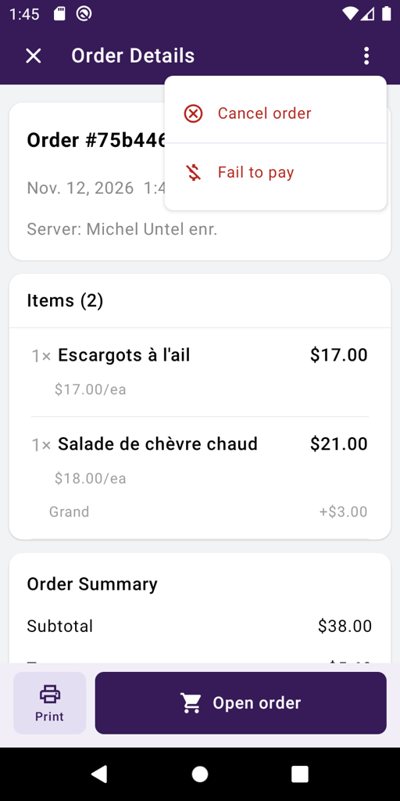
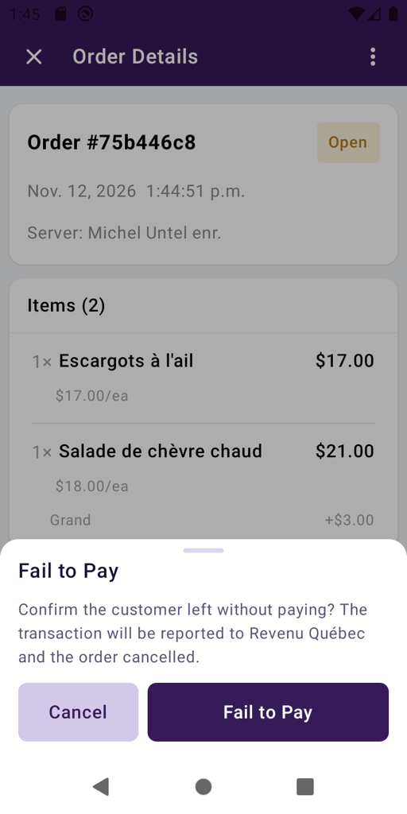
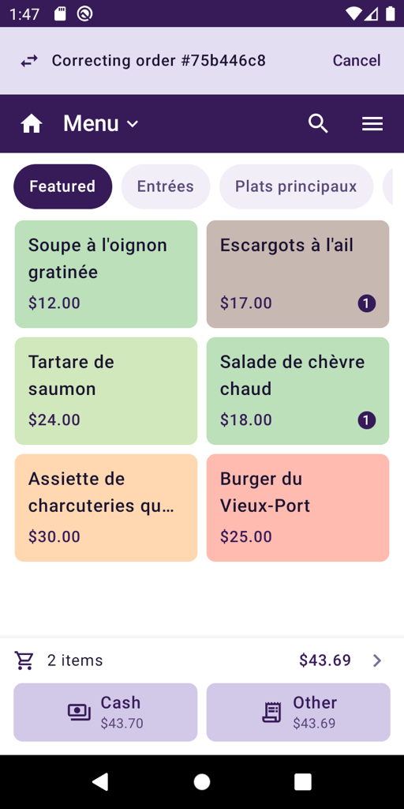
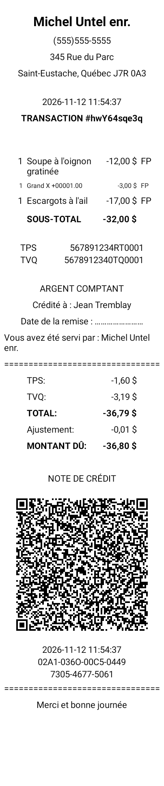

Sur un appareil WEB-SRM, chaque annulation, correction et remboursement est inscrit auprès de Revenu Québec. La façon de faire dépend de l'impression d'une addition ou du paiement de la commande.

| Situation | Utilisez |
|---|---|
| Commande en cours de saisie, aucune addition imprimée | Annuler avant l'addition |
| Addition imprimée, non payée, commande abandonnée | Annuler après l'addition |
| Addition imprimée, client parti sans payer | Client parti sans payer |
| Payée en argent comptant ou **Autre**, mauvais mode de paiement ou articles | Corriger une commande payée |
| Payée, le client retourne des articles ou est remboursé | Remboursements et notes de crédit |

## Annuler avant l'addition

<Steps>
  <Step title="Annuler depuis la Caisse">
    Dans la **Caisse**, ouvrez ☰ → **Annuler la commande**.
  </Step>
  <Step title="Confirmer">
    Rien n'est imprimé. Revenu Québec est avisé que la commande a été abandonnée.
  </Step>
</Steps>

## Annuler après l'addition

<Steps>
  <Step title="Ouvrir la commande">
    Quittez la **Caisse** avec le bouton Accueil, ouvrez **Commandes** et touchez la commande.
  </Step>
  <Step title="Annuler depuis les Détails de la commande">
    Dans les **Détails de la commande**, ouvrez le menu ⋮ → **Annuler la commande**, puis confirmez avec **Annuler la commande**.
  </Step>
</Steps>

Le terminal imprime un reçu de clôture qui reprend les articles, ajoute une ligne « Annulation », sans paiement. Il porte **AUCUN PAIEMENT** et **FACTURE ANNULÉE**.

<Warning>
  Une fois l'addition imprimée, annulez toujours depuis les **Détails de la commande**. **Annuler la commande** dans la Caisse traite la commande comme abandonnée en cours de saisie et n'imprime pas le reçu de facture annulée.
</Warning>

<Frame caption="Le menu ⋮ d'une commande ouverte dans les Détails de la commande.">
  
</Frame>

## Client parti sans payer

Inscrivez-le lorsqu'un client quitte après avoir reçu l'addition.

<Steps>
  <Step title="Ouvrir la commande">
    Quittez la **Caisse** avec le bouton Accueil, ouvrez **Commandes** et touchez la commande.
  </Step>
  <Step title="Inscrire le défaut de paiement">
    Ouvrez le menu ⋮ → **Défaut de paiement**, puis confirmez avec **Échec de paiement**.
  </Step>
</Steps>

Rien n'est imprimé. Revenu Québec reçoit un reçu de clôture qui reprend les montants de l'addition, marqué comme impayé, et la commande est annulée.

<Frame caption="Confirmation du défaut de paiement.">
  
</Frame>

## Corriger une commande payée

La correction remplace un reçu de clôture payé en argent comptant ou par **Autre**, par exemple lorsque le mauvais mode de paiement a été inscrit.

<Steps>
  <Step title="Lancer la correction">
    Ouvrez **Commandes**, touchez la commande, puis **Corriger la commande**, et confirmez.
  </Step>
  <Step title="Modifier la commande">
    La **Caisse** s'ouvre avec la commande et le bandeau **Correction de la commande #…**. Modifiez les articles au besoin.
  </Step>
  <Step title="Payer de nouveau">
    Payez avec **Espèces** ou **Autre**, les seuls modes offerts pendant une correction.
  </Step>
</Steps>

Au paiement, le terminal transmet à Revenu Québec l'inverse du reçu d'origine, qui n'est pas imprimé, puis le reçu corrigé, imprimé avec **Facture corrigée**.

Tant que vous n'avez pas payé, touchez **Annuler** dans le bandeau pour abandonner la correction. Le reçu d'origine demeure valide.

<Frame caption="La Caisse pendant une correction. Seuls Espèces et Autre sont offerts.">
  
</Frame>

## Remboursements et notes de crédit

Un remboursement produit une note de crédit : un reçu aux montants négatifs qui fait référence à la vente. Lancez-le depuis **Transactions** → la vente → **Remboursement** (carte) ou **Retour** (espèces ou Autre). Voir [Rembourser](/fr-CA/taliup-pos/transactions/refund) pour les étapes complètes.

Sur un appareil WEB-SRM :

- Choisissez **Articles** pour rembourser certaines lignes, ou **Remboursement complet** pour toute la vente. **Montant** n'est pas offert.
- **Nom sur le reçu** est obligatoire. Saisissez le nom du client avant de toucher **Rembourser**.

| Remboursement | Montants sur la note de crédit |
|---|---|
| Articles | Seulement les articles remboursés, en montants négatifs. L'arrondi en espèces de la vente d'origine n'est pas repris. |
| Remboursement complet | L'inverse exact de la vente, arrondi en espèces compris. |

La note de crédit imprime **NOTE DE CRÉDIT**, une ligne « Crédité à » suivie du nom du client et une ligne « Date de la remise » à remplir à la main. Elle est datée au moment où le terminal la produit.

<Frame caption="Note de crédit d'un remboursement complet.">
  
</Frame>

## Dépannage

| Problème | Que faire |
|---|---|
| Une addition annulée n'a pas imprimé de reçu **FACTURE ANNULÉE** | Elle a été annulée depuis la Caisse. Annulez une commande dont l'addition est imprimée depuis **Détails de la commande** → ⋮ → **Annuler la commande**. |
| **Corriger la commande** n'offre que **Espèces** et **Autre** | C'est normal. Une correction ne peut être payée qu'avec ces modes. |
| **Rembourser** reste désactivé | Saisissez le **Nom sur le reçu**. Revenu Québec l'exige sur une note de crédit. |
