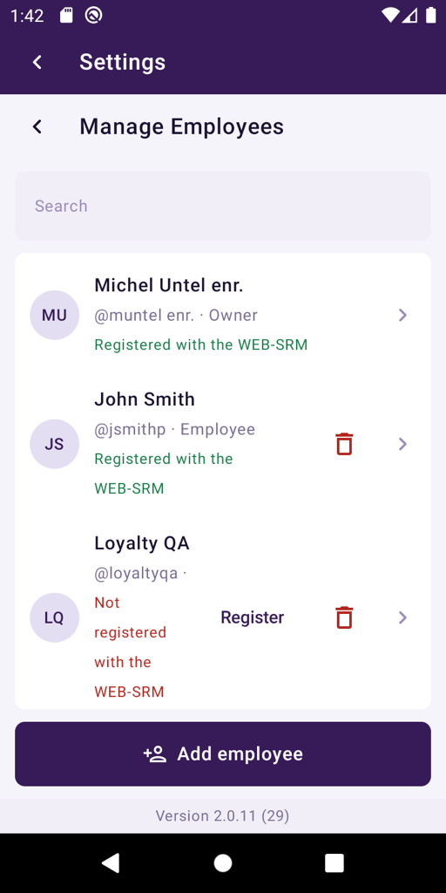
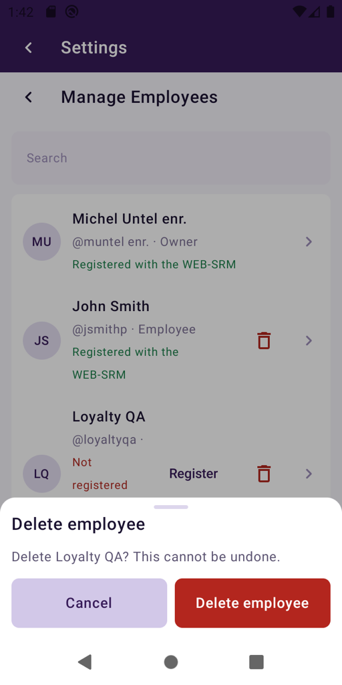

Chaque employé qui facture sur un appareil WEB-SRM doit être inscrit auprès de Revenu Québec. Taliup POS inscrit un employé tout seul à sa première connexion sur un appareil inscrit. Le propriétaire peut aussi inscrire ou retirer des employés depuis **Gérer les employés**.

L'inscription transmet le prénom et le nom de l'employé, avec les numéros de TPS et de TVQ de l'entreprise.

## Ouvrir Gérer les employés

Ouvrez Accueil → **Paramètres** → **Outils** → **Gérer les employés**. Seul un employé avec le rôle **Owner** (propriétaire) peut ouvrir cet écran. Ajouter ou retirer des employés exige aussi les permissions **Manage Employees** et **Delete Employees**; voir [Employés](/fr-CA/taliup-pos/settings/employees).

Chaque employé affiche **Inscrit au WEB-SRM** ou **Non inscrit au WEB-SRM**.

<Frame caption="Gérer les employés. Loyalty QA n'est pas inscrit et affiche un bouton Inscrire.">
  
</Frame>

## Inscrire un employé

Sur la ligne de l'employé, touchez **Inscrire**. L'état devient **Inscrit au WEB-SRM** dès que Revenu Québec accepte.

## Ajouter un employé

<Steps>
  <Step title="Ouvrir le formulaire">
    Touchez **Ajouter un employé**.
  </Step>
  <Step title="Le remplir">
    Saisissez le **Prénom**, le **Nom de famille**, un **Nom d'utilisateur** et un **Code d'accès (6 chiffres)** avec sa confirmation. Le courriel est facultatif.
  </Step>
  <Step title="Enregistrer">
    Touchez **Ajouter un employé**. L'inscription est transmise à Revenu Québec à l'enregistrement.
  </Step>
</Steps>

<Note>
  Un nom d'utilisateur reste réservé après la suppression de son employé. Donnez à un nouvel employé un nom d'utilisateur jamais utilisé.
</Note>

## Retirer un employé

Sur la ligne de l'employé, touchez l'icône de corbeille, puis **Supprimer l'employé**. Revenu Québec est avisé que l'employé ne facture plus. Cette action est irréversible.

<Frame caption="Confirmation de la suppression d'un employé.">
  
</Frame>

## Dépannage

| Problème | Que faire |
|---|---|
| **Seul un propriétaire peut gérer les employés.** | Connectez-vous avec le compte du propriétaire. |
| Un employé reste **Non inscrit au WEB-SRM** | Vérifiez que l'appareil est en ligne et inscrit, puis touchez **Inscrire** de nouveau. |
| Un nouvel employé ne peut pas facturer | Son inscription n'a pas abouti. Touchez **Réessayer** sur la feuille, ou inscrivez-le depuis **Gérer les employés**. |
