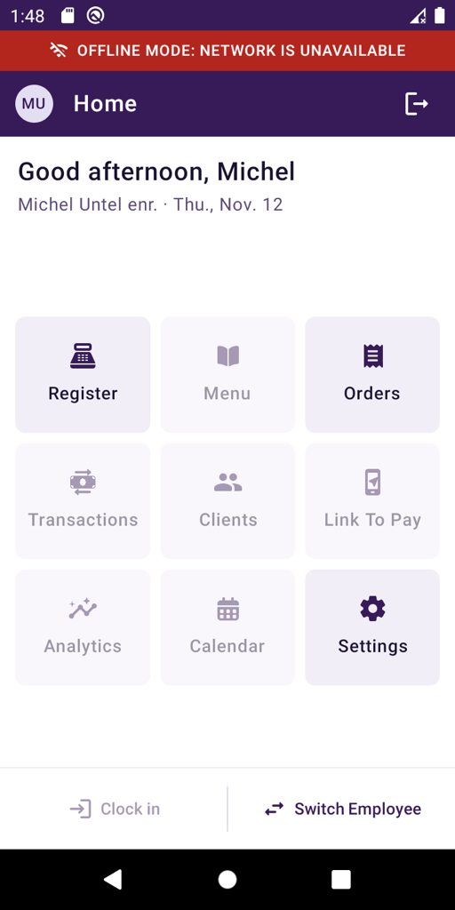
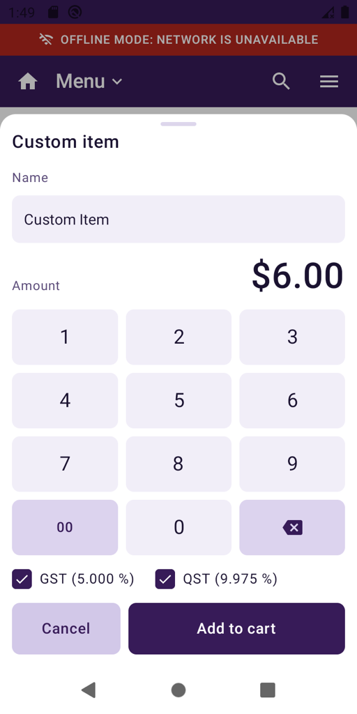
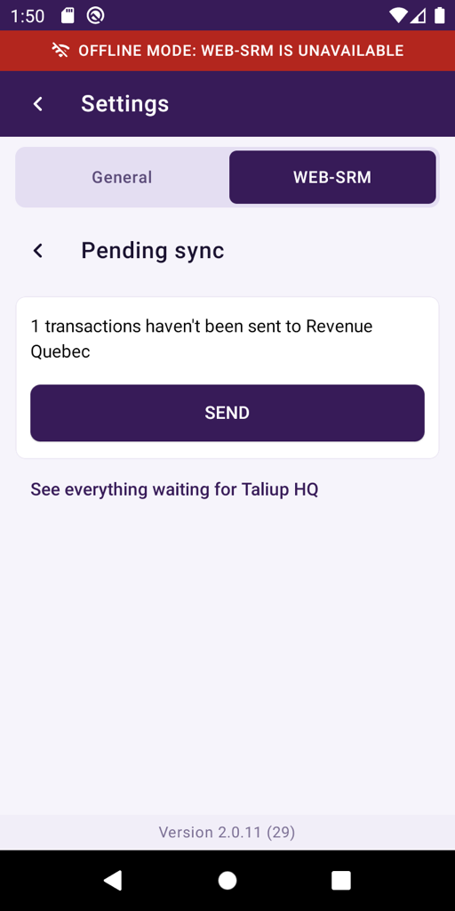

Sans connexion réseau, Taliup POS continue de facturer. Chaque document est signé, imprimé avec **PROBLÈME DE COMMUNICATION** et conservé dans un lot pour Revenu Québec. Le lot est transmis au retour de la connexion.

## La bannière hors ligne

Une bannière rouge apparaît en haut de tous les écrans lorsque l'appareil ne peut pas joindre Revenu Québec.

| Bannière | Signification |
|---|---|
| **MODE HORS LIGNE : RÉSEAU INDISPONIBLE** | L'appareil n'a aucune connexion réseau. |
| **MODE HORS LIGNE : WEB-SRM INDISPONIBLE** | Le réseau est revenu, mais aucune transaction n'a encore été acceptée par Revenu Québec depuis. Des transactions attendent d'être transmises. |

La bannière disparaît à la prochaine transaction acceptée, ou quand vous transmettez les transactions en attente depuis les **Paramètres**.

<Frame caption="Accueil quand le réseau est indisponible. Seules Caisse, Commandes et Paramètres restent disponibles.">
  
</Frame>

## Vendre hors ligne

<Steps>
  <Step title="Ouvrir la Caisse">
    Depuis l'Accueil, touchez **Caisse**. En mode **Menu**, le menu ne propose que l'**Article personnalisé** tant que l'appareil est hors ligne.
  </Step>
  <Step title="Saisir le montant">
    Touchez **Article personnalisé**, saisissez le montant, laissez les deux taxes cochées et touchez **Ajouter au panier**.
  </Step>
  <Step title="Encaisser">
    Encaissez comme d'habitude. Le reçu imprime **PROBLÈME DE COMMUNICATION**.
  </Step>
</Steps>

<Frame caption="Article personnalisé hors ligne.">
  
</Frame>

## Transmettre les transactions en attente

Au retour de la connexion, le lot part avec le prochain document produit. Pour le transmettre tout de suite :

<Steps>
  <Step title="Ouvrir la synchronisation en attente">
    Ouvrez Accueil → **Paramètres** → **WEB-SRM** → **Synchronisation en attente**. L'écran indique combien de transactions n'ont pas été envoyées à Revenu Québec.
  </Step>
  <Step title="Envoyer">
    Touchez **ENVOYER**, puis **Envoyer** pour confirmer.
  </Step>
  <Step title="Vérifier">
    **Synchronisation en attente** affiche **Aucune transaction hors ligne n'est en attente d'envoi.** et la bannière disparaît.
  </Step>
</Steps>

<Frame caption="Synchronisation en attente avec une transaction à envoyer.">
  
</Frame>

**Voir tout ce qui attend Taliup HQ**, sur le même écran, liste ce que l'appareil doit encore envoyer à Taliup HQ, ce qui est distinct de Revenu Québec.

## Dépannage

| Problème | Que faire |
|---|---|
| La bannière reste affichée après le retour du réseau | C'est normal. Elle disparaît à la prochaine transaction acceptée, ou après **Envoyer** dans **Synchronisation en attente**. |
| Le menu ne montre que l'**Article personnalisé** | L'appareil est hors ligne. Utilisez l'article personnalisé ou rétablissez le réseau. |
| Au retour du réseau, le menu affiche **Impossible de charger les produits du catalogue.** | Touchez **Réessayer**. |
| **ENVOYER** n'est pas disponible | Vérifiez que l'appareil est de nouveau en ligne, puis rouvrez **Synchronisation en attente**. |
