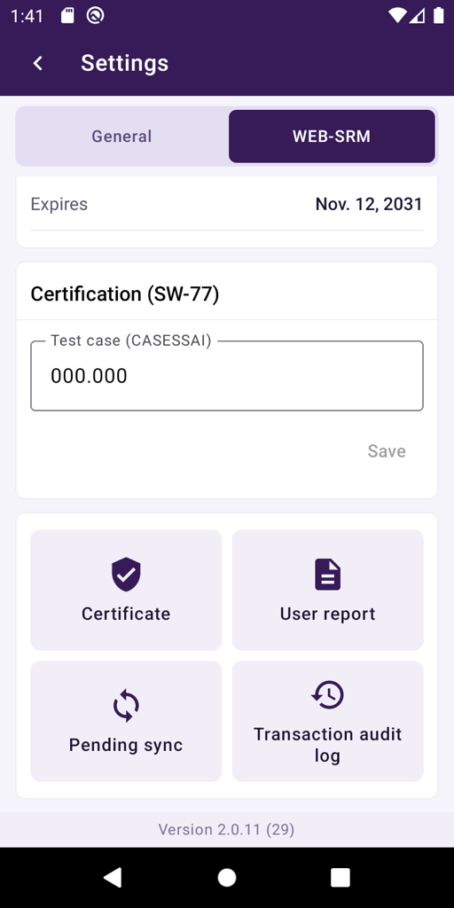

Tout ce qui concerne Revenu Québec sur l'appareil se trouve sous **Paramètres** → **WEB-SRM**. L'onglet n'apparaît que si l'entreprise utilise le WEB-SRM.

## Aperçu

| Champ | Indique |
|---|---|
| **État** | **Certificat installé**, ou **Aucun certificat — faites une demande pour commencer à facturer** |
| **Environnement** | L'environnement de Revenu Québec auquel l'appareil est relié |
| **Identifiant de l'appareil (IDAPPRL)** | Attribué par Revenu Québec |
| **Nom du certificat (SN)** | Le nom saisi à la demande du certificat |
| **Numéro de série**, **Expire le** | Le certificat en vigueur |

## Certification (SW-77)

**Cas d'essai (CASESSAI)** ne sert que pendant la certification du logiciel par Revenu Québec. Laissez la valeur `000.000`.

## Outils

<Frame caption="L'onglet WEB-SRM, défilé jusqu'aux outils.">
  
</Frame>

| Tuile | Sert à |
|---|---|
| **Certificat** | Demander, renouveler ou supprimer le certificat de l'appareil. Voir [Inscrire un appareil](/fr-CA/taliup-pos/web-srm). |
| **Rapport de l'utilisateur** | Imprimer le rapport de l'utilisateur de Revenu Québec. Voir [Rapport de l'utilisateur](/fr-CA/taliup-pos/web-srm/user-report). |
| **Synchronisation en attente** | Transmettre les transactions produites hors ligne. Voir [Travailler hors ligne](/fr-CA/taliup-pos/web-srm/offline). |
| **Journal de vérification des transactions** | Consulter, exporter ou partager le registre des événements WEB-SRM de l'appareil. |

## Journal de vérification des transactions

Le journal liste chaque événement WEB-SRM inscrit par l'appareil : l'utilisateur, le numéro de transaction, le numéro de transaction de Revenu Québec et le fait qu'il ait été produit hors ligne.

- **Exporter le ZIP** enregistre le journal dans un fichier ZIP sur l'appareil.
- **Partager le ZIP** l'envoie par le menu de partage du système, par exemple par Bluetooth.

<Warning>
  Le journal est conservé sur l'appareil sans expiration automatique. Exportez-le avant d'effacer les données de l'application ou de désinstaller Taliup POS.
</Warning>
