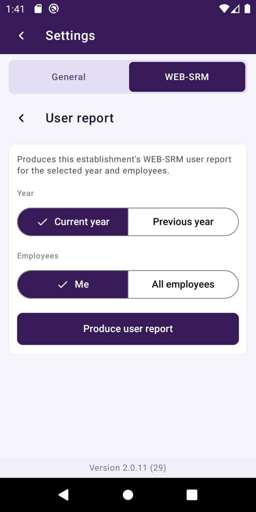

Le rapport de l'utilisateur résume les ventes inscrites auprès de Revenu Québec, pour un employé ou pour toute l'entreprise. Revenu Québec le produit ; l'appareil l'imprime.

<Steps>
  <Step title="Ouvrir le rapport">
    Ouvrez **Paramètres** → **WEB-SRM** → **Rapport de l'utilisateur**.
  </Step>
  <Step title="Choisir l'année">
    Touchez **Année en cours** ou **Année précédente**.
  </Step>
  <Step title="Choisir les employés">
    Touchez **Moi** pour l'employé connecté, ou **Tous les employés** pour toute l'entreprise, sur tous ses appareils.
  </Step>
  <Step title="Produire le rapport">
    Touchez **Produire le rapport**. L'appareil doit être en ligne.
  </Step>
</Steps>

Le rapport s'imprime avec le numéro de document attribué par Revenu Québec et un code QR. Il compte les reçus de clôture payés, notes de crédit comprises, et indique le dernier document imprimé.

<Frame caption="Options du rapport de l'utilisateur.">
  
</Frame>

## Dépannage

| Message | Que faire |
|---|---|
| **Échec du rapport de l'utilisateur** | Vérifiez que l'appareil est en ligne, puis recommencez. |
| **Le rapport a été produit et archivé, mais l'impression a échoué** | Le rapport existe chez Revenu Québec. Réglez l'imprimante, puis produisez-le de nouveau pour l'imprimer. |
| **Le rapport a été produit et archivé, mais l'imprimante n'a plus de papier** | Ajoutez du papier, puis produisez-le de nouveau. |
