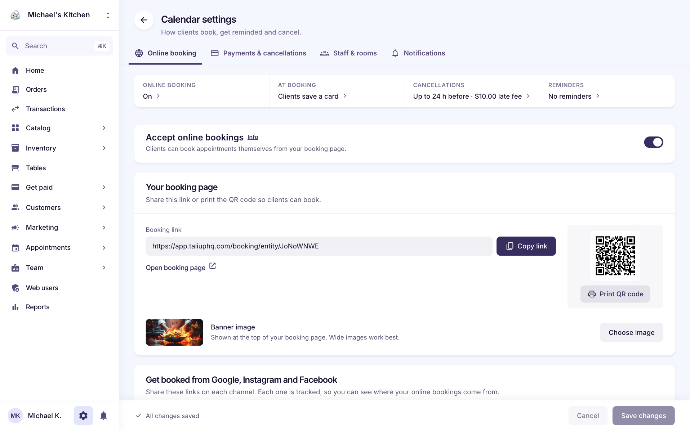

Calendar settings control online booking, deposits and cancellations, how bookings go to staff and rooms, and reminders. Some options also live on each service.

For day-to-day booking, see [Calendar](/taliup-hq/features/calendar).

## How to get here

Sidebar → **Settings** → **Features** → **Calendar**. You can also click the settings icon in the calendar toolbar.

You need the **Calendar** feature and the **Manage Settings** permission. Online booking needs the **Online Booking** add-on, and deposits, saved cards and fees need the **Online Booking Payments** feature.

The page has four tabs: **Online booking**, **Payments & cancellations**, **Staff & rooms**, and **Notifications**.

### At a glance

A summary at the top shows how things are set now: **Online booking** on or off, what clients pay **At booking**, your **Cancellations** window and fees, and your **Reminders**. Click any part to open its tab.

One bar at the bottom saves every tab. It shows **You have unsaved changes** until you click **Save changes**. Click **Cancel** to undo. If you leave with unsaved changes, **Leave without saving?** asks first.

## Online booking

| Setting | What it does |
|---|---|
| **Accept online bookings** | Turns your booking page on. Needs your hours of operation |
| **Your booking page** | Your booking link and QR code, and the banner image at the top of the page |
| **Get booked from Google, Instagram and Facebook** | A tracked link for each channel |
| **Service categories** | With more than one catalog, which catalog's categories group services on your booking page |
| **When clients can book** | **Minimum notice** before a booking, and **How far ahead clients can book** |
| **Let clients join a waitlist** | Clients can join a waitlist when no time works. See [Waitlist](/taliup-hq/features/waitlist) |

Everything after **Accept online bookings** shows once it is on. See [Online booking](/taliup-hq/features/online-booking).

## Payments & cancellations

The first two sections need the **Online Booking Payments** feature. Without it, you see **Online Booking Payments isn't on your plan**. Contact Taliup to turn it on.

Deposits, saved cards, and fees also need an online payment gateway on the location. Without one, you see **Online payments aren't set up**. Locations without a gateway are named in a warning, and bookings there don't ask for a card. Contact Taliup support to set one up.

### Online booking payments

Choose what clients pay or leave on file when they book online. Every service uses this unless it sets its own.

| Option | What happens |
|---|---|
| **No payment** | Clients book without a card. No-show and late-cancellation fees can't be charged |
| **Save a card** | Nothing is charged now. The card is kept so you can charge no-show and late-cancellation fees |
| **Take a deposit** | Part of the price is paid when booking, as a **Fixed amount** or a **% of price**. The card is saved too |
| **Full price upfront** | Clients pay the whole price when booking |

If some services set their own payment, the section lists them. Click **View services** to review them.

### Cancellation and no-show policy

Applies to online bookings that take a deposit or save a card.

| Setting | What it does |
|---|---|
| **Cancellation window** | Hours before the appointment. Clients who cancel earlier get their deposit back automatically. Later cancellations can be charged the late-cancellation fee |
| **No-show fee** | **No fee**, **Fixed amount**, or **% of price**. Charged when a client doesn't show up |
| **Late-cancellation fee** | **No fee**, **Fixed amount**, or **% of price**. Charged when a client cancels inside the cancellation window |

A deposit the client already paid counts toward the fee:

- Only the fee is kept from the deposit. The rest is refunded to the client's card.
- With no fee set, the whole deposit is refunded.
- If the fee is more than the deposit, the difference is charged to the saved card.

Fees can only be charged to a card the client saved, or from a deposit they paid, when booking online or through a payment link. Staff settle fees when they cancel or mark a no-show. See [Cancel an appointment](/taliup-hq/features/calendar#cancel-an-appointment).

### Clients can cancel online

Lets clients cancel from the link in their confirmation email. The cancel link stops working once the appointment has started, or once it's checked out on the register.

**When a client cancels late** shows when fees can be charged. It applies inside the cancellation window, with a late-cancellation fee set. Clients see the amount before they confirm.

| Option | What happens |
|---|---|
| **Flag it for staff to charge** | The appointment shows **Late cancellation · fee not charged** so staff can charge or waive it |
| **Charge the fee automatically** | Charged to the client's saved card as soon as they cancel |

### Payment links

When staff book an appointment, they can send the client a link to pay the deposit or save a card, the same way as booking online.

Set **Link stays valid for** in hours (1 to 168). If the client hasn't paid or saved a card by then, the appointment is cancelled and the client is told. A link sent closer to the appointment than this expires when it starts instead, and the appointment stays booked.

See [Payment links](/taliup-hq/features/calendar#payment-links) on the calendar.

## Staff & rooms

### How bookings are given to staff

**Assign employees to services**: each service is booked with the employees you assign to it, and clients can pick who they book with. Turn it off to book by service hours instead.

### Rooms and equipment

List the rooms, chairs, or machines your services need. Then pick them on each service.

| Column | What it means |
|---|---|
| **Name** | For example, a treatment room |
| **How many at once** | How many of it you have, such as 2 massage tables. Each one is numbered so you can see which one a booking is in |
| **Location** | **All locations**, or one location. A room tied to a location only counts bookings there. Shown when you have more than one location |
| **Used by** | How many services need it |
| **Active** | Turn a room off without deleting it |

To add one, click **Add room or equipment**, enter the details, then click **Add**.

To change one, open its menu and click **Edit**. When it has more than one unit, rename each numbered unit under **Name each one**. Click **Done**, then **Save changes** at the bottom of the page.

You can't lower **How many at once**:

- while the units you'd remove still have upcoming bookings. Move those bookings first.
- below what a service uses per booking. Lower it on the service first.

To delete a room, open its menu and click **Delete**. Services stop needing it.

### On the calendar

| Setting | What it does |
|---|---|
| **Drag appointments to move them** | On by default. Staff with **Manage Appointments** can drag a booking to a new time, day, or staff member. They confirm the move first |

## Notifications

**Email**

| Setting | What it does |
|---|---|
| **Email reminders to clients** | **Don't send**, or **1 day before**, **2 days before**, **3 days before**, or **7 days before** |
| **Email me about appointments** | Get an email when an appointment is booked, changed, or cancelled. Enter the address under **Send to**. Required while online booking is on |

**Text messages**

This section shows only when Taliup has appointment texts turned on.

| Setting | What it does |
|---|---|
| **Text clients a booking confirmation** | Sent when the appointment is booked, after any deposit is paid. The client needs a phone number on their profile |
| **Text clients appointment reminders** | Turns on reminder texts |
| **First reminder** | 1, 2, 3, or 7 days before |
| **Second reminder** | **No second reminder**, or a short text 1 to 12 hours before |

Every text ends with an opt-out line. Clients who reply STOP aren't texted again. The section also shows how many texts you sent this month.

### How reminders are timed

- Reminders follow your settings as they are now. If you change a lead time, upcoming appointments use the new one.
- A booking made closer to its start than the lead time gets its reminder an hour after it's booked. For the first text reminder, it's left to the second reminder when one is still to come.
- When an appointment moves, its reminders are sent again for the new time.
- Bookings still waiting on a deposit or a payment link aren't reminded until they're confirmed.
- Staff can turn off **Send reminder** on a single booking.

## Service booking options

Some booking options are set per service. Sidebar → **Catalog** → **Services**, then open a service.

### Time around each appointment

| Field | What it does |
|---|---|
| **Prep time before** | Blocked before the appointment starts |
| **Clean-up time after** | Blocked after the appointment ends |

The employee and any rooms stay busy for this time, so online booking won't place another appointment there.

### Rooms and equipment needed

Tick the rooms or equipment the service needs. Each booking uses one of every item ticked. When you have more than one of an item, set how many each booking uses with **−** and **+**, such as 2 massage chairs. Online booking won't offer a time when there aren't enough free.

If any one of several rooms will do, don't tick them all. Combine them into one item and set **How many at once** instead. The page warns you when two or more are ticked.

### Online booking payment

Shown when online booking is on. Under **What clients pay when they book online**, pick one:

- **Use the business default: [policy]**, which follows the **Payments & cancellations** tab
- **Nothing up front**
- **Save a card on file (no charge)**
- **Fixed deposit** or **Percentage deposit**, with the amount under **Deposit**
- **Full price up front**

The same choice applies when staff send a payment link for this service.

Service hours, locations, employees, and appointments at the same time are covered in [Online booking](/taliup-hq/features/online-booking).

## Related

- [Calendar](/taliup-hq/features/calendar)
- [Appointments on Taliup POS](/taliup-pos/calendar/appointments)
- [Online booking](/taliup-hq/features/online-booking)
