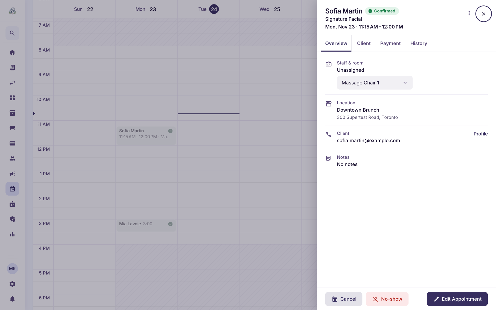

The Calendar shows every appointment for your business. From it, you book appointments, move them, and settle cancellations and no-shows, including any deposit or fee.

Staff can also book and check out appointments on the terminal. See [Appointments on Taliup POS](/taliup-pos/calendar/appointments). Calendar options, reminders, and policies are in [Calendar settings](/taliup-hq/features/calendar-settings).

## How to get here

Sidebar → **Appointments** → **Calendar**. You need the **Calendar** feature.

| Permission | What it allows |
|---|---|
| **View Appointments** | Open the calendar and an appointment's details, payments, and history |
| **Manage Appointments** | Book, edit, and drag appointments; cancel, mark no-shows, charge or waive fees, refund deposits, send payment links, and change rooms |
| **Delete Appointments** | Delete an appointment from its **More actions** menu |

## The toolbar

| Control | What it does |
|---|---|
| **Today** | Jumps back to today in any view |
| Arrows | Move to the previous or next day, week, or month |
| **Date** | Opens a month picker, plus shortcuts for **Today**, **+1 week**, **+2 weeks**, and **+4 weeks** |
| **View** | **Day**, **Week**, **Month**, or **List**. The calendar remembers your choice on this browser |
| **Showing** | Filters the calendar. See below |
| **More actions** | Links to **Staff schedules**, when that feature is on |
| Settings icon | Opens **Calendar settings** |
| **New appointment** | Opens the booking drawer |

### Showing

Changes under **Showing** apply right away. Click **Reset** to go back to the full calendar.

- **Location**: pick one location or **All Locations**. Shown when you have more than one location.
- **Staff**: show or hide each staff member. **Unassigned** holds bookings made with **Any available**.
- **Client**: search by name to see only one client's appointments.
- **Show cancelled appointments**: cancelled bookings are hidden unless you turn this on.

The legend shows the status colours: **Confirmed**, **Not confirmed yet**, and **No-show**. With Online Booking Payments, it also shows **Payment link pending** and **Payment link expired**. **Cancelled** appears when cancelled appointments are shown.

### Views

- **Day** shows one column per staff member, plus **Unassigned**. A side panel has a month picker and **Working today**, with each person's hours.
- **Week** and **Day** show the whole day and open at your business hours. Closed hours are shaded. Closed days are marked **Closed**.
- **Month** shows up to three bookings a day, then **+N more**.
- **List** lists the week's bookings by day.

Each booking shows the client, the service and time when there is room, the room it holds, and a status icon. Bookings that have ended are faded until you hover over them.

## Book an appointment

Click **New appointment**, or click an empty time on the calendar. In the day view, clicking a staff member's column picks that person.

<Steps>
  <Step title="Pick the client">
    Under **Client**, type at least three letters of the name, then pick the client. Click **Create New Client** to add someone new. Once picked, use **Edit Profile** to update their details or **Change** to pick someone else.
  </Step>
  <Step title="Check the client's alerts">
    The client's alerts appear under their name: allergy and medical notes in red, patch tests in amber.
  </Step>
  <Step title="Fill in the details">
    Complete the fields below. A summary line shows the day, time, and staff member as you go.
  </Step>
  <Step title="Book">
    Click **Book Appointment**.
  </Step>
</Steps>

| Field | Notes |
|---|---|
| **Location** | Required when you have more than one location |
| **Service** | Optional. Picking a service fills in the title and sets the end time from the service's duration |
| **Title** | Required |
| **Staff** | **Any available** or a staff member |
| **Date** | New appointments can't be booked in the past |
| **Start Time** / **End Time** | Changing the start keeps the appointment's length |
| **Notes** | Anything staff should know |

### Booking options

The switches at the bottom of the drawer depend on your settings and the client. In the labels on this page, [client] stands for the client's first name, and [amount], [fee], [deposit], and [card] for the amounts and saved card shown on screen.

| Switch | When it shows | What it does |
|---|---|---|
| **Ask [client] for a [amount] deposit** or **Ask [client] to save a card** | Online Booking Payments is on and the service asks for a payment online | Sends the client a payment link. See [Payment links](#payment-links) |
| **Text [client] a confirmation** | New bookings, when booking confirmation texts are on | On by default. Turn it off to skip the text for this booking. Off and greyed out when the client has no phone number |
| **Send reminder** | Email or text reminders are on | Reminders go out before the appointment, as set in Calendar settings |
| **Enable client confirmation** | Always | The client gets a link to confirm. Until they do, the appointment shows as **Not confirmed yet** |
| **Enable client cancellation** | Always | The client gets a link to cancel online |

### Staff availability

When a staff schedule is published for that week, the drawer checks the staff member as you book. A warning appears if they have no shift that day, aren't working at that time, don't offer the service, or already have another booking. It can suggest their next shift.

The warning doesn't stop you. You can still book the appointment.

### Rooms and equipment

Each booking is given a free room or piece of equipment of every kind its service needs, such as Treatment room 2. The calendar shows it next to the client.

If every room of that kind is already taken, your booking still goes through. The success message gives you a heads-up that the room is fully booked at that time.

Set up rooms in [Calendar settings](/taliup-hq/features/calendar-settings#rooms-and-equipment).

## Appointment details

Click a booking to open its details. The top shows the client, the status, the service, the staff member, and the time.

| Tab | What it shows |
|---|---|
| **Overview** | **Staff & room** (with a room picker), location, client contact, payment, notes, and **Booked via** for online bookings |
| **Client** | The client's alerts, tags, recent notes, and wallet. Add a treatment note, or open the client profile |
| **Payment** | Deposit, saved card, every charge and refund, and **Refund deposit**. Also what the booking used from memberships, when that feature is on |
| **History** | Everything that happened to the appointment, oldest first |

To move a booking to another free room of the same kind, pick it under **Staff & room**. You need **Manage Appointments**.

The footer has **Cancel**, **No-show**, and **Edit Appointment**. **No-show** appears once the appointment has started.

### History

The **History** tab lists who did what and when, with "by" and their name when someone was signed in. It includes changes made in Taliup HQ, on Taliup POS, through online booking, or from the client's links.

- How it was booked, and whether the client confirmed or cancelled
- Time, staff, service, client, location, and room changes, such as **Moved from … to …**
- Every text: confirmation, reminders, new time, and payment links. Texts that weren't delivered are flagged with the reason, such as **client opted out** or **invalid number**
- Reminder emails
- Payments, refunds, waived fees, and fees taken from a deposit
- Payment links sent, stopped, or expired
- Membership uses and treatment notes

## Edit an appointment

Open the appointment and click **Edit Appointment**. Change the fields, then click **Update Appointment**.

If you change the date or start time and confirmation texts are on, **Text [client] the new time** appears. It's on by default. When you save, the client gets a text with the new time and their cancel link.

## Drag to reschedule

With **Manage Appointments**, drag a booking to another time or day. In the day view, you can also drag it to another staff member's column. The appointment keeps its length. Cancelled appointments can't be dragged.

<Steps>
  <Step title="Drop the booking">
    **Move [client]'s appointment?** opens. It shows the old time struck through and the new time, and whether the staff member is working then.
  </Step>
  <Step title="Choose whether to text">
    When confirmation texts are on, **Text [client] the new time** is ticked. Untick it to move the booking quietly.
  </Step>
  <Step title="Confirm">
    Click **Move appointment**. Click **Keep original time** to put it back.
  </Step>
</Steps>

Moving an appointment gives it a free room at the new time. Its reminders are sent again for the new time.

To turn dragging off, see **Drag appointments to move them** in [Calendar settings](/taliup-hq/features/calendar-settings#on-the-calendar).

## Cancel an appointment

Use **Cancel** when a client or your business cancels. The appointment stays on the calendar as cancelled, and the policy is applied.

<Steps>
  <Step title="Open the appointment">
    Click **Cancel** in the footer. **Cancel [client]'s appointment?** opens.
  </Step>
  <Step title="Choose who cancelled">
    Under **Who cancelled**, pick **The client** or **The business**. When the business cancels, the deposit is refunded and no fee is charged.
  </Step>
  <Step title="Review the money">
    When the client cancels, the dialog says whether it's **Late cancellation:** (inside your cancellation window) or **In time:**. Tick or untick the options below.
  </Step>
  <Step title="Confirm">
    The button names what happens, such as **Cancel appointment**, **Cancel · refund [amount]**, or **Cancel · charge [amount]**.
  </Step>
</Steps>

| Option | When it shows |
|---|---|
| **Refund the [amount] deposit to [card]** | The client cancelled in time. Ticked by default |
| **Keep the [fee] late-cancellation fee from the [deposit] deposit** | The client cancelled late and a late-cancellation fee is set. Only the fee is kept. The rest is refunded to the card |
| **Charge the late-cancellation fee: [amount] to [card]** | The client cancelled late, the fee is more than the deposit (or there is no deposit), and a card is saved. Only the difference is charged |
| **Email [client] that it's cancelled** | The client has an email address. Ticked by default |

With no late-cancellation fee set, a late cancellation refunds the whole deposit. A fee you untick is recorded as waived.

<Note>
  Deposits and fees need the **Online Booking Payments** feature. A fee can only be charged to a card the client saved, or taken from a deposit they paid, through online booking or a payment link. Set the window and fees in [Calendar settings](/taliup-hq/features/calendar-settings#cancellation-and-no-show-policy).
</Note>

## Mark a no-show

Once the appointment has started, click **No-show**. **Mark [client] as a no-show?** opens. The appointment stays on the calendar, marked as a no-show, and its time, staff member, and room are freed.

| Situation | What happens |
|---|---|
| A deposit was paid and a no-show fee is set | **Keep the [fee] no-show fee from the [deposit] deposit** is ticked. The rest of the deposit is refunded. If the fee is more than the deposit, the difference is charged to the saved card |
| No deposit, a card is saved, and a no-show fee is set | **Charge the no-show fee: [amount] to [card]** is ticked |
| You untick the fee, or no fee is set | The fee is waived and the whole deposit is refunded |

Click **Mark no-show · charge [amount]** or **Mark as no-show**.

## Fees still to charge

A fee can be left pending, for example when a client cancels late online and your business flags late fees for staff, or when a charge is declined. The **Overview** tab then shows **Late cancellation · fee not charged** or **No-show · fee not charged**, with the amount left to charge.

Click **Charge [amount]** to charge the saved card, or **Waive** to drop the fee.

## Refund a deposit

On the **Payment** tab, click **Refund deposit**, then confirm. The deposit goes back to the card it was paid with.

## Delete an appointment

Delete is for bookings made by mistake, like a duplicate. Open the **More actions** menu, then **Delete Appointment**.

**Delete this appointment?** explains what happens. The appointment is removed from the calendar and no fee is charged. A deposit is refunded, unless it was kept for a no-show or late cancellation, or it paid for a register sale. If the client cancelled, use **Cancel** instead so the cancellation stays on record.

## Payment links

With the **Online Booking Payments** feature, staff bookings can ask for the same deposit or saved card as online booking. The amount comes from the service's online payment setting.

When you book, turn on **Ask [client] for a [amount] deposit** or **Ask [client] to save a card**. The client gets a link by email, text message, or both. The hint under the switch gives the deadline.

- If the client doesn't pay by the deadline, the appointment is cancelled automatically and the client is told.
- If the appointment starts before the deadline, the link expires at the start and the appointment stays booked.
- While the link is pending, the booking shows **Payment link pending**. The confirmation goes out once the client pays.
- Changing the time, service, location, or client sends a new link. Turn off **Payment link to [client]** to stop asking and send the usual booking confirmation.

Set how long links stay valid in [Calendar settings](/taliup-hq/features/calendar-settings#payment-links).

### Request a deposit on a booked appointment

If a booked appointment has no deposit or saved card yet, and its service asks for one online, the **Payment** tab offers **Ask [client] for a [amount] deposit** or **Ask [client] to save a card**. Click **Send link**, then confirm.

The client gets the same link as at booking. Missing the deadline never cancels the appointment. The link isn't offered once the appointment is cancelled, marked a no-show, or checked out.

## Checked-out appointments

When staff check out an appointment on the terminal, a deposit the client paid online is applied to that sale. See [Appointments on Taliup POS](/taliup-pos/calendar/appointments).

Once an appointment is checked out on the register, it's locked against cancellation:

- **Cancel** and **No-show** no longer appear in the details.
- The client's cancel link no longer works.
- Deleting it doesn't refund the deposit, because the deposit paid for the sale.

## Related

- [Calendar settings](/taliup-hq/features/calendar-settings)
- [Appointments on Taliup POS](/taliup-pos/calendar/appointments)
- [Online booking](/taliup-hq/features/online-booking)
- [Staff schedule](/taliup-hq/features/staff-schedule)
- [Clients](/taliup-hq/features/clients)
