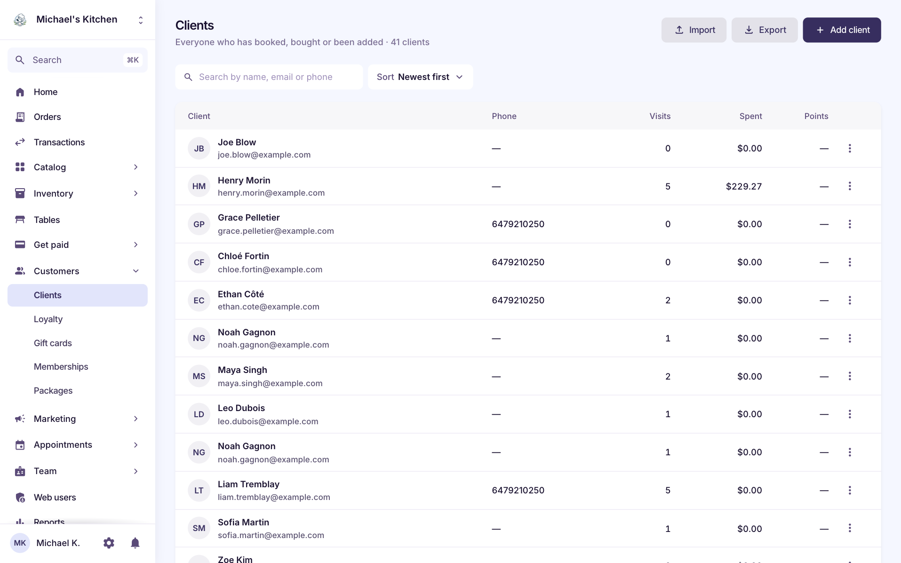
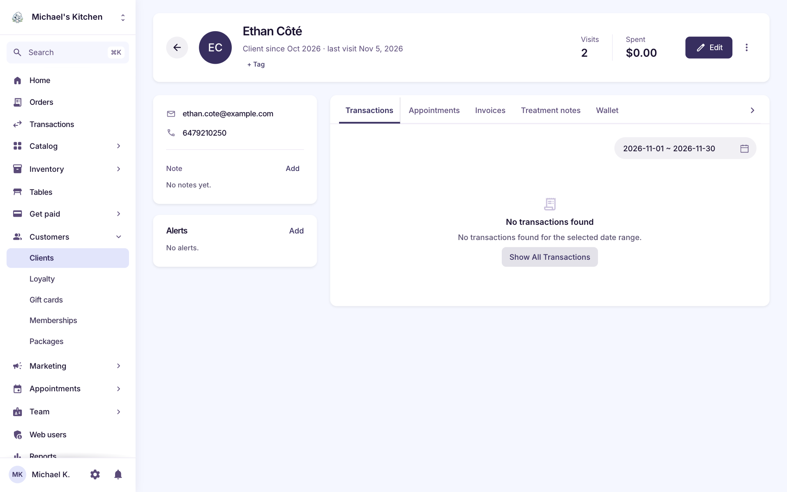
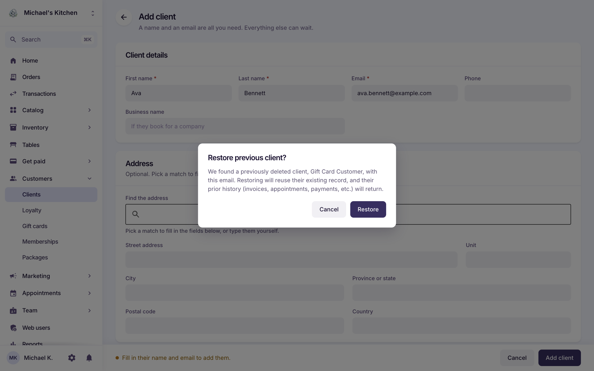

**Clients** stores customer records you can attach to invoices, Link to Pay, Calendar appointments, and Virtual Terminal payments.

In the side menu, open **Customers** → **Clients** to get started.

<Frame caption="The Clients list with search, sort, and the Import, Export, and Add client buttons.">
  
</Frame>

---

## Prerequisites

The **Clients** feature must be enabled on the entity plan. Ask your ISO admin to enable it in [Plans & Features](/taliup-hq/onboarding/plans-features) if you do not see **Clients** under **Customers** in the side menu.

| To | Permission |
|---|---|
| See the client list and profiles | **View Clients** |
| Add or edit clients, notes, alerts, and tags | **Manage Clients** |
| Delete clients | **Delete Clients** |

---

## Find a client

The list shows each client's name and email, phone, **Visits**, and **Spent**. A warning icon next to a name means the client has an allergy or medical alert.

- **Search by name, email or phone** filters the list.
- **Sort** orders it by **Newest first**, **Most visits**, or **Highest spend**. When Loyalty is active, you can also sort by **Most loyalty points**, and a **Points** column appears.
- **Reset** clears the search and sort.

---

## Create a client

<Steps>
  <Step title="Open Add client">
    In **Clients**, click **Add client**.
  </Step>
  <Step title="Enter details">
    Fill in **First name**, **Last name**, and **Email**. **Phone**, **Business name**, the address, and the **Note** are optional. Under **Find the address**, pick a match to fill in the address fields, or type them yourself.
  </Step>
  <Step title="Save">
    Click **Add client** at the bottom of the page. The new client's profile opens.
  </Step>
</Steps>

You can also add a client without leaving an invoice, a recurring payment, a Calendar appointment, or a Virtual Terminal payment. Click **New client** (or **Add client**) next to the client search.

**Email** is required. Taliup uses it to find the customer later and to send invoices or receipts.

<Tip>
  The **Note** is for general information, like how the client prefers to be contacted. Allergies and patch tests go in **Alerts** on the client's profile, so staff see them when booking.
</Tip>

---

## Client details

Click a client in the list to open a panel without leaving the page. It shows:

| Section | What it contains |
|---|---|
| **Contact** | Email, phone, and address |
| **Note** | Add or update a note |
| **Appointments** | Recent appointments and their status. Shown when Calendar is on the plan |
| **Recent Payments** | Source, method, date, and amount |
| **Invoices & Link to Pay** | Shown when the client has any |

Alerts appear at the top of the panel. Click **View profile** for the full record, or **Edit** to change details.

### Client profile

The profile shows the client's name, when they became a client, their last visit, and their tags. Totals for **Visits** and **Spent** sit on the right, plus **Points** for loyalty members. Click **+ Tag** to add a tag.

The left column holds the contact details, the **Note**, and **Alerts** (allergy, medical, patch test, preference, or other). Alerts and treatment notes are encrypted and only shown to staff.

The **More actions** menu next to **Edit** has **New appointment**, **New invoice**, **Send loyalty card**, and **Delete**, depending on your plan and permissions.

<Frame caption="A client profile with the totals on top, contact details and alerts on the left, and a tab for each feature on the plan.">
  
</Frame>

The tabs depend on the features on your plan:

| Tab | What it shows |
|---|---|
| **Transactions** | The client's payments |
| **Loyalty** | Points earned, redeemed, and adjusted. See [Loyalty](/taliup-hq/features/loyalty) |
| **Appointments** | Upcoming and past appointments |
| **Invoices** | Invoices and payment links |
| **Treatment notes** | Notes and photos from each visit |
| **Wallet** | Gift cards, [memberships](/taliup-hq/features/memberships) with the visits left, and cards on file |

---

## Import and export clients

When client import is on your plan, the Clients list shows **Import** and **Export**.

- **Import** opens **Import clients**. Click **Download template (.xlsx)**, fill in one client per row, and upload the file. A client whose email is already on your list is updated. Rows without an email are skipped. Click **Download skipped rows** to fix them and import them again.
- **Export** downloads your client list as a spreadsheet.

---

## Restore a deleted client

Deleting a client hides the record. It does not permanently remove their history.

If you create a client again with the **same email** on the same entity, Taliup finds the previous record and asks you to restore it.

<Frame caption="Restore previous client confirmation after reusing a deleted email.">
  
</Frame>

<Steps>
  <Step title="Add the client again">
    Use **Clients → Add client**, or **New client** from an invoice, a recurring payment, a Calendar appointment, or Virtual Terminal. Enter the same email as the deleted client.
  </Step>
  <Step title="Confirm the restore">
    When Taliup finds a match, it shows **Restore previous client?** The message names the previous client and explains that restoring reuses their record and brings back invoices, appointments, payments, and other history.
  </Step>
  <Step title="Restore or cancel">
    Click **Restore** to reuse that client. Click **Cancel** to leave them deleted and stay on the form.
  </Step>
</Steps>

After you restore:

- The client keeps the same record (not a second copy of the same email).
- Name and phone from the new form replace the old values.
- Prior invoices, appointments, and payments stay attached.

An **active** client with that email still cannot be duplicated. Taliup shows a unique-email error instead of the restore prompt.

<Tip>
  Restore is the right path when a merchant deleted a customer by mistake and wants their history back. Do not create a second client with a different email if you need the old invoices.
</Tip>

---

## Delete a client

In the Clients list, open the **More actions** menu on the client's row and click **Delete**. On the client profile, use **More actions** → **Delete**. Confirm with **Delete**.

The client disappears from the list. Their visits and payments stay in your reports. If the client is a loyalty member, deleting them ends the membership and removes their points. Gift cards they hold keep working.

Recreating them with the same email starts the restore flow above.

---

## Related

- [Invoicing](/taliup-hq/features/invoicing)
- [Recurring Payments](/taliup-hq/features/recurring-payments)
- [Hosted Payments](/taliup-hq/features/hosted-payments)
- [Clients on Taliup POS](/taliup-pos/clients)
