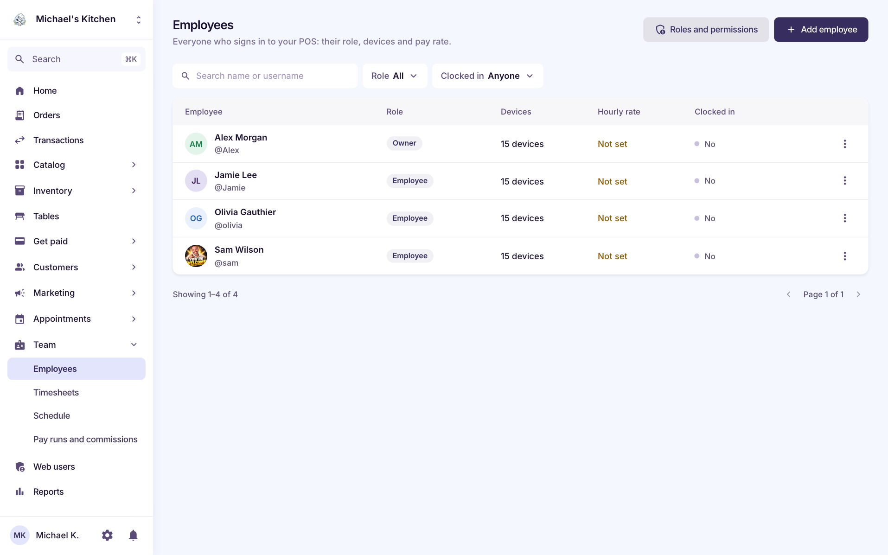
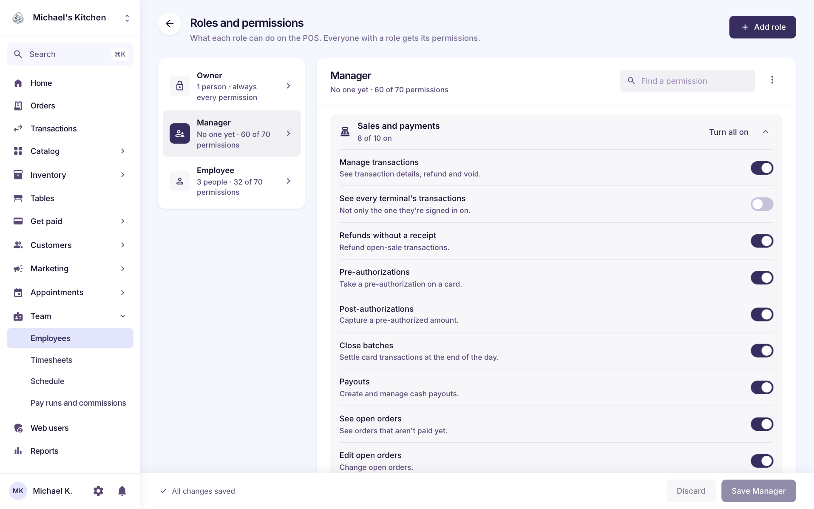

Employees are the people who sign in to Taliup POS. Each one has a username, a 6-digit passcode, a role, and the devices they can use. Their hourly rate feeds timesheets and pay runs, and their services decide what clients can book them for.

People who sign in to Taliup HQ are **Web users**, not employees. You can link an employee to a web user. See [Link an employee to HQ](#link-an-employee-to-hq).

## How to get here

Sidebar → **Team** → **Employees**. You need the **Employees** feature and the **View Employees** permission.

| To | Permission |
|---|---|
| See the list | **View Employees** |
| Add or edit an employee, and change roles and permissions | **Manage Employees** |
| Delete an employee | **Delete Employees** |

## The employees list

The list shows each employee with their **Role**, **Devices**, **Hourly rate**, and whether they are **Clocked in**. The header shows how many people are clocked in now.

- **Search name or username** to find someone.
- Filter by **Role**, or by **Clocked in** (**Anyone**, **Clocked in now**, **Not clocked in**). Click **Reset** to clear the filters.

Each row's **More actions** menu has:

| Action | What it does |
|---|---|
| **Edit profile** | Opens the employee's profile |
| **Timesheets** | Opens [Timesheets](/taliup-hq/features/timesheets) filtered to this employee |
| **Schedule** | Opens the [Staff schedule](/taliup-hq/features/staff-schedule) |
| **Clock out now** | Ends a shift that is still running |
| **Delete employee** | Removes the employee after you confirm |

You only see the actions your permissions and features allow.

## Add or edit an employee

Click **Add employee**, or open an employee's profile. Everything on the page saves together with one button.

<Steps>
  <Step title="Profile">
    Enter **First name** and **Last name**. The **Username** is suggested from the name. You can change it. Add a photo with **Upload photo**. The name and photo show on the POS, receipts and the booking page.
  </Step>
  <Step title="Role and pay">
    Pick a **Role**. It decides what they can do on the POS. Optionally enter an **Hourly rate (optional)**. It is used for labour cost on timesheets and for pay runs.
  </Step>
  <Step title="Email">
    Optionally enter **Email (optional)**. Staff get their schedule at this address when you publish a week.
  </Step>
  <Step title="POS passcode">
    Type a 6-digit **Passcode**, then type it again. On an existing employee, click **Change passcode** to set a new one, or **Keep the current passcode**.
  </Step>
  <Step title="Devices">
    Under **Devices**, tick the POS terminals they can sign in to. Terminals are grouped by location. Use **Select all** or **Clear all** for a whole location.
  </Step>
  <Step title="Services they do">
    If your business has services, pick the ones this employee performs. Clients can book them for these services online and in the calendar.
  </Step>
  <Step title="Save">
    Click **Add employee** for a new employee, or **Save changes**. Fields that need fixing are marked next to the field.
  </Step>
</Steps>

If you leave the page with unsaved changes, Taliup HQ asks before it discards them.

### At a glance

An existing employee's profile has an **At a glance** card:

| Row | What it shows |
|---|---|
| **Clocked in** | Since when, and the time so far. **Clock out** ends the shift |
| **Hours this week** | Finished hours since Sunday, with the labour cost. Links to **Timesheets** |
| **Next shift** | Their next published shift. Links to **Schedule**. Needs the **Employee Scheduling** feature |
| **Commission** | **Own rates** or **Business default**. Links to **Pay runs**. See [Pay runs and commissions](/taliup-hq/features/payroll) |

## Delete an employee

Open **More actions** on the profile or the list, then **Delete employee**. The employee can no longer sign in to the POS. Past sales, timesheets and pay runs stay as they are.

If the employee is linked to a web user, the dialog shows the **Linked web user**. Tick **Also delete this web user** to remove their HQ account too. Otherwise the web user is kept and unlinked.

## Link an employee to HQ

An employee can also have a Taliup HQ login. The **HQ access** card on the profile links them to a web user. You see it only if you have both **Manage Employees** and **Manage Web Users**.

| **HQ access** | What happens |
|---|---|
| **None** | The employee has no HQ login |
| **Link existing web user** | Pick a web user who isn't linked to anyone yet |
| **Invite new web user** | Enter an email and a web user role. Taliup HQ sends them an invitation |

You can also link from the web user's side, in **Web users**.

Once linked, the person can clock in and out from their account menu in Taliup HQ (**Clock in** / **Clock out**). This needs the **Timesheets** feature. A linked person can also get "Mine" push notifications in the Taliup HQ app. See [Permissions](/taliup-hq/manage/permissions#notifications).

## POS roles and permissions

A role decides what its people can do on Taliup POS. Everyone with a role gets its permissions.

On the employees list, click **Roles and permissions**. You need **Manage Employees**.

Every business starts with three roles: **Owner**, **Manager** and **Employee**. Pick a role on the left to see its permissions. Each role shows how many people have it and how many permissions are on.

<Note>
  **Owner always has every permission**, so the business owner can never be locked out of the POS. New permissions are added to it automatically. You can't change Owner's permissions.
</Note>

### Change a role's permissions

<Steps>
  <Step title="Pick the role">
    Click a role in the list.
  </Step>
  <Step title="Turn permissions on or off">
    Permissions are grouped by area. Open a group and use the switch next to each permission. Use **Turn all on** or **Turn all off** for the whole group. **Find a permission** searches by name.
  </Step>
  <Step title="Save">
    The bar at the bottom counts your changes. Click the **Save** button (it names the role) to apply them to everyone with the role, or **Discard** them.
  </Step>
</Steps>

Permission groups:

| Group | Covers |
|---|---|
| **Sales and payments** | Transactions, refunds without a receipt, pre- and post-authorizations, closing batches, payouts, open orders |
| **Products and catalog** | Catalogs, products, taxes, inventory, discounts, fees |
| **Clients** | Seeing, editing and deleting clients |
| **Invoices and payment links** | Link to Pay links |
| **Memberships** | Seeing memberships, signing up members, managing plans, and changing clients' memberships |
| **Team** | Seeing, editing and deleting employees, and their own settings |
| **Reports** | Sales analytics |
| **Settings and integrations** | Business, register and kitchen printer settings, QuickBooks sync |
| **Table management app** | Tables, table orders, employees and settings in the tables app |
| **Other** | Permissions that don't belong to a group above |

Some groups only show when your business has the matching feature, such as **Table management app**. Each permission has a short description under its name.

### Add, rename or duplicate a role

- **Add role**: enter a **Role name**, then choose **Start with the permissions of**: **Nothing**, or an existing role. You can change the permissions after.
- **Duplicate**: in the role's more-actions menu. Starts a new role with this role's permissions.
- **Rename**: in the role's more-actions menu, for roles you added. **Owner**, **Manager** and **Employee** keep their names.

## Related

- [Staff schedule](/taliup-hq/features/staff-schedule)
- [Timesheets](/taliup-hq/features/timesheets)
- [Pay runs and commissions](/taliup-hq/features/payroll)
- [Helped by on Taliup POS](/taliup-pos/register/helped-by)
- [Permissions](/taliup-hq/manage/permissions)
