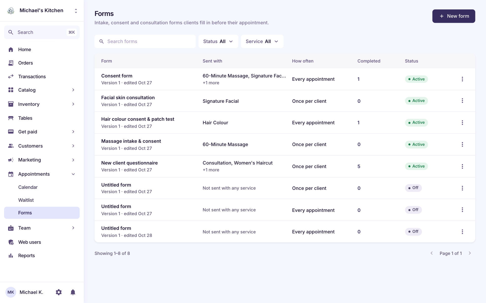

Forms are intake, consent, and consultation forms clients fill in before their appointment. You attach a form to services. When a client books one of those services, they get a link to fill it in on their phone. The signed copy is kept on their profile.

## How to get here

Sidebar → **Appointments** → **Forms**. You need the **Forms** feature, which comes with **Calendar**.

| Permission | What it allows |
|---|---|
| **Manage Settings** | Open the **Forms** page, and create, edit, turn on or off, and delete forms |
| **View Appointments** | See responses, signed copies, an appointment's forms, and a client's **Forms** tab |
| **Manage Appointments** | **Fill in now** and **Send link** on an appointment |

## The Forms page

The list shows each form with the services it is **Sent with**, **How often** it is asked, how many copies are **Completed**, and its **Status** (**Active** or **Off**). Search by name, and filter by **Status** and **Service**.

Each row's **More actions** menu has:

| Action | What it does |
|---|---|
| **Edit form** | Opens the form builder |
| **Preview** | Shows the form as clients see it on their phone. Answers in the preview aren't saved |
| **View responses** | Opens the form's **Responses** tab. Clicking the **Completed** count does the same |
| **Stop sending** / **Start sending** | Turns the form off or on for new bookings |
| **Delete form** | Asks you to confirm. New bookings stop getting the form. Copies clients already signed stay on their profiles |

## Create a form

<Steps>
  <Step title="Start a form">
    Click **New form**.
  </Step>
  <Step title="Name it">
    Under **Form details**, enter the **Form name** and an optional **Intro**. Clients see both at the top of the form.
  </Step>
  <Step title="Add questions">
    Under **Questions**, click **Add a question** and pick a type. Click a question to edit it. Drag to reorder.
  </Step>
  <Step title="Choose when it's sent">
    Under **Sending**, turn on **Send with bookings**, choose **How often**, and tick the **Services** that send it.
  </Step>
  <Step title="Save">
    Click **Save form**. Click **Preview** any time to see the unsaved form as clients will.
  </Step>
</Steps>

If you leave with unsaved changes, Taliup HQ asks you to **Keep editing** or **Discard changes**.

### Question types

| Type | What clients do |
|---|---|
| **Short answer** | One line, like a name or phone number |
| **Long answer** | A few sentences |
| **Single choice** | Pick one option |
| **Multiple choice** | Pick any that apply |
| **Date** | A date, like a date of birth |
| **Yes / No** | Can show a follow-up question |
| **Signature** | The client types their full name to sign |
| **File or photo upload** | A photo or PDF from their phone |
| **Heading** | Starts a new section. No answer |
| **Text / consent wording** | Something clients read. No answer |

For each question, you can add **Help text (optional)**, mark it **Required**, **Duplicate** it, or **Remove** it. Under **Show this question**, pick **Always**, or show it only when an earlier question has a given answer.

### How often

| Choice | What happens |
|---|---|
| **Every appointment** | A new copy for each visit |
| **Once per client** | The client fills it in once. They're asked again only after you change the questions |

When you change the questions of a form clients have already filled in, it becomes a new version. Clients asked **Once per client** sign the new version at their next booking. Copies already signed keep the questions they answered.

## Signatures

Clients sign by typing their full name. The signature is kept in capitals. By typing their name, they confirm their answers are true and agree to the terms on the form.

Older copies signed with a drawn signature still show the drawing.

## How clients get the form

- **When booking online**, the booking page says a short form comes before the visit. Right after booking, the confirmation page shows **One more step** with a **Fill in now** button for each form. See [Online booking](/taliup-hq/features/online-booking).
- **When the appointment is booked**, the client is emailed a link to each form, after any deposit is paid. They are also texted the link when you text booking confirmations.
- **In appointment emails and reminders.** The confirmation, update, and reminder emails list any forms the client hasn't filled in yet. Reminder texts add a link for each one.

A client fills in the form on their phone, then taps **Submit**. Files can be JPG, PNG, HEIC, or PDF. A completed form can't be changed.

A form that isn't filled in stops working once its appointment is cancelled or over. The link then shows **This form is no longer available**, and staff see the copy as **Expired**.

## Forms on an appointment

In the [Calendar](/taliup-hq/features/calendar), an appointment's details have a **Forms** tab. Each form the booked service sends shows a status:

| Status | Meaning |
|---|---|
| **Not sent** | The link hasn't gone out yet |
| **Sent, not completed** | The client has the link but hasn't filled it in |
| **Completed** | Filled in for this appointment. Click **View** to open the signed copy |
| **On file** | A **Once per client** form the client already filled in |
| **Expired** | The appointment was cancelled or is over |

While the form is open, you can:

- **Fill in now**: opens the form in a new tab, so the client can fill it in at the front desk.
- **Send link** or **Resend link**: emails the link, and texts it when you text booking confirmations.

## Responses

Open a form, then the **Responses** tab, to see every copy of that form. Search by client, and filter by **Status** (**Completed**, **Sent, not completed**, **Expired**) and **Version**. Click a row to open the signed copy.

The signed copy shows the client's answers exactly as they were sent. A **Details** card shows the client with a **Profile** link, the appointment, when it was sent and completed, the IP address it was completed from, and the form version. Click **Print** for a clean printout.

## Client profile

A client's record in **Clients** has a **Forms** tab. It lists every form they were sent, with its status and date. Click **View** to open a copy.

## Related

- [Online booking](/taliup-hq/features/online-booking)
- [Calendar](/taliup-hq/features/calendar)
- [Calendar settings](/taliup-hq/features/calendar-settings)
- [Clients](/taliup-hq/features/clients)
