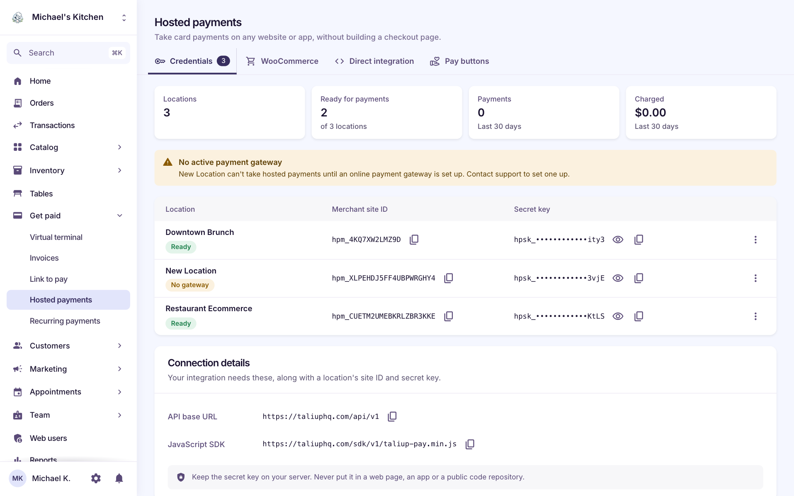
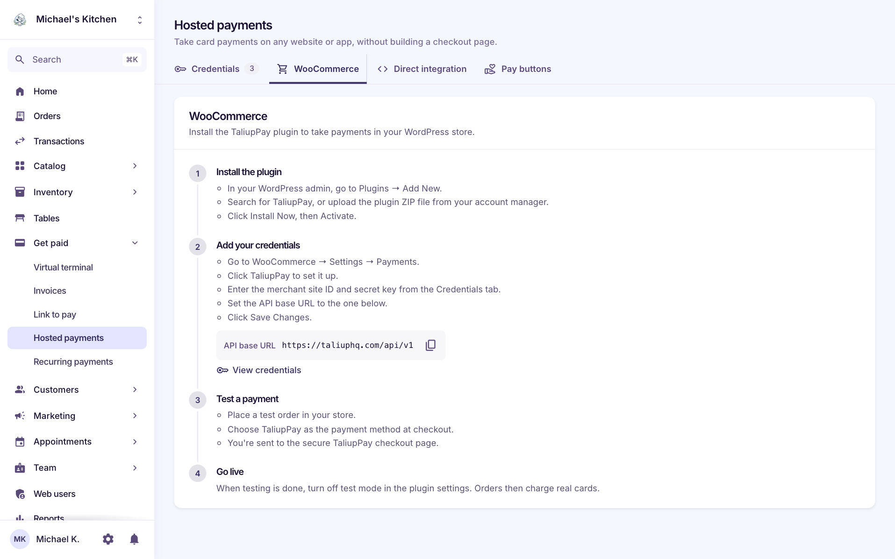
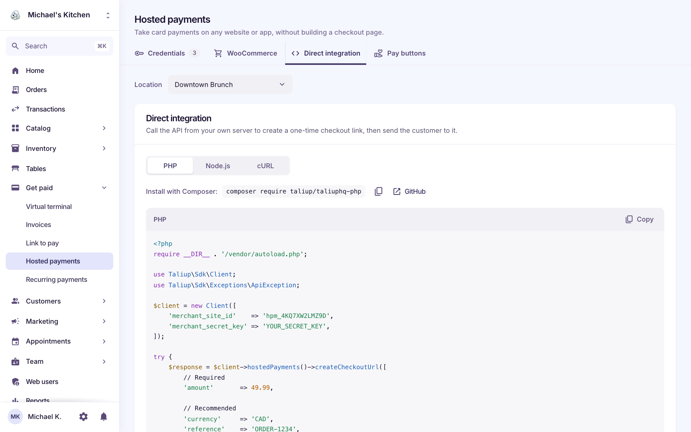
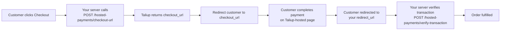
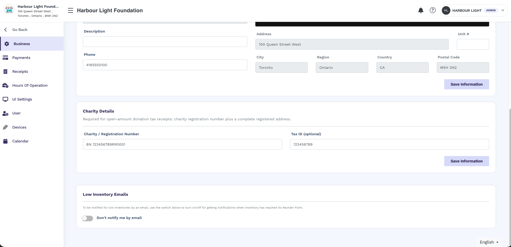
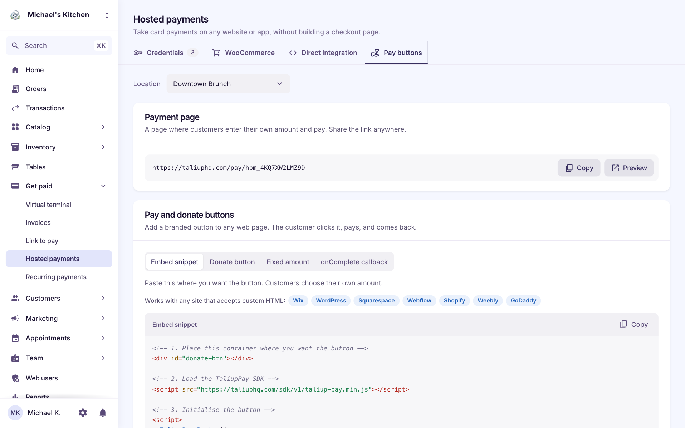
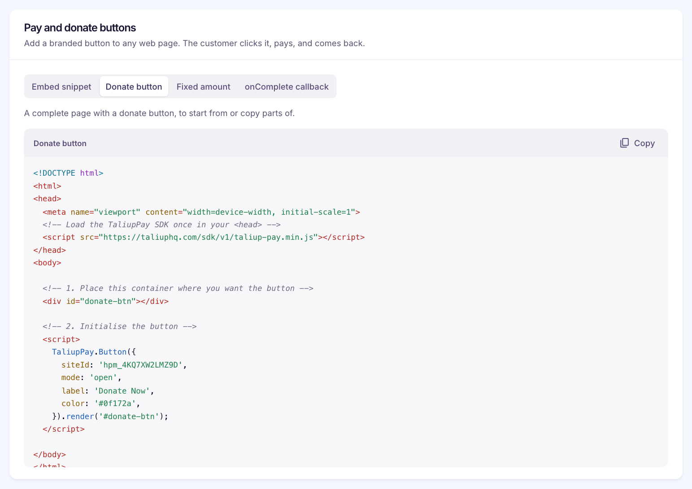
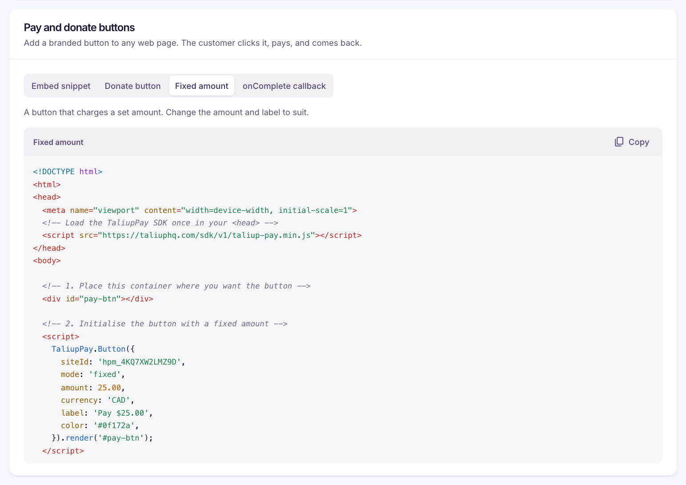
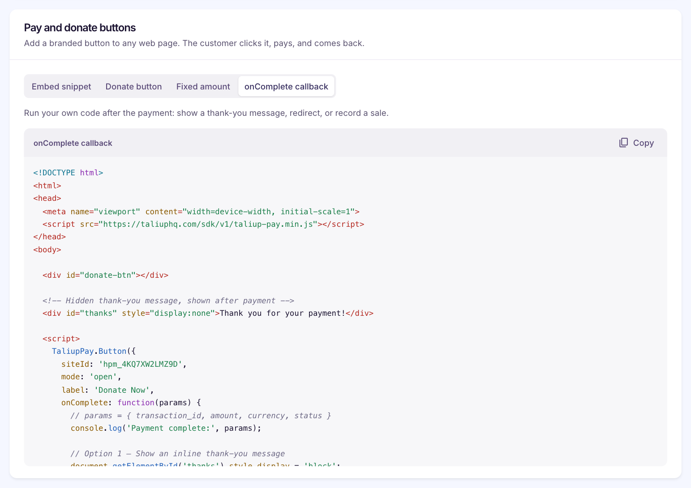

Hosted Payments lets merchants accept payments on any website, app, or platform without building a checkout page. The merchant's backend generates a secure, one-time checkout URL; the customer completes payment on a Taliup-hosted page and is returned to the merchant's site.

Open **Get paid** → **Hosted payments** in the side menu. The page has four tabs: **Credentials**, **WooCommerce**, **Direct integration**, and **Pay buttons**.

---

## Prerequisites

Three conditions must be met before the feature is usable:

<Steps>
  <Step title="Supported payment provider">
    The entity's payment provider must support Hosted Payments, such as **Elavon**. This is set during entity creation or can be updated in the [Entity Profile](/taliup-hq/manage/profile).
  </Step>
  <Step title="Feature enabled">
    The `Hosted Payment Solution` feature must be enabled for the entity. Enable it in [Plans & Features](/taliup-hq/onboarding/plans-features).
  </Step>
  <Step title="Online payment gateway configured">
    At least one location must have an active online payment gateway, such as Elavon Converge. See [Locations](/taliup-hq/onboarding/locations) for setup instructions.
  </Step>
</Steps>

On the **Credentials** tab, each location shows **Ready** or **No gateway**. When a location has no gateway, a **No active payment gateway** notice names it. That location can't take hosted payments until a gateway is set up.

---

## Credentials

<Frame caption="The Credentials tab: 30-day totals, each location's keys, and the connection details.">
  
</Frame>

The tiles at the top show how many locations you have, how many are **Ready for payments**, and the **Payments** and amount **Charged** through hosted payments in the last 30 days.

Credentials are generated **per location**. Each location has its own row.

| Field | Description |
|---|---|
| **Location** | The location name, with its **Ready** or **No gateway** status. |
| **Merchant site ID** | Unique identifier for this location (`hpm_...`). Passed as the `X-Merchant-Site-Id` header in every API request. Use the copy button next to it. |
| **Secret key** | Masked by default. Use the eye button to show or hide it, or the copy button to copy it without showing it. Only users with the **Manage Settings** permission can see or copy the key. Others see **Only someone who can manage settings can see it**. |

The **⋮** menu on each row has:

| Action | Description |
|---|---|
| **Open payment page** | Opens the location's open-amount payment page. See [Open amount and donation page](#open-amount-and-donation-page). |
| **Copy payment page link** | Copies the link to that page. |
| **Rotate secret key** | Generates a new secret key after you confirm with **Rotate key**. Anything still using the old key stops working right away. Requires **Manage Settings**. |

The **Connection details** card shows the **API base URL** and the **JavaScript SDK** URL, each with a copy button.

**API Base URLs:**

| Environment | URL |
|---|---|
| Production | `https://taliuphq.com/api/v1` |
| Staging | `https://staging.taliuphq.com/api/v1` |

<Warning>
  Keep the secret key on your server. Never put it in a web page, an app, or a public code repository. All API requests must be made from your server.
</Warning>

---

## WooCommerce integration

<Frame caption="The WooCommerce tab: four steps to install and set up the TaliupPay plugin.">
  
</Frame>

The **WooCommerce** tab provides a guided setup for WordPress stores using the TaliupPay WooCommerce plugin.

<Steps>
  <Step title="Install the plugin">
    In your WordPress admin, go to **Plugins → Add New**. Search for **TaliupPay**, or upload the plugin ZIP file provided by your account manager. Click **Install Now** then **Activate**.
  </Step>
  <Step title="Add your credentials">
    Go to **WooCommerce → Settings → Payments**. Click **TaliupPay** to set it up. Enter the **Merchant site ID** and **Secret key** from the **Credentials** tab. Set the **API base URL** to the one shown in this step (`https://taliuphq.com/api/v1`). Click **Save Changes**. **View credentials** takes you back to the **Credentials** tab.
  </Step>
  <Step title="Test a payment">
    Place a test order in your store. Choose **TaliupPay** as the payment method at checkout. You are sent to the secure TaliupPay checkout page to complete the test.
  </Step>
  <Step title="Go live">
    When testing is done, turn off test mode in the plugin settings. Orders then charge real cards.
  </Step>
</Steps>

---

## Direct integration

<Frame caption="The Direct integration tab: PHP, Node.js, and cURL examples for creating a checkout link from your server.">
  
</Frame>

The **Direct integration** tab is for developers who want to call the Taliup API directly from their backend. Choose **PHP**, **Node.js**, or **cURL** to see an example. The samples are filled in with your merchant site ID. When you have more than one location, pick one from **Location** at the top of the tab.

The **Always check the payment on your server** notice shows the endpoint to call before you fulfil an order. See [Verify transaction](#verify-transaction).

### Install the SDK

PHP:

```bash
composer require taliup/taliuphq-php
```

Node.js:

```bash
npm install @taliup/taliuphq-node
```

The source is also available on GitHub ([PHP](https://github.com/Taliup/taliuphq-php), [Node.js](https://github.com/Taliup/taliuphq-node)).

### Integration flow



### Request fields

| Field | Required | Notes |
|---|---|---|
| `amount` | Yes | Number, minimum `0.01`. |
| `currency` | Recommended | `CAD` or `USD`. |
| `reference` | Recommended | Your order or invoice ID — passed through to the transaction record. |
| `redirect_url` | Recommended | Where to send the customer after a successful payment. Max 2048 chars. |
| `cancel_url` | Recommended | Where to send the customer if they cancel. Max 2048 chars. |
| `first_name` / `last_name` / `email` | Optional | Pre-fills the checkout form for a smoother customer experience. |
| `webhook_url` | Optional | Receive a signed POST to your server when the payment captures. See [Webhooks](#webhooks). |
| `expires_in_minutes` | Optional | 5–60. Defaults vary by configuration. |

### Return URL query parameters

After checkout, Taliup redirects the customer to your `redirect_url` (or `cancel_url`) and appends these query parameters:

| Parameter | Notes |
|---|---|
| `status` | `approved`, `declined`, `cancelled`, or `error`. |
| `amount` | The amount processed. |
| `currency` | The currency used. |
| `reference` | Your reference value, if provided. |
| `transaction_id` | The Taliup transaction ID. Present when available. |
| `host_response` | Host transaction response details. |
| `message` | Human-readable result message, when available. |

<Warning>
  Always verify the transaction server-side before fulfilling an order. After the customer is redirected back, call `POST /hosted-payments/verify-transaction` with the `transaction_id`. Do not rely on the redirect URL parameters alone.
</Warning>

### Verify transaction

```bash
curl -X POST "https://taliuphq.com/api/v1/hosted-payments/verify-transaction" \
  -H "Content-Type: application/json" \
  -H "X-Merchant-Site-Id: hpm_xxxxxxxxx" \
  -H "X-Merchant-Secret-Key: hpsk_xxxxxxxxx" \
  -d '{"transaction_id":"1234567890"}'
```

Success response:

```json
{
  "success": true,
  "approved": true,
  "transaction_id": "1234567890",
  "result_code": "0",
  "result_message": "APPROVAL"
}
```

For the full API reference, authentication details, and error handling see the [Taliup PHP SDK documentation](/php-sdk/concepts/hosted-payments).

---

## Open amount and donation page

The open-amount payment page lets customers pay any amount they choose — no server-side code required. It is ideal for donations, memberships, tips, or any use case with flexible pricing.

Everything for it is on the **Pay buttons** tab. When you have more than one location, pick one from **Location** at the top of the tab.

- The **Payment page** card shows the location's payment page link, with **Copy** and **Preview**.
- The **Pay and donate buttons** card has the code for a button on your own site: **Embed snippet**, **Donate button**, **Fixed amount**, and **onComplete callback**.

### How it works

A customer visits a Taliup-hosted landing page (or clicks an embedded button on your site), enters their amount and details, and completes payment. On success:

- A **Taliup Order** is created with status `complete`.
- A **Client record** is found by email or created automatically.
- An optional **email receipt** is sent to the customer.

### Charity donation tax receipts

If the entity industry is **Charity**, the open-amount donation page can send a tax-compliant electronic receipt (English, French, or Spanish).

Before the donation page works, open **Settings** → **Business details** and complete:

- **Charity number** in the **Charity** card (required)
- **Tax ID** in the **Charity** card (optional)
- A complete registered address in the **Address** card

<Frame caption="The Charity card on Settings → Business details.">
  
</Frame>

Incomplete charity details block the open-amount donation landing page and initiate call. The **Pay buttons** tab then shows **Donations are not open yet**. Fixed-amount checkout and Direct integration still work.

<Warning>
  Do not enable Charity and share the open-amount `/pay/{merchant_site_id}` URL until the **Charity number** and the address are complete. Donors will otherwise see an error instead of the payment page.
</Warning>

### View and resend a receipt

After a charity donation is captured, you can open the same tax receipt from **Transactions**.

<Steps>
  <Step title="Open Transactions">
    Go to **Transactions** and select the **Online** tab.
  </Step>
  <Step title="Select the donation">
    Click the donation to open its details.
  </Step>
  <Step title="View or send the receipt">
    Click **View receipt** to open the receipt the donor received. Click **Send receipt** to email it again. The address defaults to the client on the order. You can change it before you click **Send**.
  </Step>
</Steps>

If sending fails, the dialog stays open and shows an error so you can retry. The receipt number on the preview may be blank.

<Note>
  **View receipt** and **Send receipt** appear only for Charity donations taken on the open-amount hosted page. Older donations do not show these actions.
</Note>

### Embed snippet

<Frame caption="The Pay buttons tab with Embed snippet selected: the payment page link and a short embed for any platform.">
  
</Frame>

The quickest way to add a payment button to any webpage. Load the SDK and initialise the button:

```html
<!-- 1. Place this container where you want the button -->
<div id="donate-btn"></div>

<!-- 2. Load the TaliupPay SDK -->
<script src="https://taliuphq.com/sdk/v1/taliup-pay.min.js"></script>

<!-- 3. Initialise the button -->
<script>
TaliupPay.Button({
  siteId: 'hpm_YOUR_MERCHANT_SITE_ID',
  mode: 'open',
  label: 'Donate Now',
  color: '#0f172a',
}).render('#donate-btn');
</script>
```

Works on any platform that supports custom HTML, including Wix, WordPress, Squarespace, Webflow, Shopify, Weebly, and GoDaddy.

### Donate button

<Frame caption="Donate button: a full HTML page example for an open-amount button.">
  
</Frame>

A complete HTML page example showing the SDK loaded in `<head>` and an open-amount button initialised in `<body>`. The customer clicks the button, is taken to the Taliup landing page, enters their amount, and completes payment.

### Fixed amount

<Frame caption="Fixed amount: a button that charges a set amount.">
  
</Frame>

Use `mode: 'fixed'` to charge a specific amount without requiring the customer to enter one:

```javascript
TaliupPay.Button({
  siteId: 'hpm_YOUR_MERCHANT_SITE_ID',
  mode: 'fixed',
  amount: 25.00,
  currency: 'CAD',
  label: 'Pay $25.00',
  color: '#0f172a',
}).render('#pay-btn');
```

### onComplete callback

<Frame caption="onComplete callback: run your own code after the payment.">
  
</Frame>

Both `open` and `fixed` mode buttons fire an `onComplete` callback when payment succeeds. The callback receives `{ transaction_id, amount, currency, status }`:

```javascript
TaliupPay.Button({
  siteId: 'hpm_YOUR_MERCHANT_SITE_ID',
  mode: 'open',
  label: 'Donate Now',
  onComplete: function(params) {
    // params = { transaction_id, amount, currency, status }

    // Option 1 — Show an inline thank-you message
    document.getElementById('thanks').style.display = 'block';

    // Option 2 — Redirect to a custom thank-you page
    window.location.href = 'https://yoursite.com/thank-you'
      + '?ref=' + params.transaction_id
      + '&amount=' + params.amount
      + '&currency=' + params.currency;

    // Option 3 — Send to your analytics
    gtag('event', 'purchase', {
      value: params.amount,
      currency: params.currency,
      transaction_id: params.transaction_id,
    });
  },
}).render('#donate-btn');
```

### Direct landing page URL

No embed required. Copy the link from the **Payment page** card, or from **Copy payment page link** on the **Credentials** tab. Share it directly in an email, social post, or QR code — customers land on your branded Taliup payment page and enter their own amount:

```
https://taliuphq.com/pay/{merchant_site_id}
```

---

## Webhooks

Webhooks deliver a signed server-to-server notification when a payment captures. They apply to the **Direct integration** flow — pass `webhook_url` in your `createCheckoutUrl` request.

### Webhook payload

```json
{
  "event": "payment.captured",
  "merchant_site_id": "hpm_...",
  "transaction_id": "...",
  "amount": 49.99,
  "currency": "USD",
  "status": "captured",
  "card_type": "VISA",
  "card_number_masked": "411111XXXXXX1111",
  "reference": "ORDER-123",
  "timestamp": "2026-06-16T18:00:00Z"
}
```

### Verify the signature

Every webhook includes an `X-Taliup-Signature` header. Always verify it before processing the payload:

```php
$payload   = file_get_contents('php://input');
$signature = $_SERVER['HTTP_X_TALIUP_SIGNATURE'] ?? '';
$secret    = 'your_merchant_secret_key';
$expected  = 'sha256=' . hash_hmac('sha256', $payload, $secret);

if (!hash_equals($expected, $signature)) {
    http_response_code(401);
    exit;
}
```

The signature is an HMAC-SHA256 of the raw request body, signed with your **Secret key**.

<Warning>
  Reject any webhook request where the signature does not match. Do not use the payload for order fulfillment until the signature is verified.
</Warning>

---

## Related

- [Recurring Payments](/taliup-hq/features/recurring-payments)
- [Invoicing](/taliup-hq/features/invoicing)

