Invoicing lets you bill a client for products, services, or anything else. You send the invoice by email or text, the client can pay it online by card, and Taliup HQ shows what is scheduled, waiting, late, and paid.

---

## Prerequisites

<Steps>
  <Step title="Invoicing feature enabled">
    The `Invoicing` feature must be enabled on your entity plan. Ask your ISO admin to enable it in [Plans & Features](/taliup-hq/onboarding/plans-features) if you do not see **Invoices** in the sidebar.
  </Step>
  <Step title="Client with an email or phone">
    **Send now** goes out by email, so the client needs an email address. A scheduled invoice can go by email, by text, or both. You can add a client from the invoice or from **Clients**.
  </Step>
  <Step title="Online payments (optional)">
    To add a **Pay now** button, the `Link To Pay` feature must be on your plan and the invoice's location must be connected to an online payment gateway. Without a gateway, the invoice still goes out, but the client cannot pay it online.
  </Step>
</Steps>

## How to get here

Sidebar → **Get paid** → **Invoices**.

| To | Permission |
|---|---|
| See invoices and their details | **View Invoices** |
| Create, edit, send, remind, record a payment, or refund | **Manage Invoices** |
| Delete an invoice | **Delete Invoices** |

Payment links made on the register are listed separately under **Get paid** → **Link to pay**, with the same list and details panel. See [Link To Pay on Taliup POS](/taliup-pos/link-to-pay/create-and-send).

---

## Invoices list

The top of the page sums up your invoices in four tiles: **Scheduled**, **Awaiting payment**, **Overdue**, and **Paid**, each with a count and a total. Click a tile to show only those invoices.

<Frame caption="The Invoices page with status tiles, search, and the invoice list.">
  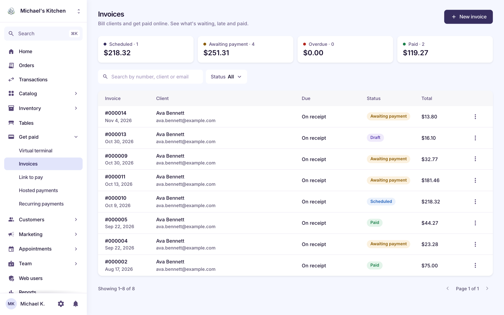
</Frame>

- Click **New invoice** to open the editor.
- Search by number, client, or email, or pick a **Status**. **Reset** clears the filters.
- The **Due** column shows **On receipt** or the due date. While an invoice waits for payment, it also shows **Due today**, **Due in X days**, or **X days late**.
- Click a row to open its details. Use the **⋮** menu on a row for quick actions.

Before your first invoice, the page shows **No invoices yet** with a **New invoice** button.

### Statuses

| Status | Meaning |
|---|---|
| **Draft** | Saved but not sent. The client does not see it |
| **Scheduled** | Goes out automatically on its send date |
| **Awaiting payment** | Sent and not paid yet |
| **Overdue** | Past its due date and not paid |
| **Paid** | Paid in full |
| **Refunded** | The payment was refunded |
| **Canceled** | Canceled. There is nothing to pay |

### Invoice details

Click a row to open the invoice in a side panel. It shows the **Total**, when it is due (or **Paid on**), **Details** such as the location and how it was sent, the **Client**, **Items** with totals, **Payments**, and **Activity**.

The main button at the bottom changes with the status:

| Status | Main action |
|---|---|
| **Scheduled** | **Send now** |
| **Awaiting payment** | **Send again** |
| **Overdue** | **Send reminder** |
| **Paid** | **Refund** |

You can also click **View page** to open the client's payment page, **Edit**, or **Delete**.

---

## Create an invoice

Click **New invoice**. The editor has the invoice on the left, and a **Summary** of the totals and a live **Preview** on the right.

<Frame caption="The New invoice editor with the form on the left and the summary and preview on the right.">
  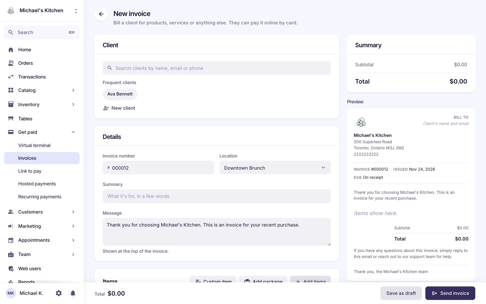
</Frame>

The bar at the bottom shows the total and the save buttons:

- **Save as draft** keeps the invoice without sending it.
- **Send invoice** sends it now. When you schedule it, the button reads **Schedule invoice**.
- **Save as paid** replaces them when the total is $0, for example when a membership covers every item. Nothing is sent.

If you leave with unsaved changes, Taliup asks before discarding them.

### Client

Search clients by name, email, or phone, or click one of your **Frequent clients**.

<Frame caption="The Client card with search, frequent clients, and New client.">
  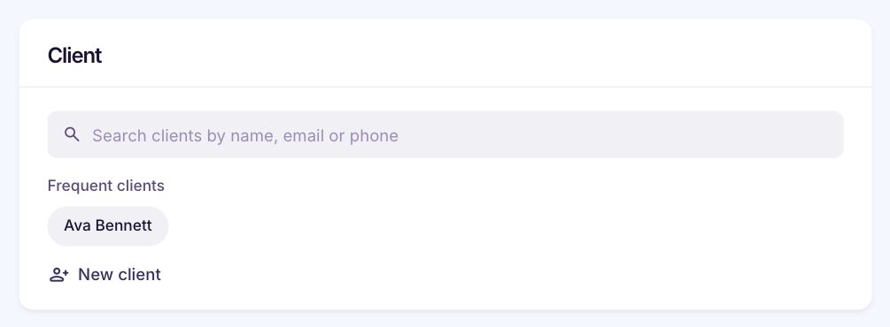
</Frame>

Click **New client** to add someone without leaving the invoice. Enter their **First name**, **Last name**, and **Email**. **Phone**, **Business name**, and **Notes** are optional. Click **Add client** and they are picked for the invoice.

<Frame caption="The New client panel opened from the invoice.">
  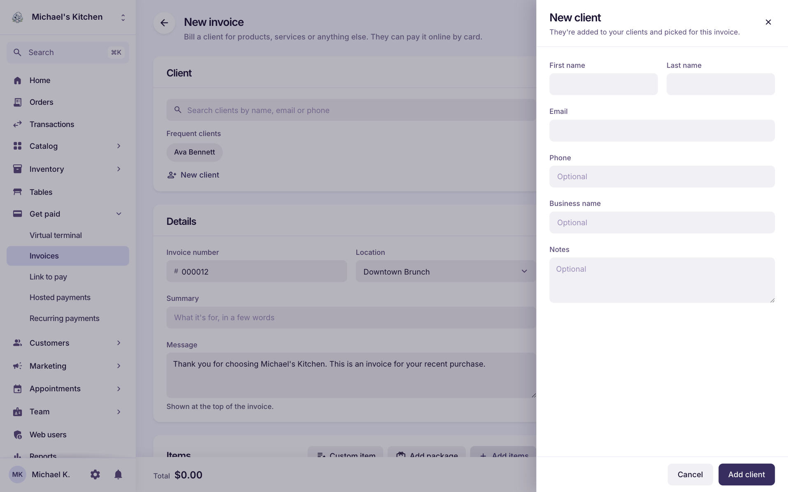
</Frame>

If that email belongs to a client you already deleted, Taliup asks **Restore this client?** instead of creating a duplicate. Click **Restore client** to bring back the record and their history. See [Restore a deleted client](/taliup-hq/features/clients#restore-a-deleted-client).

### Details

<Frame caption="The Details card.">
  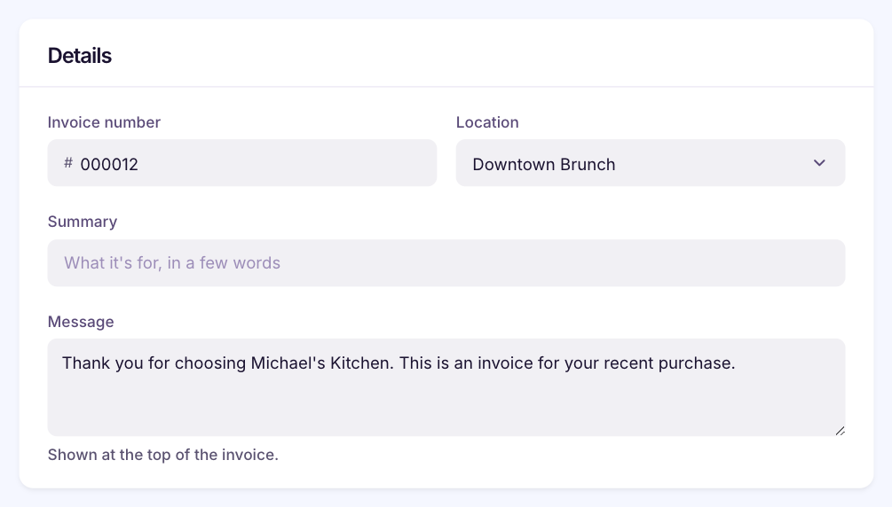
</Frame>

| Field | Description |
|---|---|
| **Invoice number** | Filled in with the next number. You can change it while the invoice is a draft. |
| **Location** | The business location for the invoice. Its online payment gateway takes the client's payment. |
| **Summary** | Optional. What the invoice is for, in a few words. |
| **Message** | Shown at the top of the invoice. |

### Items

<Frame caption="The Items card with invoice lines, discounts, and fees.">
  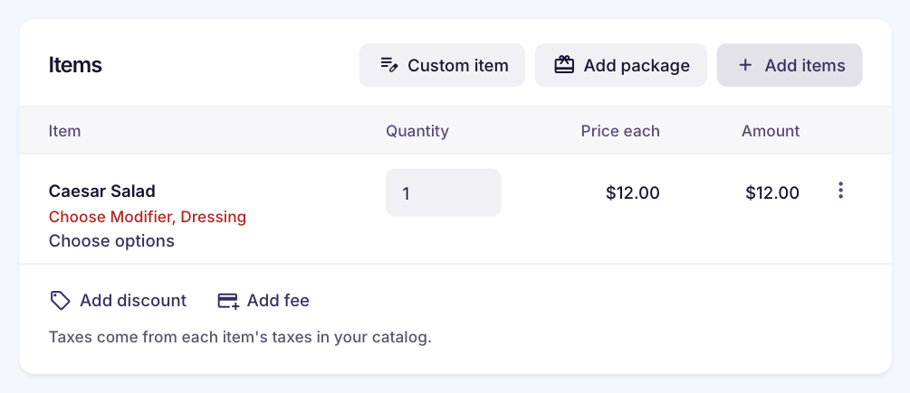
</Frame>

- **Add items** opens your catalog. Search by name or SKU, tick the products and services you want, and click **Add**.
- **Custom item** adds a one-off line that is not in your catalog, with a name, price, and optional description.
- On each line, change the **Quantity**. Items priced at the time of sale also take a price. Use the line's **⋮** menu to add a note or remove the line.
- If an item needs options, the line shows **Choose options**.
- **Add discount** and **Add fee** take an amount or a percentage, before or after tax. Pick one of yours or create a new one.

Taxes come from each item's taxes in your catalog.

<Frame caption="The Add items panel for picking products from the catalog.">
  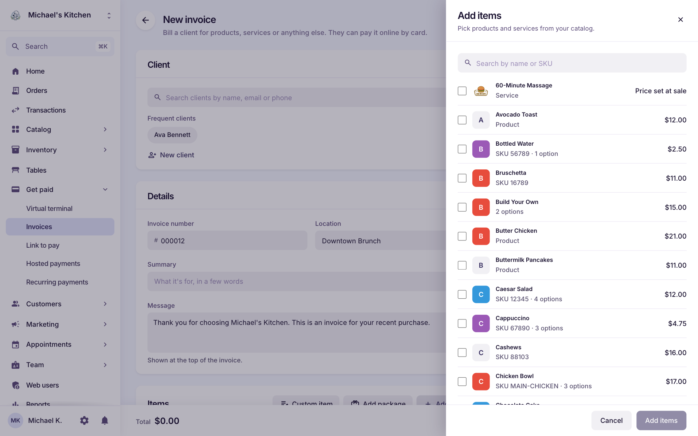
</Frame>

#### Memberships

Invoices can use the visits and discounts a client's membership gives. When the client has a membership that covers an item, the line offers **Use visit**. Member discounts are added for you. See [Memberships](/taliup-hq/features/memberships).

### Payment

<Frame caption="The Payment card with the due date and online payment.">
  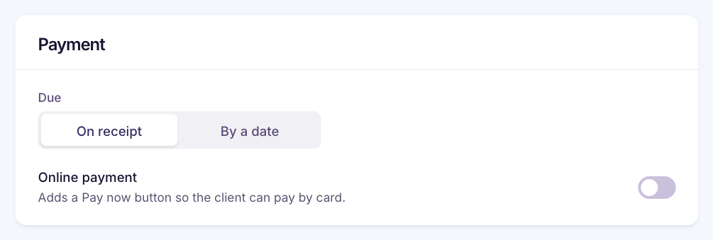
</Frame>

| Setting | Description |
|---|---|
| **Due** | **On receipt**, or **By a date** with a due date. |
| **Online payment** | Adds a **Pay now** button so the client can pay by card. Shown when `Link To Pay` is on your plan. |

If the location is not connected to an online payment gateway, the switch stays off and Taliup shows **This location can't take online payments yet**.

### Sending

<Frame caption="The Sending card with when to send, email, text, reply-to, and support message.">
  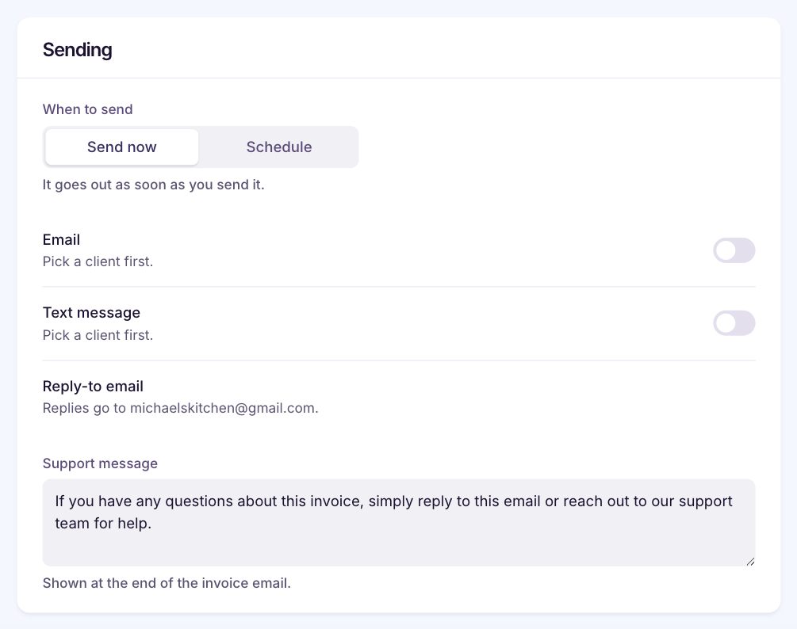
</Frame>

| Setting | Description |
|---|---|
| **When to send** | **Send now**, or **Schedule** to send it automatically on a **Send date**. |
| **Email** | Emails the invoice to the client. Always on for **Send now**. |
| **Text message** | Texts the pay link to the client's phone. |
| **Reply-to email** | Where client replies go. Set it in [Invoice settings](#invoice-settings). If it is not set, click **Set up**. |
| **Support message** | Shown at the end of the invoice email, for example how to reach you. |

### Summary and preview

The **Summary** shows the subtotal, discounts, fees, taxes, and total. The **Preview** below it updates as you edit, so you can check the message, items, and totals before you send.

If your business has a logo in **Settings** → **Business details**, it appears on the preview and on downloaded invoice and receipt PDFs.

<Frame caption="The live invoice preview.">
  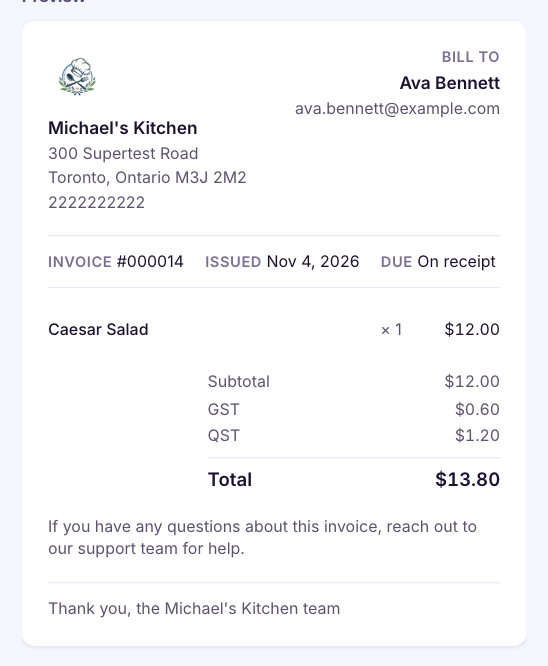
</Frame>

---

## Edit an invoice

Open the invoice and click **Edit**, or use **Edit** in the row's **⋮** menu. You can edit an invoice until it is paid.

| Status | What you can do |
|---|---|
| **Draft** | Edit everything. Click **Save draft**, or send or schedule it. |
| **Scheduled** | Edit everything except the client, number, and location. Click **Save**, or **Move to drafts** to stop it from going out. |
| **Awaiting payment** or **Overdue** | Edit the items, message, due date, and payment settings. Click **Save**, or **Save and send again** to send the updated invoice. |
| **Paid**, **Refunded**, or **Canceled** | Cannot be edited. An invoice with a payment on it cannot be edited either. |

<Frame caption="Editing a sent invoice. The bar shows Save and Save and send again.">
  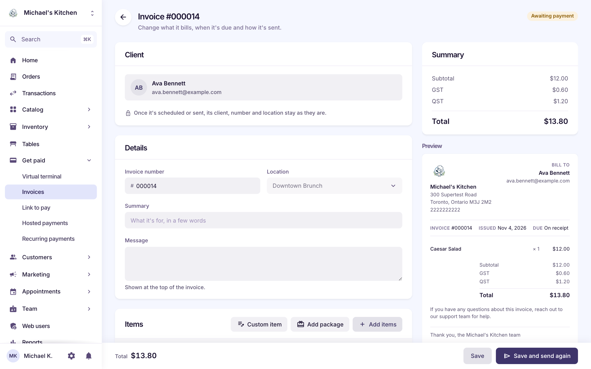
</Frame>

Once an invoice is scheduled or sent, its client, number, and location stay as they are.

---

## Send, remind, and record payments

Use the details panel or the row's **⋮** menu.

- **Send now** sends a scheduled invoice right away. **Send again** resends one that is awaiting payment.
- **Send reminder** emails a reminder for an overdue invoice. You can change the **Email subject** first. To send reminders automatically, turn on past-due reminders in [Invoice settings](#invoice-settings).
- **Record payment** records a payment you took outside Taliup. Enter the **Amount**, choose **Paid by** (**Cash**, **Cheque**, or **Other**), and add optional **Notes**. Turn on **Send a receipt** to email the client a receipt.

---

## Invoice settings

Settings → **Features** → **Invoices**. You need **Manage Settings**.

<Frame caption="Invoice settings with Emails, Reminders, and Deleting an invoice.">
  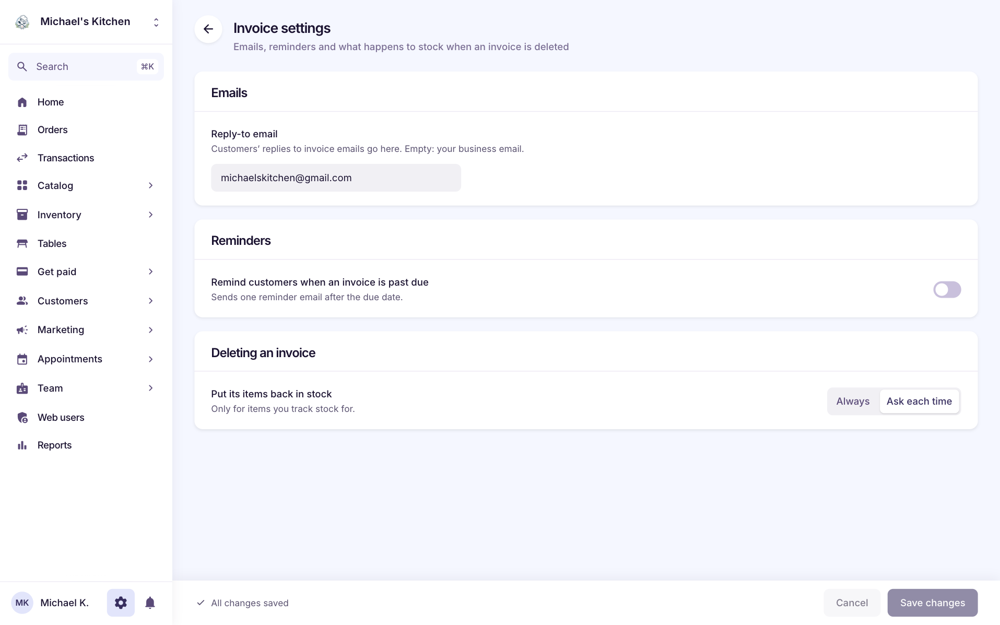
</Frame>

| Setting | Description |
|---|---|
| **Reply-to email** | Where client replies to invoice emails go. When empty, replies go to your business email. |
| **Remind customers when an invoice is past due** | Sends one reminder email after the due date. Set how many days after in **Send it after**. |
| **Put its items back in stock** | **Always**, or **Ask each time** you delete an invoice. Only for items you track stock for. |

### Return stock when you delete an invoice

When your business tracks inventory, deleting a scheduled, sent, overdue, or canceled invoice can put its items back in stock.

- With **Always**, the delete dialog tells you the items go back in stock.
- With **Ask each time**, tick **Put its items back in stock** in the delete dialog.

<Frame caption="The delete invoice dialog.">
  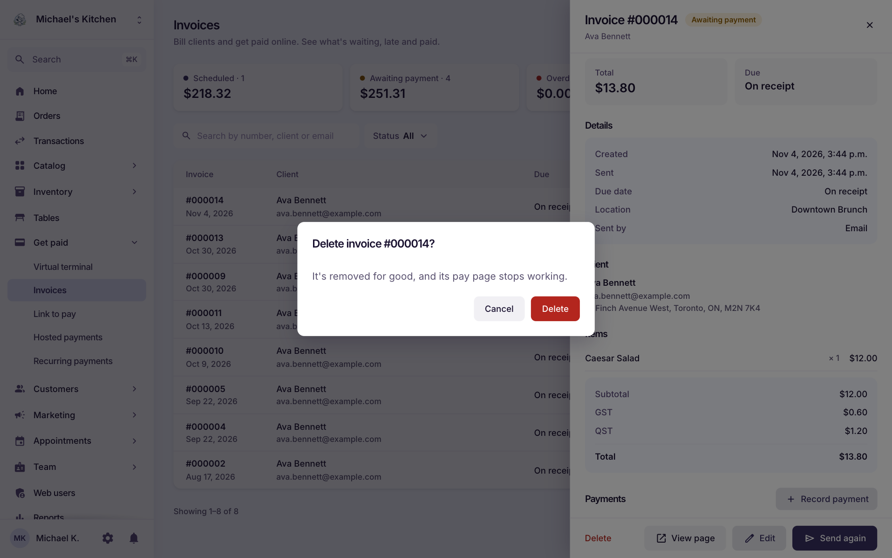
</Frame>

Deleting a draft or a paid invoice does not return stock. A deleted invoice's pay page stops working.

---

## Customer payment page

When the client opens the invoice from the email or text, they see the invoice number and status, the amount due, the issued and due dates, who it is from and billed to, the message, and the items.

- With online payment on, they click **Pay now** and enter their card under **Pay by card**.
- **Download invoice** saves a PDF while it is unpaid. Once it is paid, the page shows **Paid** with **Download receipt**.

To see what your client sees, open the invoice in Taliup HQ and click **View page**.

<Frame caption="The customer-facing invoice payment page.">
  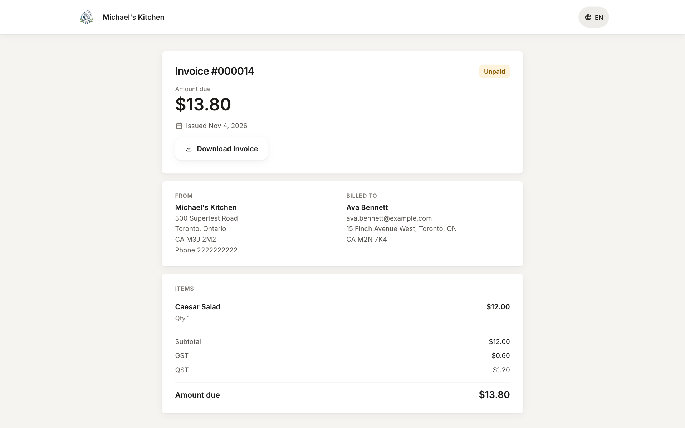
</Frame>

<Tip>
  Invoice emails do not attach a PDF. If a client needs a file copy, ask them to use **Download invoice** or **Download receipt** on the payment page.
</Tip>

---

## Refunds

You can refund a paid invoice from its details panel or the row's **⋮** menu.

<Frame caption="The refund dialog.">
  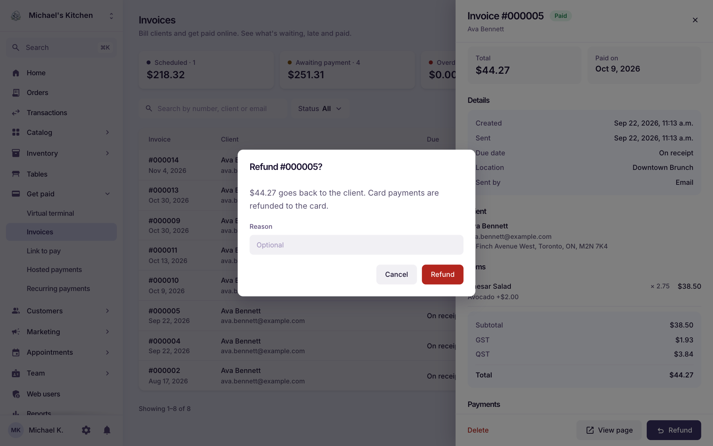
</Frame>

1. Click **Refund**.
2. Enter an optional **Reason**.
3. Click **Refund** to confirm, or **Cancel**.

The full amount goes back to the client. Card payments are refunded to the card.

---

## Invoice email conditions

An invoice email is sent only when all of the following are true:

| Condition | What to check |
|---|---|
| Email is on | **Sending** → **Email** is on |
| Client has a valid email | A client is picked and their record has an email |
| Timing is ready | **Send now** was chosen, or the scheduled **Send date** has been reached |
| The total is more than $0 | Add an item. A $0 invoice is saved as paid and not sent |
| Address can receive mail | Taliup is not blocked from delivering to that address (you see a clear error if send is blocked) |
| Reply-to (optional) | If Invoice settings include a reply-to address, client replies go there |

<Info>
  **Send now** always needs a client email. If the client has none, add their email, or schedule the invoice to go by text.
</Info>

---

## Troubleshooting

### Customer says they did not receive the invoice

1. Confirm the client email spelling on the client record.
2. Ask the customer to check **Junk** / **Spam**.
3. On Outlook / Hotmail, ask whether junk filtering is set to trust only Safe senders. If so, they should mark the message **It's not junk** and add the sender to Safe senders.
4. Open the invoice and check **Activity** to see when and how it was sent. Use **Send again** if needed.

### Merchant sees a delivery / suppressed email error

If Taliup cannot send because the address was previously unreachable or blocked for delivery:

- Update the client to a working email address, or
- Contact Taliup support to review the address before retrying

Do not keep resending to an address that has already failed hard delivery.

### Online pay link is missing

1. Edit the invoice and confirm **Payment** → **Online payment** is on.
2. If you see **This location can't take online payments yet**, the location has no online payment gateway. Contact Taliup to set one up.
3. If you do not see **Online payment** at all, ask your ISO admin to turn on `Link To Pay` for your plan.

### Customer needs a PDF

Ask them to use **Download invoice** or **Download receipt** on the payment page. The invoice email is designed to stand alone without a PDF attachment.

### Wrong reply destination

Update **Reply-to email** in [Invoice settings](#invoice-settings) so client replies go to the right mailbox.

---

## Related

- [Clients](/taliup-hq/features/clients)
- [Memberships](/taliup-hq/features/memberships)
- [Link To Pay on Taliup POS](/taliup-pos/link-to-pay/create-and-send)
