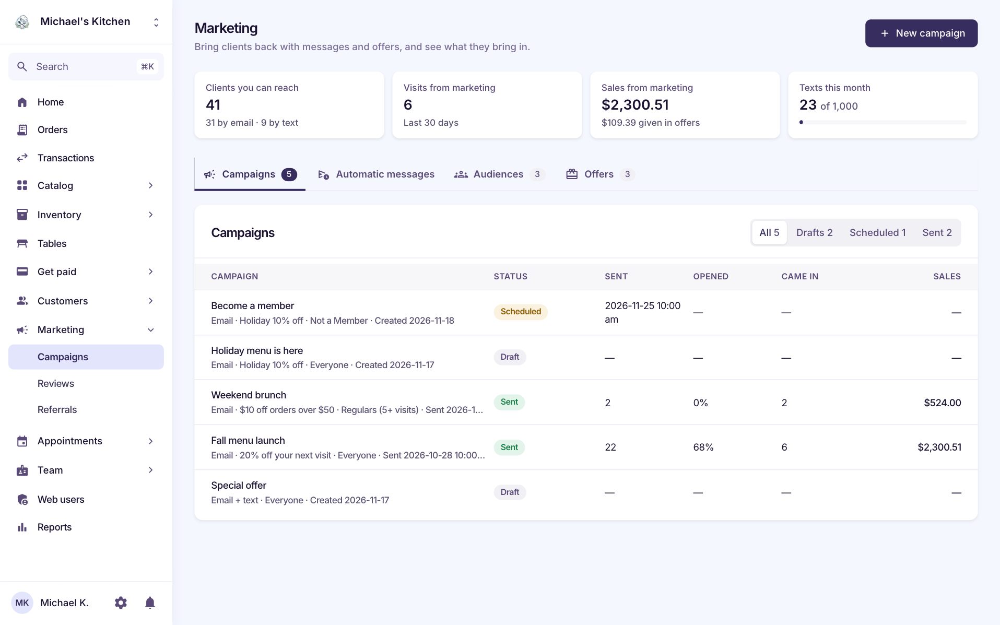

Marketing brings clients back with messages and offers. You send one-off campaigns, set up automatic messages such as birthday wishes, attach offers your clients use at checkout, and see the visits and sales that follow.

Staff apply offers on the terminal. See [Offers and client credit on Taliup POS](/taliup-pos/register/offers-and-credit).

## How to get here

Sidebar → **Marketing** → **Campaigns**. You need the **Clients** and **Marketing** features.

| Permission | What it allows |
|---|---|
| **View Marketing** | See campaigns, automatic messages, offers, and their results |
| **Manage Marketing** | Create and send campaigns, and set up automatic messages and audiences |
| **Manage Offers** | Create, change, and end offers |
| **Apply Offers** | A Taliup POS permission: apply an offer at checkout |

The **Marketing** page has four tabs: **Campaigns**, **Automatic messages**, **Audiences**, and **Offers**.

## At a glance

Tiles at the top of the page show:

| Tile | What it shows |
|---|---|
| **Clients you can reach** | Clients who agreed to marketing, by email and by text |
| **Visits from marketing** | Clients who came in after a message, in the last 30 days |
| **Sales from marketing** | Sales from those visits, and how much was given in offers |
| **Texts this month** | Marketing texts used against your monthly limit |

Marketing texts stop at a monthly limit per business. When you reach it, you see **You've used all your texts this month**. Emails, appointment reminders, and receipts still go out. Contact Taliup to raise your limit.

## Who gets messages

Only clients who agreed to marketing get campaigns and automatic messages. Clients who did not agree, unsubscribed, or replied STOP are always left out.

Every email ends with your business name, address, and an unsubscribe link. Every text ends with your business name and "Reply STOP to opt out."

See [Client consent and birthdays](#client-consent-and-birthdays) to record consent.

## Campaigns

A campaign is a one-off message by email, text, or both.

<Steps>
  <Step title="Start a campaign">
    On **Campaigns**, click **New campaign**. Pick a template, such as **Special offer**, **Last-minute openings**, **News and updates**, or **Ask for a review**, or click **Start from scratch**. You can change everything before sending.
  </Step>
  <Step title="Name and channel">
    Under **Name and channel**, enter a **Campaign name** (only you see it). Under **Send by**, pick **Email**, **Text**, or **Email + text**.
  </Step>
  <Step title="Audience">
    Under **Audience**, choose who it goes to in **Send to**: **Everyone who agreed to marketing**, or a saved audience. The count shows how many clients can be emailed and texted.
  </Step>
  <Step title="Offer">
    Optional. Under **Offer**, pick an offer to send with the message. On a text, click **Add the code** so the offer code is in the message.
  </Step>
  <Step title="Write the message">
    Write the email **Subject** and build the email (see [Email builder](#email-builder)), and choose its **Button**. For a text, write the **Text message**. Insert personal details such as **First name** or **Booking link** with the buttons above each field. The **Preview** shows what clients see.
  </Step>
  <Step title="Send">
    Click **Send now**, **Schedule** to pick a date and time, or **Save draft**. Click **Send a test** to send it to your own email or phone first.
  </Step>
</Steps>

A scheduled campaign shows **Scheduled for** with its date. Click **Cancel schedule** to put it back to draft.

Filter the list by **All**, **Drafts**, **Scheduled**, or **Sent**. Each row shows the campaign's **Status**, **Sent**, **Opened**, **Came in**, and **Sales**.

### Email button

The **Button** goes under your email. Clicks count in the results.

| Option | What it does |
|---|---|
| **Book now** | Opens your online booking. With an offer, the button reads **Book now — offer applied** |
| **Your own link** | Your **Button text** and **Link** |
| **No button** | Sends the email without a button |

**Book now** needs online booking to be on, with at least one service to book. Otherwise, choose your own link or no button.

### Resend to clients who didn't open it

After an email campaign is sent, you can send it again once to clients who got it but did not open it. Click **Resend**, change the subject if you like, and confirm. It goes out right away as a new campaign. Clients who opened it, bounced, or unsubscribed since are left out.

## Email builder

Emails are built from blocks, shown in your **Brand colour** with your business logo at the top. Click **Add a block** to add:

| Block | What it adds |
|---|---|
| **Heading** | A title line |
| **Text** | A paragraph |
| **Image** | An uploaded image: JPG, PNG, GIF, or WebP, up to 5 MB. Add a **Description** and an optional **Link** |
| **Divider** | A thin line between parts of the message |
| **Offer card** | The offer, its code, and its barcode, when the email carries an offer |
| **Button** | The button you chose under **Button** |

Drag blocks to reorder them. Use **Remove** to delete one.

## Automatic messages

Automatic messages go out on their own to clients who qualify. Click **New automatic message** and pick what it is for:

| Message | When it goes out |
|---|---|
| **Welcome** | The day after a client's first visit |
| **Thank you** | A set number of hours after each visit (1 to 48 hours), between 9 am and 9 pm |
| **Time to rebook** | A set number of weeks after a service, set per service. Only for businesses with services |
| **Loyal client** | When a client reaches a visit number, such as 5, 10, or 20 |
| **Birthday** | On the client's birthday |
| **Win back** | When a client hasn't come in for a set number of days and has nothing booked |

You can run more than one of a kind. For example, run a win back at 60 days and another at 120 days with a bigger offer.

The editor works like a campaign, with a **When it goes out** section:

- **Send automatically** turns the message on or off. Each client gets it once per birthday, or once each time they lapse.
- **Days since last visit** sets the win-back delay.
- **Hours after the visit** sets the thank-you delay.
- **Visit numbers** sets the loyal-client milestones, separated by commas.
- **Weeks until the next visit** sets the rebook delay for each service. Services left empty don't send a message.

Use the audience to narrow who gets it, for example only VIP clients. Click **Save**.

Each card on **Automatic messages** shows when it goes out, its channel, its offer, and its last 30 days: sent, came in, and sales. Use the switch on the card to pause or resume it.

A checked-out appointment and its sale count as one visit.

## Audiences

An audience is a saved group of clients that campaigns and automatic messages can send to. Audiences update on their own: a client who starts matching joins.

Click **New audience**, enter a **Name**, and set filters:

| Group | Filters |
|---|---|
| **Visits** | Not seen in more than, visited in the last, at least this many visits, first visit in the last (new clients), birthday month, upcoming appointment |
| **What they bought** | Bought any of the chosen services or products, any time or in the last number of days |
| **Spending** | Spent at least an amount, any time or in the last number of days. Completed sales, after refunds |
| **Memberships, packages and loyalty** | Is or isn't a member, has a package with visits left or has none, is or isn't a loyalty member |
| **Tags** | Has any of the chosen client tags |

The list shows each audience's **Clients**, **By email**, **By text**, and which campaigns or messages use it (**Used by**). Click the client count to see the clients, search them, and filter by how they can be reached.

If you delete an audience that is in use, those campaigns and messages go to everyone who agreed to marketing instead.

## Offers

An offer is a discount clients use with a code. One offer per sale.

<Steps>
  <Step title="Create an offer">
    On **Offers**, click **New offer**.
  </Step>
  <Step title="Set what it gives">
    Fill in the fields below.
  </Step>
  <Step title="Save">
    Click **Create offer**. Then add it to a campaign or an automatic message.
  </Step>
</Steps>

| Field | What it does |
|---|---|
| **Name** | Clients see it in messages and on their receipt |
| **Gives** | **Percent off** or **Amount off**, with the **Amount** |
| **On** | **The whole sale**, or **Chosen services and products** |
| **Starts** / **Ends** | When the offer is valid. Leave **Ends** empty for no end date |
| **Once per client** | Each client can use it once |
| **New clients only** | Only new clients can use it |
| **Minimum spend** | Before tax, on what the offer applies to |
| **Limit uses** | Stops working after this many uses in total |
| **Code** | **One code for everyone** (you choose it; letters, numbers, and dashes), or **A code per client** |

A code per client is made when a campaign or automatic message goes out. Each one works once, only for that client.

Filter offers by **Active**, **Upcoming**, or **Ended**. Each row shows the **Code**, when it is **Valid**, how many times it was **Used**, and its **Sales**.

To stop an offer, open its menu and choose **End offer**. Its codes stop working right away, including in messages already sent. Bookings already made with it keep the discount.

### Where clients use offers

| Where | How |
|---|---|
| Taliup POS | Staff type the code, scan the barcode from the email, or pick it from the client's offers. See [Offers and client credit](/taliup-pos/register/offers-and-credit) |
| Online booking | The client clicks **Book now — offer applied** in the email, or types the code under **Have an offer code?** when booking. The appointment keeps the offer until checkout |
| Appointment checkout | An offer on a booked appointment comes off at checkout |

A use is recorded when the sale is completed. If the sale is voided or refunded, the use is given back.

## Results

Open a sent campaign or an automatic message to see its results:

| Result | What it counts |
|---|---|
| **Sent** | Messages sent |
| **Opened** | Emails opened |
| **Clicked** | Clicks in the email |
| **Booked online** | Online bookings from the message |
| **Came in** | Clients who had a sale within 30 days of the message |
| **Sales** | Those sales, after refunds |

When the message carries an offer, you also see how many clients used it and how much it took off.

**Recipients** lists who got the message. Search by client, and filter by **Delivered**, **Opened**, **Clicked**, **Came in**, **Not sent**, or **Bounced**.

Automatic message results cover the last 30 days.

## Client consent and birthdays

In **Clients**, open a client and go to the **Marketing** tab:

| Field | What it does |
|---|---|
| **Birthday** | Used for birthday messages. If you don't know the year, any year works |
| **Agreed to marketing emails** | Turn on when the client agreed. Needs an email on file |
| **Agreed to marketing texts** | Turn on when the client agreed. Needs a mobile number on file |

Only turn consent on when the client agreed, in person, in writing, or online. Appointment reminders are not affected. Click **Save**. You need the **Manage Clients** permission.

Each consent shows when it was given and how: recorded by staff, or opted in when booking online. A client who replied STOP to a text gets no marketing texts. They can text START to opt back in.

Clients can also opt in when they book online, and staff can record birthday and consent on Taliup POS. See [Create and edit a client](/taliup-pos/clients/create-and-edit).

## Related

- [Offers and client credit on Taliup POS](/taliup-pos/register/offers-and-credit)
- [Referrals](/taliup-hq/features/referrals)
- [Clients](/taliup-hq/features/clients)
- [Brand Hub](/taliup-hq/merchant/brand-hub)
