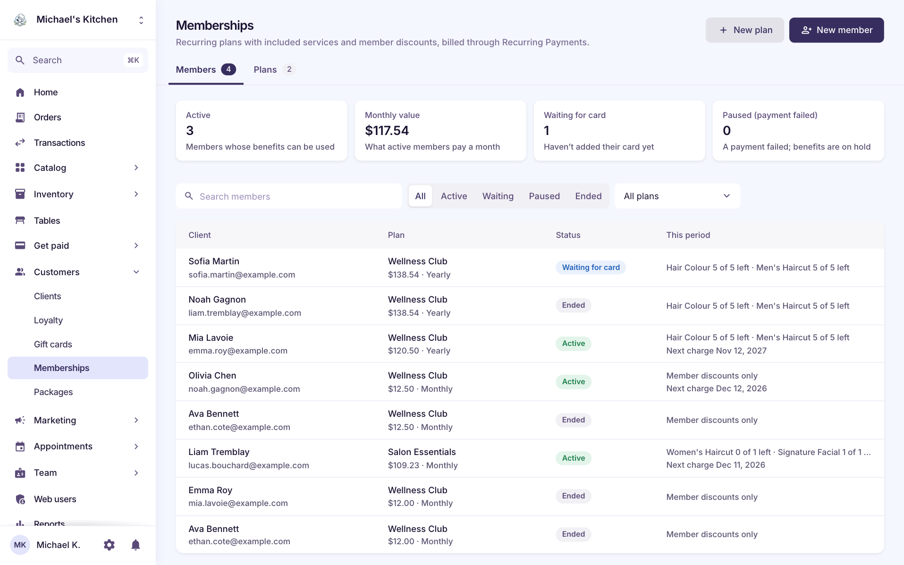

A membership is a plan the client pays for every billing period. Each period it can include services, like one haircut a month, and it can give members a discount on other services and on retail.

Memberships bill through [Recurring Payments](/taliup-hq/features/recurring-payments). When you sign a client up, they get an email to add their card and make the first payment.

Staff use included services and member discounts at the register too. See [Memberships on Taliup POS](/taliup-pos/register/packages-and-memberships).

## How to get here

Sidebar → **Customers** → **Memberships**. You need the **Memberships** feature and the **View Memberships** permission.

| To | Permission |
|---|---|
| See plans and members | **View Memberships** |
| Create, edit or delete plans, sign clients up, cancel memberships | **Manage Memberships** |
| Use or undo an included visit on an appointment | **Manage Appointments** |

The **Memberships** feature sits under **Recurring Payments**. Ask your ISO or partner to turn it on in [Plans & Features](/taliup-hq/onboarding/plans-features).

<Note>
  Memberships need an active **Elavon Converge** online payment gateway on one of your locations, as Recurring Payments does. Without one, the page shows **Memberships can't bill yet**.
</Note>

## Create a plan

<Steps>
  <Step title="Open the editor">
    On **Memberships**, click **New plan**.
  </Step>
  <Step title="Name and price">
    Enter a **Plan name** and an optional **Description**. Enter the **Price before tax ($)**.
  </Step>
  <Step title="Billing cycle">
    In **Billed**, pick **Weekly**, **Every 2 weeks**, **Monthly**, or **Yearly**.
  </Step>
  <Step title="Included services">
    Under **Included every billing period**, click **Add service**. Pick the service and the number of **Visits** per period. Leave it empty for a discount-only plan.
  </Step>
  <Step title="Member discounts">
    Enter **% off other services** and **% off retail**. Leave them blank for no discount.
  </Step>
  <Step title="Taxes and save">
    Tick the **Taxes** charged on each payment. Leave **Available for new members** on, then click **Save plan**.
  </Step>
</Steps>

The **Plans** tab shows each plan's price with tax (**Incl. tax**), its billing cycle, and how many members it has.

### Edit, stop offering, or delete a plan

Click a plan to edit it. Current members keep the price and benefits they signed up with. Changes apply to new members.

- Turn off **Available for new members** to stop new sign-ups. The plan shows **Not offered**. Current members keep their membership.
- **Delete plan** removes it. Existing members keep their membership.

## Sign a client up

<Steps>
  <Step title="Open the form">
    On **Memberships**, click **New member**.
  </Step>
  <Step title="Pick the client and plan">
    Search for the **Client**, then pick the **Plan**. If you have more than one location with Converge, pick where the membership is **Billed at location**.
  </Step>
  <Step title="Create">
    Click **Create membership**.
  </Step>
</Steps>

The client is emailed a secure link to add their card and complete the first payment. The email names the plan. The membership starts once the first payment goes through. Until then it shows **Waiting for card**.

The client needs an email address to get the link. A client can't sign up twice to the same plan while a membership on it is waiting, active, or paused.

The membership also appears in **Recurring Payments** as an agreement, charged on the plan's billing cycle. See [Recurring Payments](/taliup-hq/features/recurring-payments).

## Members

The **Members** tab lists everyone signed up.

| Tile | What it counts |
|---|---|
| **Active** | Members whose benefits can be used |
| **Monthly value** | What active members pay a month |
| **Waiting for card** | Clients who haven't added their card yet. Click it to filter the list |
| **Paused (payment failed)** | A payment failed, so the benefits are on hold. Click it to filter the list |

Search members, filter by status (**All**, **Active**, **Waiting**, **Paused**, **Ended**), and by plan. The **This period** column shows the included visits left and the next charge.

| Status | Meaning |
|---|---|
| **Waiting for card** | The client hasn't completed the first payment |
| **Active** | Paid up. Benefits can be used |
| **Paused (payment failed)** | A payment failed. Benefits are on hold until a payment goes through |
| **Ended** | Cancelled, or its billing ended |

### Member details

Click a member to open their details:

- **Included every billing period**: each service with the visits left, since the start of the current period.
- **Member discounts**: the percentages off services and retail.
- **Client**: name and contact details.
- **Billing**: the price and its tax, **Member since**, payments made, last payment, and the next charge (or when it ends).
- **Card on file**: the card brand, last 4 digits, and expiry.
- **Visit history**: each included visit used, and where: **Appointment**, **Register**, **Invoice**, or **Virtual terminal**.

When the last payment failed, the details show **The last payment didn't go through**. The client can update their card from the manage link in their emails. **Billing** opens the Recurring Payments agreement.

Included visits reset at the start of each billing period. Unused visits don't carry over.

## Cancel a membership

Open the member and click **Cancel membership**, then confirm.

- Billing stops now.
- If the current period is paid for, the benefits last until it ends. The member shows **Ends [date]**.
- If it isn't paid for, the benefits end now.

The client is emailed when you cancel. The email says when the benefits end and the included visits they still have.

## Use included services

An included service covers one unit of that service at $0.

| Where | How |
|---|---|
| Taliup POS | **Use a visit from …** under the cart line, or applied for you at appointment checkout. See [Use a membership](/taliup-pos/register/packages-and-memberships#memberships-at-the-register) |
| [Calendar](/taliup-hq/features/calendar) in Taliup HQ | In the appointment's **Memberships** panel, click **Use membership**. It then shows **Included in membership**. **Undo** gives the visit back |
| Virtual Terminal | On an itemized sale, click **Use [plan] visit** on the line. The visit is used once the payment goes through |
| Invoices | Under the line, **Included in [plan]** → **Use visit**. The invoice gets a line *[service] · included in [plan]* |

On an invoice, the visit is used when you save. Editing, deleting, refunding, voiding, or cancelling the invoice gives it back. An invoice that comes to $0 because everything is included is saved with **Save as paid**, and nothing is sent.

If the member's plan doesn't include the appointment's service, the panel shows **Member, but this service isn't included**.

When a client signs in to [book online](/taliup-hq/features/online-booking#memberships) and their membership covers the service, no deposit is asked.

With the **Pay Runs and Commissions** feature, each included visit counts as a service sale of the plan's price divided by the visits it includes each period. See [Pay runs and commissions](/taliup-hq/features/payroll).

## Member discounts

A member discount is taken off before tax. Services get the services percentage. Products get the retail percentage. When a client has more than one active membership, the biggest discount applies.

| Where | What happens |
|---|---|
| Taliup POS | Applied to the sale's lines while **Member discount** is on. See [Member pricing](/taliup-pos/register/packages-and-memberships#member-pricing) |
| Virtual Terminal | On itemized sales, **Member discount on services · [plan]** and **Member discount on retail · [plan]** apply to matching catalog items. Staff can remove them |
| Invoices | A **Member discount · [plan]** line, worked out from the catalog items on the invoice |
| Calendar in Taliup HQ | The discount is shown to staff on the member's appointments |

The discount counts only on what an included visit leaves of an item.

## Client profile

A client's profile in **Clients** has a **Wallet** tab. It lists their memberships with the status and the included visits left this period.

## Related

- [Recurring Payments](/taliup-hq/features/recurring-payments)
- [Memberships on Taliup POS](/taliup-pos/register/packages-and-memberships)
- [Invoicing](/taliup-hq/features/invoicing)
- [Virtual Terminal](/taliup-hq/onboarding/virtual-terminal)
