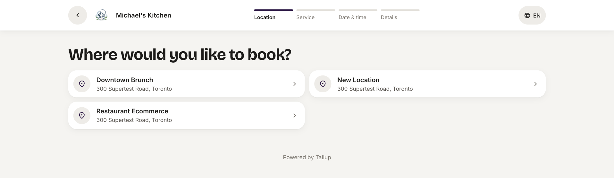
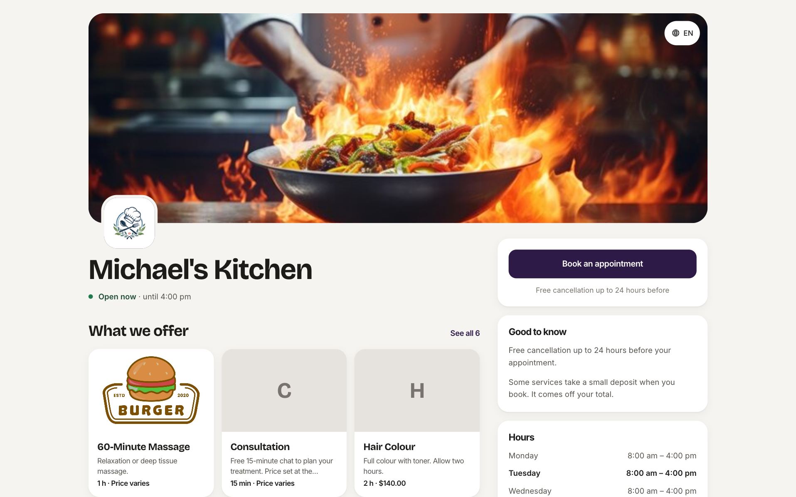

Clients book appointments themselves from your booking page, any time. They pick a service, who with, and a time, sign in with Google or a code sent to their email, and pay a deposit or save a card when you ask for one. Each booking lands on your calendar.

You set up online booking in Taliup HQ. To manage the bookings once they are made, see [Calendar](/taliup-hq/features/calendar) and [Calendar on Taliup POS](/taliup-pos/calendar).

## How to get here

**You (setup):** Sidebar → **Settings** → **Features** → **Calendar**, then the **Online booking** tab. You need the **Calendar** feature, the **Online Booking** add-on, and the **Manage Settings** permission. Deposits, saved cards, and fees on the **Payments & cancellations** tab also need the **Online Booking Payments** feature.

**Your clients:** they open your booking link. You copy it, or print its QR code, from **Your booking page** on the **Online booking** tab.

## Set up online booking

<Steps>
  <Step title="Set your hours">
    Under **Settings** → **Hours of operation**, set the days you are open. Online booking cannot be turned on without them.
  </Step>
  <Step title="Turn it on">
    On the **Online booking** tab, turn on **Accept online bookings**. If the add-on is not on your plan, you see **Online booking isn't on your plan** with **Add Online Booking** or **Compare plans**.
  </Step>
  <Step title="Add a notification email">
    On the **Notifications** tab, turn on **Email me about appointments** and enter an address. It is required while online booking is on.
  </Step>
  <Step title="Choose how services are grouped">
    If you have more than one catalog, pick one under **Service categories**. Your booking page groups services under that catalog's categories.
  </Step>
  <Step title="Save">
    Click **Save changes**. **Your booking page** then shows your booking link and QR code.
  </Step>
</Steps>

The other tabs of Calendar settings shape online bookings too. See [Calendar settings](/taliup-hq/features/calendar-settings) for the full list.

| Tab | What it sets for online booking |
|---|---|
| **Online booking** | The on/off switch, your link, QR code, and banner image, the catalog for service categories, **Minimum notice**, and **How far ahead clients can book** |
| **Payments & cancellations** | What clients pay or leave on file when they book, the **Cancellation window**, the **No-show fee** and **Late-cancellation fee**, and **Clients can cancel online**. See [Booking payments](#booking-payments) |
| **Staff & rooms** | **Assign employees to services**, and the rooms and equipment services need |
| **Notifications** | The email for new, changed, and cancelled appointments, and client reminders |

## Get your services ready

Clients can book a service at a location when the service is offered there and ticked for online booking.

- **Booking locations:** sidebar → **Catalog** → **Services**, then the **Booking locations** tab. Tick where clients can book each service online. The list is grouped like your booking page.
- **Categories:** on a service's page, under **Catalogs and categories**, add it to a catalog and category. Services that are not in the booking catalog appear under **Other services**.
- **Image:** add an **Image** on the service's page. It shows on the service's card on your booking page.
- **Payment:** a service follows the business default from the **Payments & cancellations** tab. To change it for one service, use **Online booking payment** on the service's page.

## Share your booking link

Under **Your booking page** on the **Online booking** tab:

| Option | What it does |
|---|---|
| **Copy link** | Copies your booking link |
| **Open booking page** | Opens your booking page in a new tab |
| **Print QR code** | Prints a QR code that opens your booking page |
| **Banner image** | The wide image at the top of your booking page |

**Get booked from Google, Instagram and Facebook** gives a link for each channel, with steps to add it. Each link is tracked, so you can see how many bookings each one brought in the last 30 days. Use the **Your website** link for a "Book now" button on your own site.

Your booking page uses your logo and your [Brand Hub](/taliup-hq/merchant/brand-hub) colour.

## What clients see

Clients can switch the language of the booking pages at any time. A back button and a step counter keep them oriented.

### Your business page

The booking link opens your business page: banner, logo, open or closed now, what you offer by category, your team, your hours, and your address with directions. **Good to know** lists your free cancellation window and whether some services take a deposit.

Clients click **Book an appointment**, or pick a category or service to jump straight to it.

### Location

With more than one location, clients choose where they want to book. With one location, this step is skipped.

### Service

Services are listed under your catalog's categories, with their image, duration, and price. Clients can search, or filter by category. A badge shows when a service takes a deposit, is **Paid in full online**, or needs a **Card on file**.

### Staff

This step shows only when **Assign employees to services** is on and more than one person offers the service. Each person shows their next opening. **Any available** gives the most times to choose from.

### Date and time

Clients pick a day of the week, or click **See the whole month** to choose from a month calendar. Then they pick a time under **Morning**, **Afternoon**, or **Evening**. Times are shown in your time zone. When cancelling late costs something, the page shows how long they can cancel for free.

### Details and email sign-in

Before booking, clients sign in with Google or with a 6-digit code sent to their email. No password is needed.

<Steps>
  <Step title="Sign in with Google, or enter an email">
    The client clicks **Continue with Google**, or enters their email and clicks **Email me a code**. With Google, Google confirms the email, so there is no code to enter.
  </Step>
  <Step title="Enter the code">
    The code arrives by email and works for 10 minutes. **Keep me signed in on this device** is ticked by default. The client clicks **Verify & continue**.
  </Step>
  <Step title="Choose who it's for">
    If more than one of your clients uses that email, the client picks who the booking is for, or **Someone new**.
  </Step>
  <Step title="Check the details">
    A returning client is welcomed back by name, with their details filled in. The email shows as **Verified**. They can add notes for you.
  </Step>
</Steps>

**Not you?** signs the browser out so someone else can book.

### Signing in with Google

**Continue with Google** shows when Taliup has Google sign-in set up. Google shares only the client's verified email and name.

- A client already on file with that email books as that client. If several share it, they pick who the booking is for, as with a code.
- Someone new is added as a client with the name Google gave.
- The client's profile shows **Joined with Google sign-in**, and the appointment's History notes that they signed in with Google.

The page then shows the booking's price, what is due now, and your cancellation and no-show terms with the real amounts. When you charge a no-show or late-cancellation fee, the client must tick **I agree to the cancellation and no-show policy.**

### Paying and confirmation

What happens next depends on the service's payment option. When a payment or card is needed, the client goes to a secure payment page that shows the appointment, then comes back. If they leave the payment page without paying, the time is released and nothing is charged.

If someone else books the same time first, the client sees **That time is no longer available. Please pick another time.** and nothing is charged. If their card is declined, they come back to their details with everything still filled in, and the time isn't booked yet.

The confirmation page says **You’re booked!** and shows the appointment, what was paid, and the terms. Clients can **Add to calendar**, get **Directions**, or **Cancel Appointment** when you let clients cancel online.

## Booking payments

On the **Payments & cancellations** tab, choose what clients pay or leave on file by default. Any service can set its own.

| Option | What the client does | Button they see |
|---|---|---|
| **No payment** | Books without a card. No-show and late-cancellation fees can't be charged | **Book appointment** |
| **Save a card** | Saves a card. Nothing is charged now | **Save card & book** |
| **Take a deposit** | Pays part of the price, as a **Fixed amount** or a **% of price**. The card is saved too | **Pay [amount] deposit & book** |
| **Full price upfront** | Pays the whole price | **Pay [amount] & book** |

A location needs an online payment gateway to take payments. Bookings at a location without one don't ask for a card, and the tab names those locations. Contact Taliup support to set one up.

Set no-show and late-cancellation fees on the same tab, under **Cancellation and no-show policy**. Fees can only be charged to a card the client saved, or from a deposit they paid, when booking online.

### Memberships

When a signed-in client has a membership that covers the service, the page shows **Covered by your membership** with the visits left. No deposit is asked for.

If you charge no-show or late-cancellation fees, the client still saves a card, and nothing is charged. Otherwise they book with no payment.

### Saved cards

A signed-in client with a saved card that the location can charge sees it under **Due now**, as **[card] on file**.

- **Card on file only:** they book in one tap with **Book**. Nothing is charged.
- **Deposit or full price:** the card is charged in one tap. If they signed in a while ago, they first confirm it's them, with a new code sent to their email or with **Continue with Google**.

**Use a different card** opens **Pay with**: each of their saved cards, and **A new card (entered on the next page)**. If the saved card is declined, the time is released and they can pay with another card.

## Booking emails

Booking emails use your logo and are written in your business's language.

| Email | Who gets it | When |
|---|---|---|
| Verification code | Client | They ask for a code at the Details step (not sent when they sign in with Google) |
| Appointment confirmed | Client | The booking is made, or the deposit or card goes through |
| Appointment reminder | Client | Before the appointment, as set under **Email reminders to clients** |
| Appointment updated | Client | The appointment changes |
| Appointment cancelled | Client | You cancel the appointment, with what happened to their deposit and any fee |
| New appointment, updated, confirmed, cancelled | Your notification email and the staff member | An appointment is booked, changed, confirmed, or cancelled |

Client emails show the date, time, service, who with, and where. They include **Add to calendar**, what was paid, and the cancellation terms. **Cancel appointment** appears when clients can cancel online.

## Related

- [Calendar](/taliup-hq/features/calendar)
- [Clients](/taliup-hq/features/clients)
- [Brand Hub](/taliup-hq/merchant/brand-hub)
- [Calendar on Taliup POS](/taliup-pos/calendar)
