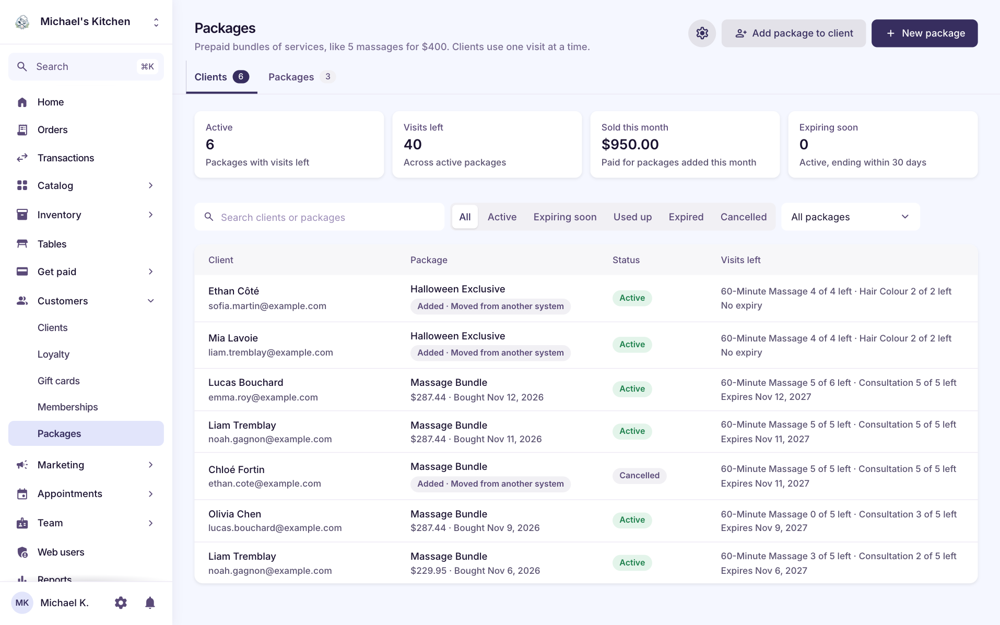

A package is a prepaid bundle of services, like 5 massages for $400. The client pays once, then uses one visit at a time. Taliup HQ keeps the packages you sell and every package your clients hold, with the visits they have left.

Staff sell packages and use visits on the terminal. See [Packages and memberships on Taliup POS](/taliup-pos/register/packages-and-memberships).

## How to get here

Sidebar → **Customers** → **Packages**. You need the **Packages** feature and the **View Packages** permission.

| To | Permission |
|---|---|
| See packages and client packages | **View Packages** |
| Create, edit or delete a package, add a package to a client, adjust or cancel a client package | **Manage Packages** |
| Change **Package settings** | **Manage Settings** |
| Use or undo a package visit on an appointment | **Manage Appointments** |

The **Packages** feature sits under **Calendar**. Ask your ISO or partner to turn it on in [Plans & Features](/taliup-hq/onboarding/plans-features).

## Create a package

<Steps>
  <Step title="Open the editor">
    On **Packages**, click **New package**.
  </Step>
  <Step title="Name and price">
    Enter a **Name** and an optional **Description**. Enter the **Price before tax**.
  </Step>
  <Step title="Add services">
    Under **Services included**, click **Add service**. Pick a **Service** and the number of **Visits**. Add as many services as the package covers, for example 3 facials and 2 peels.
  </Step>
  <Step title="Set the expiry">
    In **Expires after**, enter a number of days. The count starts on the day the client buys it. Leave it empty if the package never expires.
  </Step>
  <Step title="Choose taxes">
    Under **Taxes**, tick the taxes charged when the package is sold.
  </Step>
  <Step title="Save">
    Leave **For sale** on, then click **Save**.
  </Step>
</Steps>

Services come from your catalog. If you have none, you see **Add services to your catalog first.**

Lists show the price with tax, marked **Incl. tax**.

### Edit or stop selling a package

Click a package on the **Packages** tab to edit it. Clients who already bought it keep what they bought. Changes apply to new sales.

- Turn off **For sale** to stop selling it. The package shows **Not for sale**. Clients who have it keep it.
- **Delete package** removes it. Clients keep the packages they bought.

## The Packages page

The page has two tabs.

| Tab | What it shows |
|---|---|
| **Clients** | Every package a client holds, with its status and visits left |
| **Packages** | The packages you sell, with the price, expiry, and how many were sold |

### Clients tab

Tiles sum up the packages clients hold:

| Tile | What it counts |
|---|---|
| **Active** | Packages with visits left |
| **Visits left** | Visits left across active packages |
| **Sold this month** | What was paid for packages added this month |
| **Expiring soon** | Active packages ending within 30 days. Click it to filter the list |

Search by client name, email, phone, package name, or payment reference. Filter by status (**All**, **Active**, **Expiring soon**, **Used up**, **Expired**, **Cancelled**) and by package.

| Status | Meaning |
|---|---|
| **Active** | Visits left, not expired |
| **Used up** | Every visit has been used |
| **Expired** | Past its expiry date. The visits left can't be used |
| **Cancelled** | Cancelled by staff or by a refund. The visits left can't be used |

### Client package details

Click a row to open the client package. It shows:

- **Visits**: each service with visits left, such as *3 of 5 left*.
- **Client**: name and contact details. **Open client** goes to the client profile.
- **Purchase**: what was paid and when, the tax, **Sold by**, the expiry, the payment reference, and the order number.
- **Visit history**: each visit used, with where it was used: **Appointment**, **Register**, **Invoice**, or **Virtual terminal**.
- **Adjustments**: changes made by hand, with who made them and the note.

The purchase section always names the package the client bought, even if you later rename or delete it.

## Sell a package

Packages are sold in person, on Taliup POS, the Virtual Terminal, and invoices. They are not sold online. A package always sells at its Taliup HQ price and taxes, and it always goes to the sale's client.

| Where | How |
|---|---|
| Taliup POS | **Options** → **Sell a package**. See [Sell a package](/taliup-pos/register/packages-and-memberships#sell-a-package) |
| Virtual Terminal | Pick the client, then **Add package**. The client gets the package once the payment goes through |
| Invoices | Pick the client, then **Add package**. The client gets the package once the invoice is paid |

The line shows **Package ·** and what it includes. You can't change its price. Sale-wide discounts apply to it as to any other line.

The visits of a package sold on a sale can cover other lines of that same sale.

When a sale with a package is voided, cancelled, or the package line is refunded, the package is cancelled. An invoice that is refunded, voided, cancelled, or deleted cancels its packages too.

## Add a package to a client

Use **Add package to client** to give a package without a sale. For example, a client moving from another system, or a complimentary package. Nothing is charged and no commission is paid.

<Steps>
  <Step title="Open the form">
    On **Packages**, click **Add package to client**.
  </Step>
  <Step title="Pick the client and package">
    Search for the **Client**, then pick the **Package**.
  </Step>
  <Step title="Set the visits left">
    **Visits left** is filled in from the package. Change it to what the client has left.
  </Step>
  <Step title="Set the expiry and reason">
    Pick an **Expires on** date, or leave it empty if the package never expires. Choose a **Reason**: **Moved from another system** or **Complimentary**.
  </Step>
  <Step title="Add">
    Click **Add to client**.
  </Step>
</Steps>

The list shows the package as **Added** with the reason, instead of a price.

When the **Package purchased** email is on in [Package settings](#package-settings), the client gets that email without a price. The client needs an email address.

## Adjust a client package

Correct the visits left or the expiry of a client package.

<Steps>
  <Step title="Open the client package">
    On the **Clients** tab, click the row, then **Adjust**.
  </Step>
  <Step title="Change what's needed">
    Change **Visits left** for each service, or the **Expires on** date. Tick **Never expires** to remove the expiry.
  </Step>
  <Step title="Add a note and save">
    Add an optional **Note** explaining why. Click **Save**.
  </Step>
</Steps>

The change is listed under **Adjustments**, such as *Expiry: Jan 5 → Mar 5* or *Massage: 2 → 4 left*. A cancelled package can't be adjusted.

## Cancel a client package

Open the client package and click **Cancel package**. The client can't use the visits left. Nothing is refunded: refund the client at the register if needed.

## Use package visits

A visit covers one unit of a service the package includes. When a client holds more than one package for the service, Taliup offers the one that expires first.

| Where | How |
|---|---|
| Taliup POS register | **Use a visit from …** under the cart line. See [Use a package visit](/taliup-pos/register/packages-and-memberships#use-a-package-visit) |
| Appointment checkout on Taliup POS | The visit is applied for you. See [Package settings](#package-settings) |
| [Calendar](/taliup-hq/features/calendar) in Taliup HQ | In the appointment's **Packages** panel, click **Use package**. The panel then shows **Paid with package**. **Undo** gives the visit back |
| Virtual Terminal | Click **Use [package] visit** on the line |
| Invoices | Under the line, **Visits left in [package]** → **Use package visit** |

A covered line costs $0. On a register or Virtual Terminal sale, the visit is used once the sale is paid. Voids and refunds give the visits back, including partial refunds of the covered lines.

On an invoice, a visit from a package the client already holds is used when you save the invoice. Editing or deleting the invoice gives it back. A visit from a package the invoice itself sells is used once the invoice is paid.

An appointment can't be covered by both a package and a membership.

When a client signs in to [book online](/taliup-hq/features/online-booking#packages-and-memberships) and a package covers the service, no deposit is asked.

## Package settings

Settings → **Features** → **Packages**, or the gear on the **Packages** page. You need **Manage Settings**.

### Commission

Shown when your business has the **Pay Runs and Commissions** feature. **Pay commission on packages** uses each employee's commission rates in Payroll.

| Option | Who earns commission |
|---|---|
| **When visits are used** (default) | Each employee who does a visit earns on it as a service sale. Each visit is worth the price paid divided by the number of visits |
| **When it's sold** | The employee who sold it earns on the full price as a retail sale |
| **Both** | Both of the above |

The example under the setting shows what each person earns under the rule you pick. A package keeps the rule it was sold under. See [Pay runs and commissions](/taliup-hq/features/payroll).

### Emails to clients

| Email | When it's sent | Default |
|---|---|---|
| **Package purchased** | When a client buys a package: what it includes, their visits, and when it expires. When an invoice sold it, the email names the invoice | On |
| **Expiring soon** | Once, 14 days before a package with unused visits expires | Off |

The client needs an email address. If you push a package's expiry later, the expiring soon reminder can go out again.

### Checkout

Shown when your business has the **Calendar** feature. **Use visits automatically for appointments** is on by default. When an appointment is checked out at the register and the client's package covers its service, the visit is applied. Staff can remove it.

## Client profile

A client's profile in **Clients** has a **Wallet** tab. It lists their packages with the visits left for each service.

## Related

- [Packages and memberships on Taliup POS](/taliup-pos/register/packages-and-memberships)
- [Memberships](/taliup-hq/features/memberships)
- [Invoicing](/taliup-hq/features/invoicing)
- [Virtual Terminal](/taliup-hq/onboarding/virtual-terminal)
- [Pay runs and commissions](/taliup-hq/features/payroll)
- [Clients](/taliup-hq/features/clients)
