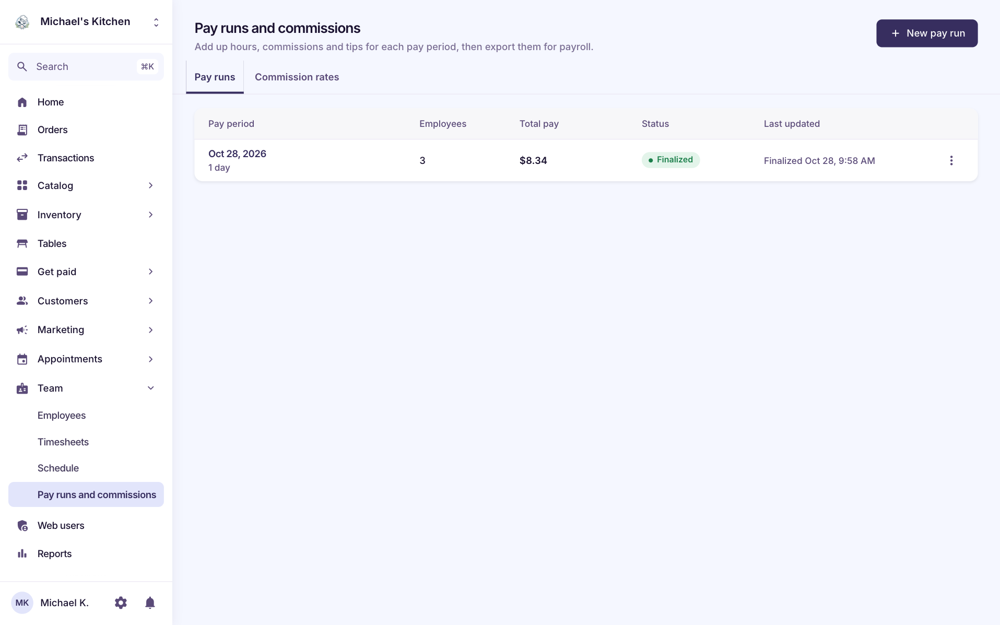

A pay run adds up each employee's clocked hours, commissions and tips for a pay period. You review it, finalize it, and export it for your payroll provider. Taliup HQ does not pay employees itself.

## How to get here

Sidebar → **Team** → **Pay runs and commissions**. You need the **Pay Runs and Commissions** feature and the **Admin** web user role.

**Pay Runs and Commissions** is off by default. Ask your ISO or partner to turn it on.

The page has two tabs: **Pay runs** and **Commission rates**.

## Set commission rates

Set rates before your first pay run. Open **Commission rates**.

### Business default

Everyone earns the **Business default** unless they have their own rates.

| Field | What it does |
|---|---|
| **Service commission** | Percent of the service sales they perform |
| **Retail commission** | Percent of the products they sell |
| **Tips paid out** | Share of their tips paid to them |
| **Higher rate past a sales amount** | Optional tiers for service commission. Click **Add a tier**, then set where it starts and its rate |

Tiers work in bands. Each rate only applies to the service sales inside its band in a pay period. For example: 40% on the first $5,000 of service sales, then 45% on the rest.

The example under the form shows what a set of sales would earn. Click **Save rates**.

### An employee's own rates

The **Employees** table shows each person's hourly rate and rates, and whether they use **Own rates** or the **Default**.

<Steps>
  <Step title="Open their rates">
    Click **Edit** on the employee.
  </Step>
  <Step title="Set their own rates">
    Fill in the rates that differ. Leave a field empty to use the business default. The drawer compares what they earned in the last pay run with these rates and with the default.
  </Step>
  <Step title="Save">
    Click **Save**. To go back to the default, click **Use the default instead**.
  </Step>
</Steps>

Hourly rates come from each employee's profile. See [Employees](/taliup-hq/features/employees).

## Create a pay run

<Steps>
  <Step title="Start it">
    On **Pay runs**, click **New pay run**.
  </Step>
  <Step title="Pick the pay period">
    Choose **Last 2 weeks**, **Last week**, **Last month**, or **Custom dates**.
  </Step>
  <Step title="Check open shifts">
    If shifts in the period are still clocked in, the dialog names them. They won't count until they're clocked out. Fix them in [Timesheets](/taliup-hq/features/timesheets) first.
  </Step>
  <Step title="Create">
    Click **Create pay run**. It opens as a **Draft**.
  </Step>
</Steps>

## Review a pay run

The pay run shows:

| Total | What it adds up |
|---|---|
| **Total pay** | Everything below, for every employee |
| **Hourly pay** | Clocked-out hours × hourly rate |
| **Commissions** | Service and retail commission |
| **Tips paid** | Each person's share of their tips |

**Pay by employee** lists each person's hours, commissions, tips and total, with a **Totals** row. Click a person to see how their pay adds up: their shifts, sales, the tier bands, and the rates the run used.

While the run is a **Draft**:

- **Recalculate** picks up the latest sales, tips and timesheets, for example after you fix a timesheet or a late refund comes in.
- **Delete** (in **More actions**) removes the draft. Timesheets, sales and tips aren't touched.

### Finalize

Click **Finalize**, then **Finalize pay run**. The numbers are locked. Later changes to timesheets, sales or rates don't change it, and it can't be deleted. The pay run records who finalized it.

### Export

Click **Export CSV** on the pay run, or in the row's menu on **Pay runs**. The file has each employee's hours, hourly pay, service and retail sales and commission, tips, tips paid and total pay.

## Who earns what

A pay run counts completed sales, before tax. Refunded lines, cancelled orders, and voided or refunded tips don't count.

Each sale line is credited to one employee, in this order:

1. The employee set as **Done by** on the line.
2. Else the employee set as **Helped by** on the sale.
3. Else, for an online deposit or a no-show or late-cancel fee, the staff member the appointment was booked with.
4. Else the cashier who rang up the sale.

That employee earns the service or retail commission on the line. Staff set **Done by** and **Helped by** on Taliup POS. See [Helped by](/taliup-pos/register/helped-by).

**Tips** are split between the people credited with the services on each sale, by their share of the service amount. On a sale without services, the tip goes to whoever helped, else the cashier.

**Gift card** sales don't earn commission. What the client buys with the card later does.

### Memberships

Included membership visits count as a service sale of the plan's price ÷ the visits it includes each period.

## Related

- [Employees](/taliup-hq/features/employees)
- [Timesheets](/taliup-hq/features/timesheets)
- [Helped by on Taliup POS](/taliup-pos/register/helped-by)
