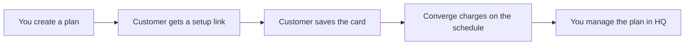
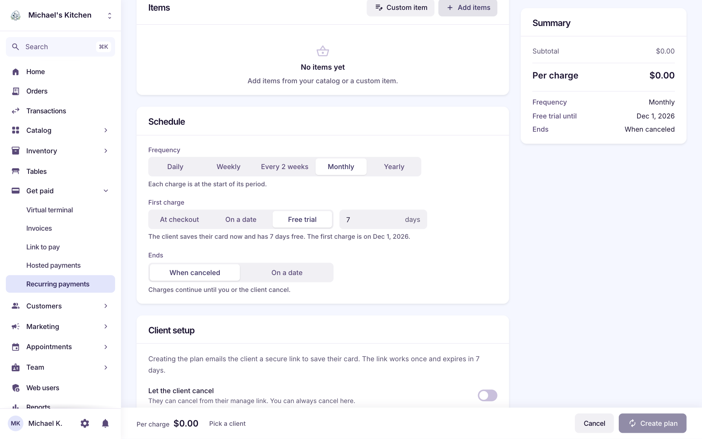
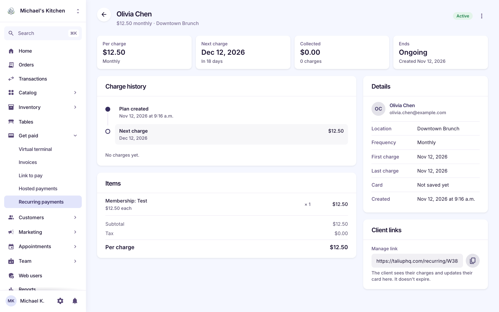
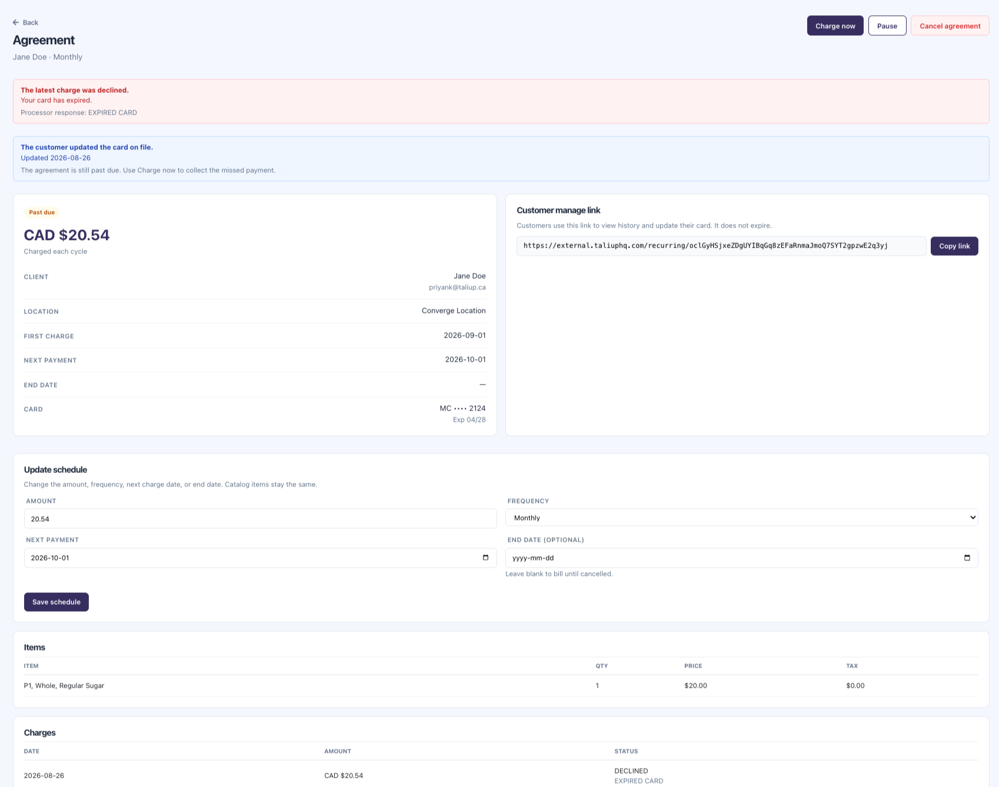
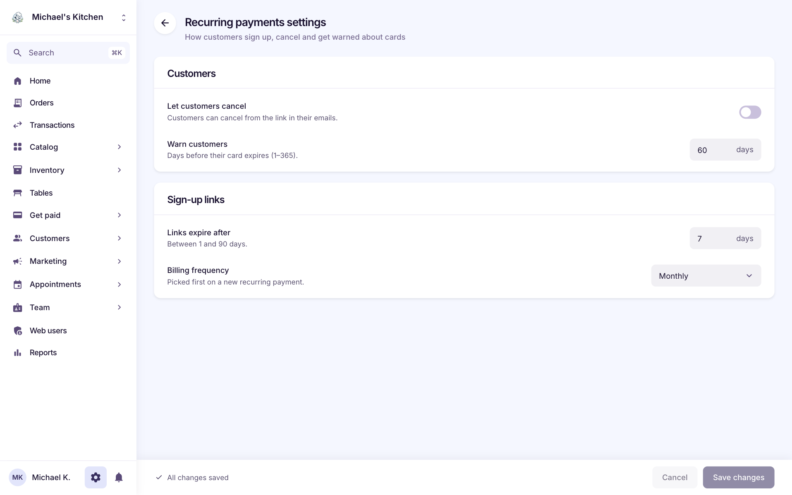

Recurring Payments lets you bill a customer on a schedule. You create a plan in Taliup HQ, the customer gets a secure link to save their card, and Elavon Converge charges the card on the schedule you set.

Open **Get paid** → **Recurring payments** in the side menu.

<Frame caption="The Recurring payments list with totals, plan tabs, search, and plan rows.">
  
</Frame>

<Note>
  [Memberships](/taliup-hq/features/memberships) bill through Recurring Payments. Each membership sign-up creates a plan on this page, and its emails to the client are worded as the membership.
</Note>

---

## Prerequisites

<Steps>
  <Step title="Recurring Payments enabled">
    The **Recurring Payments** feature must be enabled on the entity plan. Enabling it also turns on **Hosted Payment Solution** and **Clients**. Ask your ISO admin to enable it in [Plans & Features](/taliup-hq/onboarding/plans-features) if you do not see **Recurring payments** in the side menu.
  </Step>
  <Step title="Permissions">
    **View Recurring Payments** lets a user see plans. **Manage Recurring Payments** lets them create plans and resend, retry, pause, resume, or cancel them. Opening the settings needs **Manage Settings**.
  </Step>
  <Step title="Elavon Converge on a location">
    At least one location must have an active **Elavon Converge** online payment gateway. Locations on other processors stay available for everything else. See [Locations](/taliup-hq/onboarding/locations).
  </Step>
</Steps>

If Converge is missing, the page shows **Elavon Converge needed** and you cannot create plans.

---

## How it works

- If the first charge is **At checkout**, the card is charged for the first cycle when the customer saves it, and the schedule starts.
- If the first charge is **On a date**, or you offer a **Free trial**, the customer saves the card only. Charging starts on the first-charge date.
- Later cycles are collected by Converge. Taliup HQ syncs status, next date, and charge history.

---

## Plans list

When you have no plans yet, the page shows **No recurring payments yet** and a **New plan** button.

Use **New plan** once Converge is available. Use **Settings** for defaults that apply to new plans.

The tiles at the top show:

| Tile | What it shows |
|---|---|
| **Monthly recurring** | What your billing plans bring in per month |
| **Collected, last 30 days** | Total charged in the last 30 days, and the number of charges |
| **Next charge** | The date, amount, and client of the next scheduled charge |
| **Needs attention** | Plans to look at. Click the tile to open that tab |

Tabs:

| Tab | What it includes |
|---|---|
| **All** | Active plans and plans awaiting setup |
| **Needs attention** | Past due, grace period, paused, an expired setup link, or a card that is about to expire |
| **Active** | Plans that are billing, including scheduled plans and free trials |
| **Awaiting setup** | Waiting for the customer to save their card |
| **Closed** | Ended, canceled, or setup failed |

Search by client name, email, or amount (`100` or `$100`). Results update as you type. **Reset** clears the search and keeps the tab you are on.

Each row shows the client, the amount and frequency, the status (with any alert, such as **Card expiring soon**), and the next charge. Click a row to open the plan. The row menu has **Open plan**, plus **Copy setup link** (awaiting setup) or **Copy manage link** (after setup).

If anything needs a look, the list opens on **Needs attention**.

---

## Create a plan

<Frame caption="The New plan page with client, items, schedule, client setup, and the summary.">
  
</Frame>

<Steps>
  <Step title="Open New plan">
    From **Recurring payments**, click **New plan**.
  </Step>
  <Step title="Choose the client and location">
    Search for a client, pick one from **Recent clients**, or click **New client** to add one. If that email belongs to a deleted client, Taliup asks **Restore this client?** See [Restore a deleted client](/taliup-hq/features/clients#restore-a-deleted-client).
  </Step>
  <Step title="Add items">
    Click **Add items** to pick products and services from your catalog, or **Custom item** for anything that isn't in it. Set quantities and options. Taxes follow the selected location.
  </Step>
  <Step title="Set the schedule">
    Choose the frequency, when the first charge runs, and when the plan ends.
  </Step>
  <Step title="Create plan">
    Check the **Per charge** total, then click **Create plan**. Taliup emails the client a secure link to save their card.
  </Step>
</Steps>

### Client

| Setting | Description |
|---|---|
| **Client** | Required. The setup link is emailed to the client's email. |
| **Location** | The location whose Elavon Converge account takes the charges. Hidden when the entity has only one location. |

If the client has no email, the page shows **This client has no email**. No email goes out. After you create the plan, copy its setup link and send it to the client yourself.

### Items

**Add items** opens your catalog. Items with options need **Choose options** before you can create the plan. For items priced at sale, you enter the price.

**Custom item** adds a one-off item with a **Name**, a **Price**, and its own **Taxes**. Use the row menu to edit or remove an item.

You cannot change the items or the schedule after the plan is created. Create a new plan if it needs to change.

### Schedule

| Setting | Description |
|---|---|
| **Frequency** | **Daily**, **Weekly**, **Every 2 weeks**, **Monthly**, or **Yearly**. Each charge is at the start of its period. The Settings default is picked first. |
| **First charge** | **At checkout** charges the card when the client saves it. **On a date** saves the card now and charges on the date you pick. **Free trial** saves the card now and charges after the trial. |
| **Free trial length** | Shown with **Free trial**. 1–90 days. The hint shows the first-charge date. |
| **Ends** | **When canceled** bills until you or the client cancel. **On a date** stops charges after the **End date**. |

### Client setup

This card explains the setup email and how long the link lasts (default 7 days; change it in Settings).

| Setting | Description |
|---|---|
| **Let the client cancel** | When on, the client can cancel from their manage link. You can always cancel from HQ. Defaults from Settings. |

### Summary

The summary shows the subtotal, each tax, and the **Per charge** total, along with the frequency, the first charge, and when the plan ends. **Per charge** is the amount Converge charges each cycle.

---

## After you create

The plan starts as **Awaiting setup**.

<Frame caption="A plan page with its totals, charge history, items, details, and client links.">
  
</Frame>

The plan page shows:

- Tiles for **Per charge**, **Next charge** (or **Free trial ends**), **Collected**, and **Ends**.
- **Charge history**: when the plan was created, each charge with its status, and the next charge.
- **Items** with the subtotal, tax, and per-charge total.
- **Details**: the client, location, frequency, first and last charge, the card on file and its expiry, and when the plan was created or canceled.
- **Client links**: the **Setup link** before setup, and the **Manage link** after.

| Action | When it appears |
|---|---|
| **Resend setup email** | Awaiting setup, the setup link is still valid, and the client has an email |
| **Copy setup link** / **Copy manage link** | In **More actions**: the setup link before setup, or the manage link after |
| **Cancel plan** | In **More actions**: stops a pending setup, or stops future charges on a running plan |

The setup link works once and expires after the link window. An expired link cannot be resent. The plan shows **The setup link expired**. Cancel it and create a new plan if the customer still needs to set up.

After the customer saves their card:

- A charge appears under **Charge history** when the first charge is **At checkout**. With **On a date** or a **Free trial**, the card is saved and nothing is charged yet. The status shows **Scheduled** or **Free trial** until the first charge.
- The status moves to **Active**.
- The **Manage link** appears. It does not expire. Customers use it to see their charges, update their card, and cancel if you allowed it.

If the customer cancels, or you cancel from HQ, the plan shows **Canceled** plus who canceled: **By the client**, **By your business** or the name of the person who canceled it, or **Automatically**.

---

## Statuses

| Status | Meaning |
|---|---|
| **Awaiting setup** | Waiting for the customer to save their card |
| **Scheduled** | The card is saved and the first charge is on a later date |
| **Free trial** | The card is saved and the free trial is running |
| **Active** | Schedule is running |
| **Past due** | A scheduled charge failed. The schedule is still on file |
| **Grace period** | Converge is in its retry window after a failed charge |
| **Paused** | You paused the plan. Future charges are stopped |
| **Ended** | The end date was reached |
| **Canceled** | You or the customer canceled. Past charges stay captured |
| **Setup failed** | The plan couldn't be set up with Converge. The customer needs a new plan |

---

## Retry charge

**Retry charge** appears only on **Past due** or **Grace period** plans that already have a Converge schedule.

It collects one missed payment now. It does not wait for the next scheduled date. It is not available on **Active**.

<Steps>
  <Step title="Open the plan">
    Open a **Past due** or **Grace period** plan.
  </Step>
  <Step title="Retry charge">
    Click **Retry charge**. Check the amount and the card's last four digits.
  </Step>
  <Step title="Skip the next scheduled charge">
    The switch **Skip the charge on {date}** is on by default when that date is today or tomorrow. Leave it on if you do not want Converge to charge again on that date. Turn it off if you still want the regular cycle to run. Then click **Retry charge** in the dialog.
  </Step>
</Steps>

If the card approves, Taliup shows **The missed payment was collected.** Status returns to **Active** when the next Converge date is in the future. It can stay **Past due** if that next date is still today or in the past.

If the card declines, the plan stays past due. The customer and merchant get decline emails. Try again after the customer updates the card, or on the next scheduled attempt.

The receipt for a retried charge tells the customer this is a missed payment collected today. Regular cycle receipts name the billing period instead.

---

## When a charge declines

A red notice on the plan reads **The last charge was declined**. It explains the reason and can include the processor response.

Taliup emails you and the customer. The customer can open the manage link and click **Update payment method**. Updating the card does not collect the missed payment by itself.

<Frame caption="A past-due plan after the customer updated the card. Retry charge is available.">
  
</Frame>

After the customer updates the card, a blue notice shows **The client updated their card** and the date. If the plan is still past due, it reminds you to retry the charge.

The notice stays until either:

- Status is **Active** again, or
- A successful charge is collected at or after the card update (**Retry charge** or the next scheduled sale)

---

## Pause, resume, and cancel

| Action | What it does |
|---|---|
| **Pause** | In **More actions** on Active, Past due, and Grace period plans. Converge stops future charges until you resume. |
| **Resume** | On Paused plans. Scheduled charges start again from the next charge date. |
| **Cancel plan** | In **More actions**. Stops future charges. Past charges aren't refunded. On a plan awaiting setup, it only disables the setup link. |

Each of these asks you to confirm first. **Go back** closes the dialog without changes.

Customers can cancel from the manage page only when **Let the client cancel** is on for that plan. They confirm in a sheet, then the page shows who canceled.

You cannot change the amount, frequency, or dates after setup. That needs a new customer authorization. Create a new plan if it must change.

---

## Settings

From the Recurring payments list, click **Settings**. You can also open **Settings** → **Recurring payments**.

<Frame caption="Recurring payments settings for customers and sign-up links.">
  
</Frame>

| Setting | Description |
|---|---|
| **Let customers cancel** | Default for new plans. You can still change it on each new plan. Off by default. |
| **Warn customers** | How many days before a card expires the plan is flagged under **Needs attention** (1–365, default 60). |
| **Links expire after** | How long the setup link stays valid (1–90 days, default 7). Expired links cannot be resent. |
| **Billing frequency** | The frequency picked first on **New plan**. |

Click **Save changes**.

---

## What customers see

Customers do not log in to Taliup HQ.

- **Setup link** — one-time page to pay today, or to save a card when the first charge is later or a trial is on. The page follows the entity language. Customers can switch to English, French, or Mexican Spanish. They must check **I authorize {merchant} to charge my card…**
- **Manage link** — does not expire. Customers can view the schedule, charge history, and **Update payment method**. **Cancel recurring payment** appears only if you allowed it. They confirm in a sheet, then can go back. The page uses the same language dropdown.

Share either link from the plan page. The manage link is also in customer emails after setup.

---

## Emails

| Email | When it sends |
|---|---|
| Setup invitation | When you create a plan, and when you click **Resend setup email**. It says whether they pay today or only authorize a card. |
| Receipt | After a successful cycle or a retried charge |
| Payment declined | After the latest charge fails — sent to you and the customer |

Emails go out in the business's language. For a membership, they name the membership plan.

Ask the customer to check junk if an invitation is missing. Confirm the client email on the plan before you resend.

---

## Troubleshooting

### Recurring payments is not in the side menu

Ask your ISO to enable **Recurring Payments** on the entity plan. It requires **Hosted Payment Solution** and **Clients**. You also need the **View Recurring Payments** permission.

### You cannot create a plan

Add an active Elavon Converge gateway to at least one location. You also need the **Manage Recurring Payments** permission.

### Customer did not get the setup email

1. Confirm the client email on the plan.
2. Ask them to check junk.
3. Use **Resend setup email** if the link is still valid, or **Copy setup link** and send it yourself.
4. If the link expired, create a new plan.

### Setup link expired or is no longer available

The setup link is single-use and expires after the link window. Create a new plan for a fresh link.

### Latest charge was declined

Send the customer the manage link so they can update the card. Then use **Retry charge** if you need the missed payment now. The next scheduled attempt still runs unless you skip it from **Retry charge**.

### Retry charge is missing

The plan must be **Past due** or **Grace period**, and setup must have already created the Converge schedule. Plans awaiting setup and active plans do not show **Retry charge**.

### Card was updated but the plan is still past due

Updating the card does not collect the missed payment. Use **Retry charge**, or wait for the next scheduled charge.

### Setup failed

**Setup failed** plans sit under **Closed**. The customer needs a new plan and a new setup link.

### Customer wants a different amount or frequency

You cannot change the schedule after setup. Cancel the current plan if needed, then create a new one.

### Customer wants to stop billing

Use **Cancel plan**, or ask them to tap **Cancel recurring payment** on the manage page if you allowed it. Pause if you only need to stop charges temporarily.

---

## Related

- [Memberships](/taliup-hq/features/memberships)
- [Clients](/taliup-hq/features/clients)
- [Hosted Payments](/taliup-hq/features/hosted-payments)
- [Locations](/taliup-hq/onboarding/locations)
- [Plans & Features](/taliup-hq/onboarding/plans-features)
