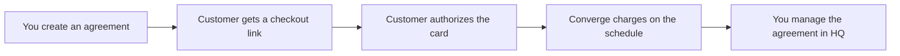

Recurring Payments lets you bill a customer on a schedule. You create an agreement in Taliup HQ, send a hosted checkout link, and the customer authorizes their card. After that, Elavon Converge charges the card on the schedule you set.

Open **Recurring payments** in the merchant sidebar.

---

## Before you start

<Steps>
  <Step title="Recurring Payments enabled">
    The **Recurring Payments** feature must be enabled on the entity plan. Enabling it also turns on **Hosted Payment Solution** and **Clients**. Ask your ISO admin to enable it in [Plans & Features](/taliup-hq/onboarding/plans-features) if you do not see **Recurring Payments** in the sidebar.
  </Step>
  <Step title="Elavon Converge on a location">
    At least one location must have an active **Elavon Converge** online payment gateway. Locations on other processors stay available for everything else. See [Locations](/taliup-hq/onboarding/locations).
  </Step>
  <Step title="A client for the plan">
    Choose a [client](/taliup-hq/features/clients). A valid email lets HQ send the invitation. For an existing client without email, copy the setup link after creating the plan and share it yourself.
  </Step>
</Steps>

If Converge is missing, the list shows **Elavon Converge needed** and you cannot create agreements.

You need **View Recurring Payments** to open **Recurring payments**. Creating agreements and pausing, resuming, cancelling or charging them need **Manage Recurring Payments**.

---

## How it works

- If the first charge is today and there is no trial, checkout charges that cycle and starts the schedule.
- If the first charge is later, or you offer a free trial, checkout saves the card only. Charging starts on the first-charge date.
- Later cycles are collected by Converge. Taliup HQ syncs status, next date, and charge history.

---

## Find a plan

Use **All** for active plans and plans awaiting setup. **Needs attention** opens first when a plan needs attention, for example after a decline or when a setup link has expired. Search by client name, email or amount. Select a row to open the plan. Its menu offers **Copy setup link** while the invitation is valid, or **Copy manage link** once the client has enrolled.

## Create a plan

1. Open **Recurring payments** and select **New plan**. Choose an existing client, or select **New client** if you have **Manage Clients**. Reusing a deleted client’s email lets you restore the record. When several locations have Converge, choose the one that will collect the charges.
2. Select **Add items** for products or services, or **Custom item** for a one-off item. Set quantities and any required options. Catalog items use their configured taxes. For a custom item, you choose its taxes.
3. Choose **Daily**, **Weekly**, **Every 2 weeks**, **Monthly** or **Yearly**. Under **First charge**, choose **At checkout** to collect when the client saves their card, **On a date** to start later, or **Free trial** for 1–90 days. Choose an end date if charges should stop on a particular day.
4. Review the amount **Per charge** and the **Let the client cancel** setting. Select **Create plan**. HQ emails a one-time setup link when the client has an email address. Otherwise use **Copy setup link** in the plans list to share it.

## After you create

**Awaiting setup** means the client still needs to open the setup link and authorize their card. With **Manage Recurring Payments**, use **Resend setup email** if the link is valid and the client has an email address. If the link expires, cancel the pending plan and create a new one.

When the first charge is due later, the saved card can appear on a **Scheduled** plan or a plan in **Free trial**. Once billing starts, see the individual payments in **Charge history**. The client’s manage link lets them see charges, update their card and cancel if permitted.

## Statuses

| Status | Meaning |
|---|---|
| **Awaiting setup** | The client has yet to authorize their card. |
| **Scheduled** or **Free trial** | The card is saved. The first charge is due later. |
| **Active** | Scheduled billing is running. |
| **Past due** or **Grace period** | A payment was missed. In a grace period, the processor is allowing time to collect it. |
| **Paused** | Future charges are suspended until you resume the plan. |
| **Ended** | The schedule has finished. |
| **Canceled** | Billing has stopped. The plan details show who canceled it. |
| **Setup failed** | Enrollment did not finish. Find the plan under **Closed**. |

## Retry a missed charge

**Retry charge** is available for an enrolled plan that is **Past due** or in **Grace period**. You need **Manage Recurring Payments**. The plan shows the reason for the decline when the processor supplies one.

1. Give the client their manage link if they need to update the card. Updating the card alone leaves the missed payment outstanding.
2. Open the plan, select **Retry charge**, and check the amount and card shown.
3. If there is a next scheduled charge, review **Skip the charge on** and its date. The switch defaults on when the date is tomorrow or earlier. Leave it off to keep the scheduled charge. Select **Retry charge** to confirm the immediate payment.

An approved retry produces a receipt where a client email is available. The plan can still show **Past due** if the next scheduled date has already arrived. If the retry is declined, the missed payment remains outstanding.

## Pause, resume or cancel

- Open **More actions** → **Pause** to stop future charges temporarily on an active, past-due or grace-period plan. Select **Resume** on a paused plan to restart scheduled charges.
- Select **More actions** → **Cancel plan** and confirm to stop future charges permanently. Past charges stay captured. Cancelling a pending plan also disables its setup link.
- To change the amount, frequency or dates after enrollment, cancel the existing plan as appropriate and create a new one so the client can authorize the new terms.

## Settings

Open **Settings** → **Recurring payments** (in the **Features** section), or select **Settings** on the Recurring Payments list. This needs the **Manage Settings** permission.

| Setting | Description |
|---|---|
| **Let customers cancel** | Customers can cancel from the link in their emails. Default for new agreements; you can still change it on each create form. |
| **Links expire after** | How long the first-payment sign-up link stays valid, from 1 to 90 days. Expired links cannot be resent. |
| **Billing frequency** | Picked first on a new agreement. |
| **Warn customers** | How many days before their card expires customers are warned (1–365). |

Select **Save changes**.

---

## What customers see

Customers do not log in to Taliup HQ. The setup page shows the amount and schedule. The customer can choose English, French or Mexican Spanish and must authorize the charges. A charge due at checkout runs immediately. A later start or free trial saves the card for the scheduled date.

The manage link stays valid after enrollment. The customer can see their schedule and charge history and select **Update payment method**. **Cancel recurring payment** appears when the plan allows customer cancellation.

## Emails and troubleshooting

- **Missing invitation.** Check the client’s address and junk folder. Use **Resend setup email** for a valid invitation, or share the setup link directly.
- **Declined payment.** HQ can notify the merchant and the client by email. Share the manage link if a card update is needed, then open the plan to retry the missed charge. A successful scheduled payment or retry sends a receipt when an email address is available.
- **Setup failed.** Look under **Closed**. If the client still needs the plan, create a new one and share its setup link.

## Related

- [Clients](/taliup-hq/features/clients)
- [Hosted Payments](/taliup-hq/features/hosted-payments)
- [Locations](/taliup-hq/onboarding/locations)
- [Plans & Features](/taliup-hq/onboarding/plans-features)
