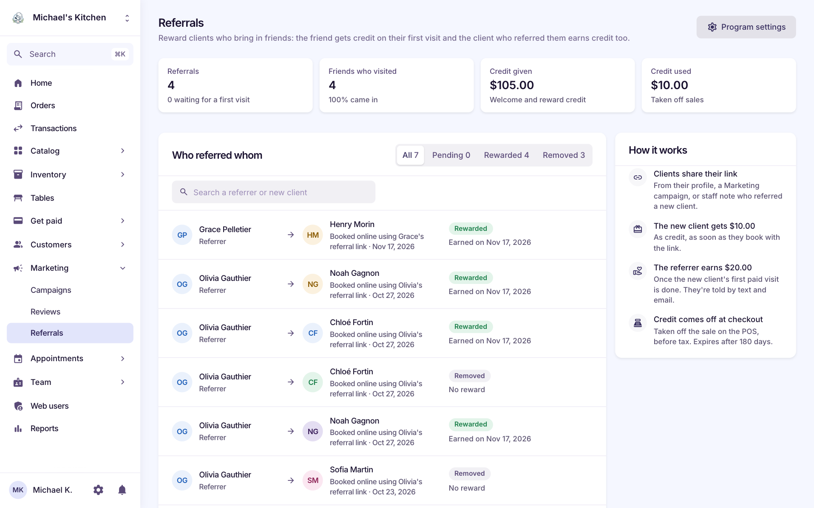

Reward clients who bring in friends. Each client gets a personal referral link. A new client who books through it gets welcome credit, and the client who referred them earns credit once the new client's first paid visit is done.

Credit comes off a sale on Taliup POS as a discount before tax. See [Offers and client credit on Taliup POS](/taliup-pos/register/offers-and-credit).

## How to get here

Sidebar → **Marketing** → **Referrals**. You need the **Referrals** feature and the **Manage Settings** permission.

## Turn on the program

When the program is off, the page shows **The referral program is off**. Clients get no referral link and no credit is given.

<Steps>
  <Step title="Open the settings">
    Click **Program settings** (or **Turn it on**).
  </Step>
  <Step title="Set the rules">
    Turn on **Run a referral program** and fill in the fields below.
  </Step>
  <Step title="Save">
    Click **Save**.
  </Step>
</Steps>

| Field | What it does |
|---|---|
| **New client gets** | Welcome credit for the new client's first visit |
| **Referrer earns** | Credit the referring client earns once the new client's first paid visit is done |
| **Minimum first purchase** | Optional. The first paid visit must come to at least this before the referrer earns. Leave blank for any paid visit |
| **Monthly limit per client** | Optional. How many rewards one client can earn in a month. Extra rewards are paid the next month |
| **Credit expires** | Turn on to make unused credit run out. Set **Expires after**, in days |

## How it works

The **How it works** card on the page sums up your rules:

1. **Clients share their link.** They find it on their profile, you send it in a Marketing campaign with the **Referral link** placeholder, or staff note who referred a new client.
2. **The new client gets their welcome credit** as soon as they book with the link.
3. **The referrer earns their reward** once the new client's first paid visit is done. They are told by text and email.
4. **Credit comes off at checkout** on Taliup POS, before tax.

A first paid visit is a completed sale that is not voided or fully refunded, and that reaches the **Minimum first purchase** when you set one. A booking alone does not earn the reward.

## Program at a glance

| Tile | What it shows |
|---|---|
| **Referrals** | All referrals, and how many are waiting for a first visit |
| **Friends who visited** | Referred clients who came in, and the share who did |
| **Credit given** | Welcome and reward credit |
| **Credit used** | Credit taken off sales |

## Who referred whom

The list shows each referral, newest first: the referrer, the new client, how they joined (booked online with the link, or noted by staff), and the status.

| Status | Meaning |
|---|---|
| **Pending** | Waiting for the new client's first paid visit. The note shows their next appointment, that they missed one, or that none is booked |
| **Rewarded** | The referrer earned their reward, with the date |
| **Removed** | The referral was removed. No reward |

Filter by **All**, **Pending**, **Rewarded**, or **Removed**. Search by referrer or new client. Click the search box to see **Top referrers**, then pick one to see only their referrals.

To remove a pending referral, click **Remove** and confirm. The referrer won't be rewarded, and the new client's unused welcome credit is removed.

## Client credit

Client credit is the welcome and reward credit from referrals, plus any credit staff add by hand.

- On Taliup POS, staff take it off a sale as a **Client credit** discount before tax, up to the sale's pre-tax total.
- Credit is used when the sale completes, soonest-expiring credit first.
- A partial refund gives back the refunded share. A void or full refund gives it all back.
- Emailed receipts show the credit line.
- The calendar's appointment window shows the client's credit balance. Credit is used at checkout on Taliup POS.

## Client profile

In **Clients**, open a client and go to the **Referrals & credit** tab:

| Section | What it shows |
|---|---|
| **Credit** | The client's balance, and when some of it expires |
| **Friends referred** | How many friends they referred, and the credit they earned |
| **Referral link** | Their personal link. Click **Copy** to send it to them |
| **Referred by** | Who referred them, with the referral status. If no one is set, search a client and click **Save** |
| **Friends referred** list | Each friend and their referral status |

Click **Add credit** to give goodwill credit. Enter an amount and an optional reason, then click **Add**. Adding credit, setting who referred a client, and removing a pending referral need the **Manage Clients** permission.

When the program is off and the client has no referrals, the tab shows their credit only, with a note to turn the program on.

The client's **Wallet** tab lists their **Credit history**: referral rewards, welcome credit, credit added by staff, credit used on a sale, credit given back on a refund, expired credit, and credit removed with its referral.

## Related

- [Offers and client credit on Taliup POS](/taliup-pos/register/offers-and-credit)
- [Create and edit a client on Taliup POS](/taliup-pos/clients/create-and-edit)
- [Marketing](/taliup-hq/features/marketing)
- [Clients](/taliup-hq/features/clients)
