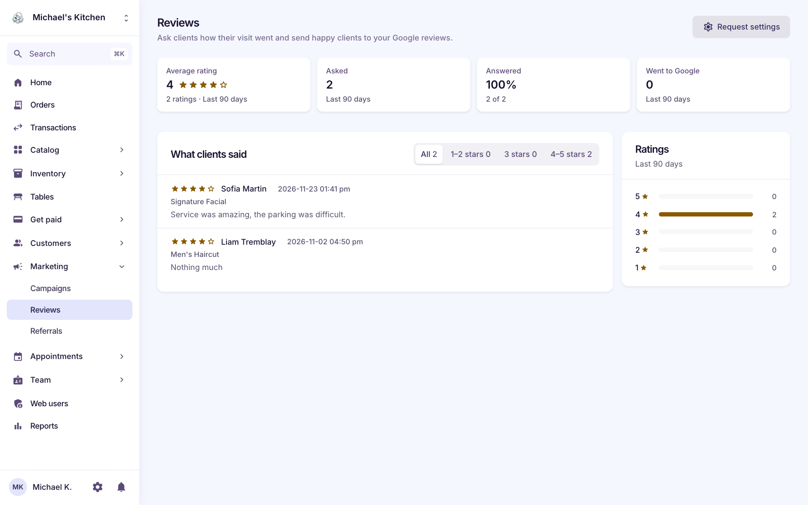

After an appointment, Taliup can text or email the client to ask how their visit went. Clients rate the visit from 1 to 5 stars. Everyone is offered your Google review link, and unhappy clients can first tell you privately what went wrong.

The **Reviews** page shows your ratings, what clients said, and how many went on to Google.

## How to get here

Sidebar → **Marketing** → **Reviews**. You need the **Reviews** feature, which comes with **Calendar**.

| Permission | What it allows |
|---|---|
| **View Reviews** | Open the **Reviews** page and a client's **Reviews** tab |
| **Manage Reviews** | Change the request settings and turn requests on |
| **Manage Clients** | Turn review requests on or off for one client |

**View Reviews** and **Manage Reviews** are under **Marketing** on the roles pages. Roles that had **Manage Settings** got both when they were added. See [Permissions](/taliup-hq/manage/permissions).

## Set up review requests

<Steps>
  <Step title="Open the settings">
    On the **Reviews** page, click **Request settings**. If requests are off, click **Turn on** in the notice instead.
  </Step>
  <Step title="Turn requests on">
    Turn on **Ask clients for a review after their appointment**.
  </Step>
  <Step title="Choose how and when">
    Complete the fields below.
  </Step>
  <Step title="Save">
    Click **Save**.
  </Step>
</Steps>

| Field | What it does |
|---|---|
| **Send by** | **Text**, **Email**, or **Text + email**. With texts, the drawer shows how many texts were used this month |
| **When to send** | How many hours after the appointment, from 1 to 72 |
| **Google review link** | In your Google Business Profile, choose **Ask for reviews** and copy the link |

## When requests go out

- One request per appointment, once the appointment is over and the delay has passed.
- Cancelled appointments and no-shows are skipped.
- A client is asked at most once every 30 days.
- Requests go out only between 9 am and 9 pm. Later ones wait for the morning.
- Clients who opted out, or who have no phone or email to reach, are skipped. Texts aren't sent to clients who replied STOP.

## What clients see

The request links to a short page that asks the client how their visit was. They tap a star to rate it.

| Rating | What happens |
|---|---|
| 4 or 5 stars | The client is thanked and asked to share it on Google with **Leave a Google review**. They can also leave an optional message |
| 1 to 3 stars | The client is first asked to tell you what went wrong. The message goes straight to your team. **Leave a Google review** is still offered |

Google doesn't allow asking only happy clients, so every client is offered your Google link.

Each request also has a link to **Stop these requests**. After that, the client isn't asked again.

## The Reviews page

When requests are off, a notice says **Review requests are off**. Click **Turn on** to start.

| Tile | What it shows |
|---|---|
| **Average rating** | The average star rating and number of ratings, over the last 90 days |
| **Asked** | Requests sent in the last 90 days |
| **Answered** | The share of requests that got a rating |
| **Went to Google** | Clients who opened your Google link in the last 90 days |

**What clients said** lists ratings, newest first, with the service and any message. Filter by **All**, **1–2 stars**, **3 stars**, or **4–5 stars**. **Opened Google** marks clients who clicked through to Google. Click a rating to see it in full, then **Open client** to go to their record.

The **Ratings** card breaks down the last 90 days by star.

## Client profile

A client's record in **Clients** has a **Reviews** tab. It lists their ratings and messages.

The **Review requests** switch turns requests on or off for that client. It saves right away. Clients who stopped requests themselves show as off.

## Related

- [Calendar](/taliup-hq/features/calendar)
- [Clients](/taliup-hq/features/clients)
- [Permissions](/taliup-hq/manage/permissions)
