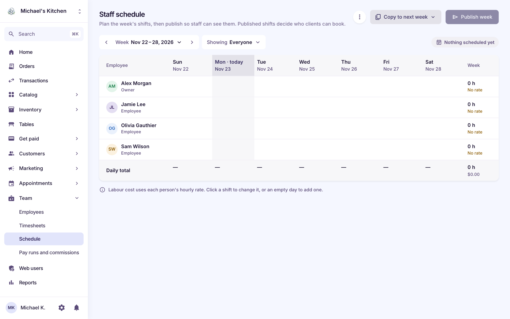

Plan the week's shifts, then publish them so staff can see them. Published shifts also decide who clients can book, and when.

## How to get here

Sidebar → **Team** → **Schedule**. You need the **Employees** and **Employee Scheduling** features and the **View Employees** permission.

Two optional features add more:

| Feature | What it adds |
|---|---|
| **Multi-Week Scheduling** | Plan any week, and copy a week's shifts to the next four weeks |
| **Shift Notifications** | Email staff their schedule when you publish a week |

Ask your ISO or partner if you need either one.

## The week grid

The grid shows one row per employee and one column per day, from Sunday to Saturday. Today is highlighted.

- Each person's row ends with their hours for the week and the labour cost.
- **Daily total** shows the hours and cost for each day.
- Labour cost is hours × each person's hourly rate, to the minute. Someone with no hourly rate shows **No rate**. Set the rate on their [employee profile](/taliup-hq/features/employees).
- Use the week arrows or the week picker to move between weeks. **This week** jumps back to today.
- **Showing** filters the grid to one person, or **Everyone**.

The status under the title tells you where the week stands:

| Status | Meaning |
|---|---|
| **Nothing scheduled yet** | The week has no shifts |
| **Draft · staff can't see this week yet** | Shifts are planned but not published |
| **Published … · changes go live right away** | Staff can see the week. Any change shows at once |

Without **Multi-Week Scheduling**, you can plan this week and next week only. Past weeks are view only.

## Add or edit a shift

Click an empty day to add a shift, or click a shift to change it. A person can have more than one shift a day.

<Steps>
  <Step title="Pick the person and date">
    Choose the **Employee** and the **Date**.
  </Step>
  <Step title="Set the times">
    Pick one of the **Quick times**, or set **Starts** and **Ends**. An end time before the start means the shift ends the next day.
  </Step>
  <Step title="Repeat it (optional)">
    Under **Same shift on (this week)**, tick other days to add the same shift. Days that already have a shift are marked.
  </Step>
  <Step title="Colour and note (optional)">
    Pick a **Colour**, or keep **Their colour**. Add a **Note (optional)**. It shows on the shift and on the staff link.
  </Step>
  <Step title="Save">
    The drawer previews the hours and labour cost. Click **Add shift**, or **Add 3 shifts** (for example) when you repeat it. For an existing shift, click **Save**.
  </Step>
</Steps>

A shift can't start and end at the same time. Shifts that overlap another shift for the same person are refused.

To remove a shift, open it and click **Delete**. On a published week, the change goes live right away.

## Copy a week

With **Multi-Week Scheduling**, click **Copy to next week** and pick one of the next four weeks. Shifts already on that week stay. Shifts that are already there are not copied twice.

## Publish a week

<Steps>
  <Step title="Open the dialog">
    Click **Publish week**. The dialog shows the week's shifts, hours scheduled, people and labour cost.
  </Step>
  <Step title="Let staff know">
    With **Shift Notifications**, choose who gets an email:
    - **Email everyone on this week**
    - **Only people whose shifts changed** since the week was last published
    - **Don't email anyone**

    Only employees with an email on their profile get one. The dialog names anyone without an email so you can share the link another way.
  </Step>
  <Step title="Publish">
    Click **Publish and email** or **Publish**.
  </Step>
</Steps>

Without **Shift Notifications**, publishing doesn't email anyone.

After you publish, the button becomes **Republish**. Use it to send the emails again after changes.

## Print and share

The **More actions** menu has:

- **Print**: prints the week. Labour cost is left out of the printout.
- **Copy staff link**: copies the link to the published week. It only appears once the week is published.

## The staff schedule page

The staff link opens a public **Staff schedule** page for that week. It shows names, shift times and notes only. It never shows pay rates, labour cost or contact details.

- On a computer, the week shows as a roster: people down the side, days across, with each person's hours and shift colours.
- On a phone, staff pick a day and see who's in.

The page shows when the week was published and reminds staff that shifts can change.

## Related

- [Employees](/taliup-hq/features/employees)
- [Timesheets](/taliup-hq/features/timesheets)
- [Pay runs and commissions](/taliup-hq/features/payroll)
