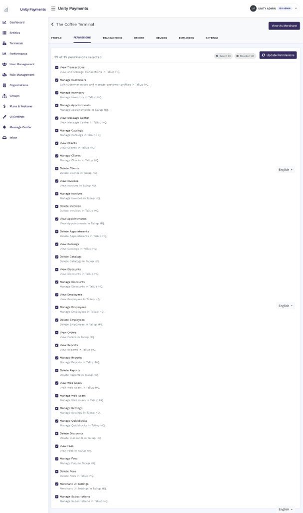

The **Permissions** tab controls which Taliup HQ pages and actions are available to the merchant's **Admin** role.

<Frame caption="The Manage Entity Permissions tab.">
  
</Frame>

<Note>
  The Manage Entity page has seven tabs: Profile, **Permissions**, Transactions, Orders, Devices, Employees, and Settings. This page documents the Permissions tab only.
</Note>

## How to get here

**Entities** → find the Entity → **Manage** → **Permissions** tab.

## How permissions work

Permissions are assigned to the entity's **Admin** role, not to individual users. Every Taliup HQ user who holds the Admin role on this entity gets the role's current permission set. When you save, all of them are updated together.

This tab edits only the Admin role. The merchant manages its other HQ roles in **Web users** → **User Roles & Permissions**, which needs the **Manage Web Users** permission. POS employee permissions are separate; see [Employees](/taliup-hq/merchant/employees).

A permission opens a page only when the merchant's plan also includes the matching feature. For example, **View Invoices** shows **Invoices** only with the **Invoicing** feature.

## Header bar

| Control | Behaviour |
|---|---|
| **X of Y permissions selected** | Live counter. It updates as you check or uncheck items. |
| **Select All** | Checks every permission in the list. |
| **Deselect All** | Unchecks every permission. |
| **Update Permissions** | Saves the current selection. Disabled when no permission is checked. |

## Permissions list

Each row shows a checkbox, the permission name in bold, and a short description. Changes are not saved until you click **Update Permissions**, so you can adjust several permissions in one pass.

### Available permissions

The tab lists these 47 permissions:

| Permission | What it enables |
|---|---|
| **View Transactions** | Open **Transactions**, see product figures on the dashboard, and open **Loyalty** and **Gift cards**. |
| **Manage Customers** | Older permission sent to the Taliup HQ mobile app at sign-in. No Taliup HQ web page checks it; client records use the Clients permissions. |
| **View Orders** | Open **Orders**. |
| **View Reports** | Open **Reports**, report details and **End of day**. |
| **Manage Reports** | Generate and download reports, and generate End of Day documents. |
| **Delete Reports** | Delete reports and generated End of Day documents. |
| **View Web Users** | Open **Web users**. |
| **Manage Web Users** | Invite, edit and delete web users and change their roles. With **Manage Employees**, link employees to HQ accounts. |
| **Manage Settings** | Open the merchant's settings sections, such as **Business details**, **Payments**, **Receipts** and **Devices**, and set up Gift Cards, Loyalty, Campaigns, Referrals and Forms. |
| **Manage Quickbooks** | Connect and use the QuickBooks integration. |
| **Manage Catalogs** | Create and edit catalogs, products, attributes and taxes, including bulk import. |
| **View Catalogs** | Open **Catalogs**, **Products** and the other catalog pages. |
| **Delete Catalogs** | Delete catalogs, products, attributes and taxes. |
| **View Discounts** | Open **Discounts**. |
| **Manage Discounts** | Create and edit discounts. |
| **Delete Discounts** | Delete discounts. |
| **View Fees** | Open **Fees**. |
| **Manage Fees** | Create and edit fees. |
| **Delete Fees** | Delete fees. |
| **View Clients** | Open **Clients**. |
| **Manage Clients** | Create and edit clients. |
| **Delete Clients** | Delete clients. |
| **View Invoices** | Open **Invoices** and **Link to pay**. |
| **Manage Invoices** | Create, edit and send invoices. |
| **Delete Invoices** | Delete invoices. |
| **View Recurring Payments** | Open **Recurring payments**. |
| **Manage Recurring Payments** | Create recurring payment plans, and pause, resume, cancel or charge them. |
| **View Virtual Terminal** | See virtual terminal payments and their details. |
| **Take Virtual Terminal Payments** | Take card, cash and other payments in the virtual terminal, and add notes, receipts and clients to them. |
| **Refund Virtual Terminal Payments** | Refund virtual terminal payments. |
| **View Appointments** | Open **Calendar** and **Waitlist**. |
| **Manage Appointments** | Book and change appointments, and open **Inbox**. |
| **Delete Appointments** | Delete appointments. |
| **View Reviews** | See ratings and what clients said after their appointments. |
| **Manage Reviews** | Turn review requests on or off and change how and when they are sent. |
| **View Packages** | See packages and what clients have left on theirs. |
| **Manage Packages** | Create and change packages, add a package to a client and cancel client packages. |
| **View Memberships** | See membership plans and members, and what members have left this period. |
| **Manage Memberships** | Create and change membership plans, sign clients up and cancel memberships. |
| **Manage Inventory** | Open **Inventory**. |
| **View Employees** | Open **Employees**. |
| **Manage Employees** | Add and edit employees, change POS roles and manage **Timesheets**. With **Manage Web Users**, link employees to HQ accounts. |
| **Delete Employees** | Delete employees. |
| **View Message Center** | Open the **Message center**. |
| **Merchant UI Settings** | Open **Brand hub**. |
| **Manage Subscriptions** | Open the subscription and billing settings. |
| **View Business Analytics** | See business-wide sales totals, the sales chart and employee figures on the Taliup HQ dashboard and in the Taliup HQ mobile app. |

## Saving permissions

Click **Update Permissions** to apply the current selection. On save:

- The Admin role's permissions become **exactly** the checked set. Permissions that are now unchecked are removed.
- Taliup HQ queues a background task for **every user** who holds the Admin role on this entity. The task refreshes the permission list that Taliup HQ checks when a page opens or an action runs.
- A success message confirms the update. If a server error occurs, an error message is shown and no changes are applied.

The change is not instant. The sidebar can show the new set on the next page load, but pages and actions keep using the previous permissions until each user's background task has run, normally within moments. Users do not need to sign out.

<Warning>
  Removing a permission takes effect for every admin user on the entity once the background update runs. Confirm with the merchant before you remove access to critical features such as **View Transactions** or **Manage Settings**.
</Warning>
