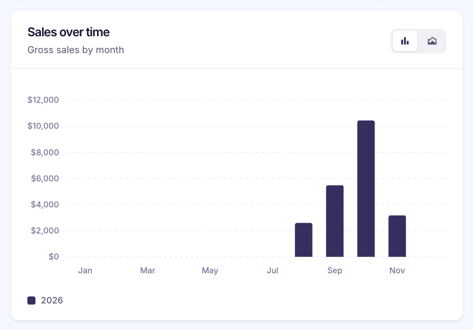
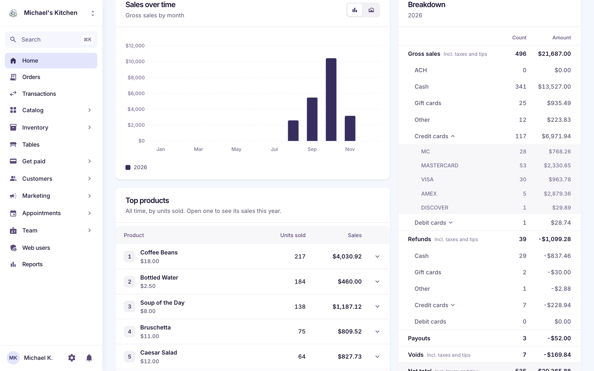
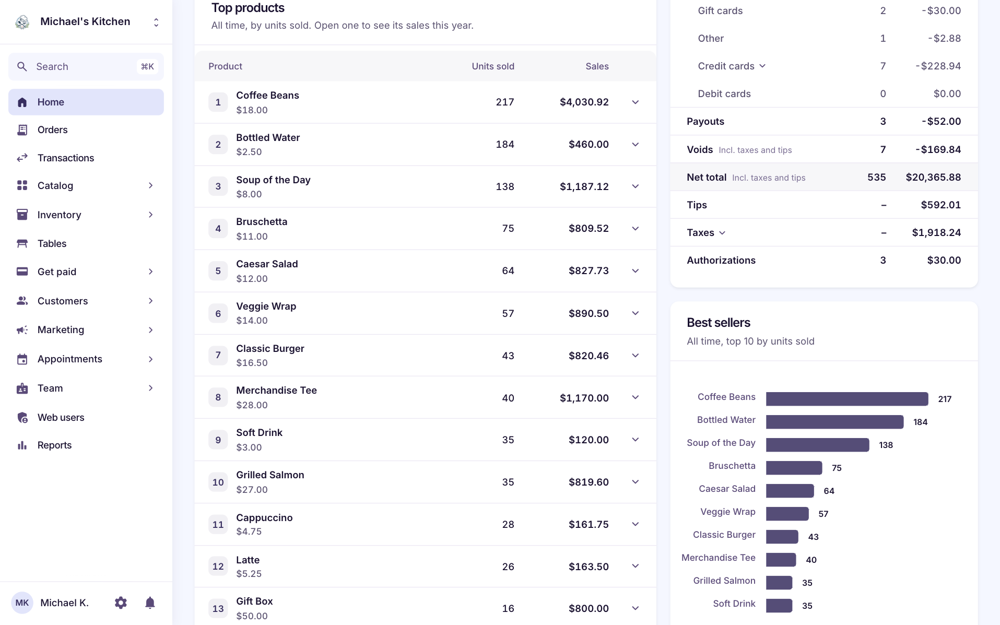
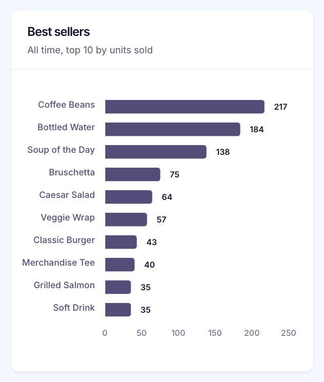
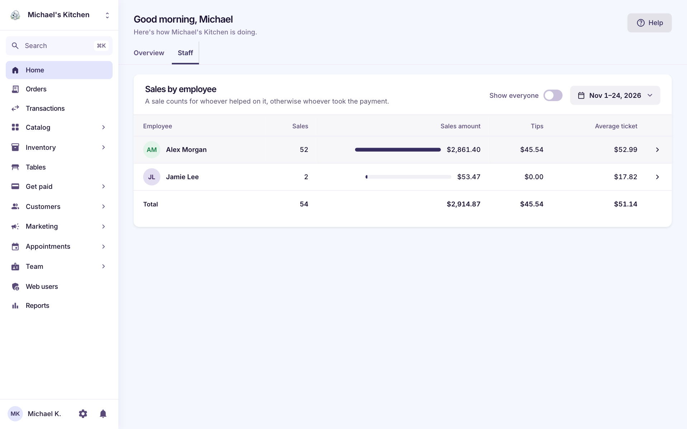
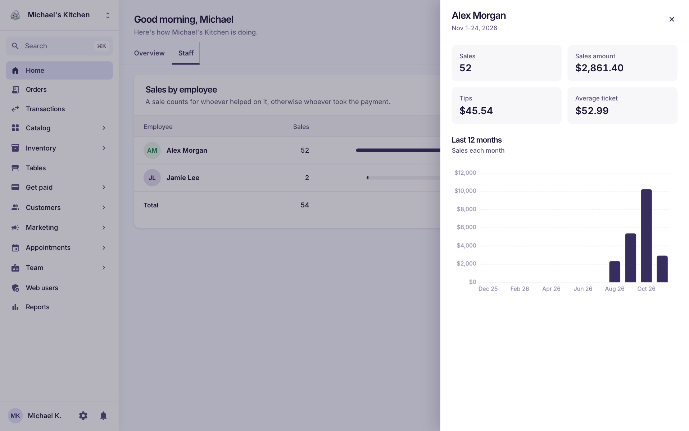

The Dashboard is the home screen for every merchant in Taliup HQ. Open it any time from **Home** at the top of the side menu. It greets you by name and gives you an at-a-glance view of today's appointments, sales, top products, and how each employee is doing — all scoped to your location and timezone.

<Frame caption="The Dashboard Overview tab with the sales tiles, the Sales over time chart, and the Breakdown card.">
  
</Frame>

The dashboard has two tabs: **Overview** and **Staff**. Click **Help** at the top right to open help for this page.

---

## What you see

Each section only appears for people allowed to see it:

| Section | Needs |
|---|---|
| **Today's appointments** | A salon, spa, or clinic business with Calendar on the plan, and the **View Appointments** permission |
| **Sales** tiles, chart, and **Breakdown** | **View Transactions** and **View Business Analytics** |
| **Top products** and **Best sellers** | **View Transactions** |
| **Staff** tab | **View Employees** and **View Business Analytics** |

**Shortcuts** shows for everyone. Someone with none of these permissions sees a welcome message and the shortcuts.

---

## Overview tab

### Today's appointments

Salons, spas, and clinics see today's appointments at the top of the page. The panel refreshes every minute, so statuses stay current through the day.

The tiles count what is **Booked today**, **Done**, and **Still to come**, the **Expected** revenue, and appointments in the **Next 7 days**. Below them, each appointment shows its time, client, service, and staff member, with badges such as **Deposit paid**, **Awaiting payment**, **Confirmed**, **Upcoming**, **In progress**, **Done**, **Cancelled**, or **No-show**.

- Click **Open calendar** to go to the [Calendar](/taliup-hq/features/calendar).
- Click a client's name to open their profile.

### Sales tiles

The **Sales** section covers payments taken in the period you choose, in your business's time zone. Four tiles sit at the top:

<Frame caption="The period picker and the four sales tiles: Gross sales, Net sales, Tips, and Authorizations.">
  
</Frame>

| Tile | What it shows |
|---|---|
| **Gross sales** | Total revenue including taxes and tips |
| **Net sales** | Revenue after refunds and voids, plus the transaction count |
| **Tips** | Total tips received in the period |
| **Authorizations** | Pre-authorized (open tab) total and transaction count |

### Choose the period

The dashboard opens on today. Use the period picker on the right of the **Sales** heading:

| Button | Period | Chart shows |
|---|---|---|
| **Day** | One day | Gross sales by hour |
| **Week** | Sunday to Saturday | Gross sales by day |
| **Month** | One calendar month | Gross sales by day |
| **Year** | One calendar year | Gross sales by month |

Use the arrows to step back or forward one period, or click the date to pick a day, week, month, or year. You cannot go past the current period. When you are looking at an earlier period, click **Today**, **This week**, **This month**, or **This year** to come back.

The tiles, chart, and **Breakdown** all refresh together, without reloading the page.

### Sales over time

The **Sales over time** chart plots gross sales across the period. Hover over the chart to see the exact amount.

<Frame caption="The Sales over time chart, with the previous period beside it and the change between the two.">
  
</Frame>

- The chart compares each period with the one before: a day with the same weekday last week, and a week, month, or year with the previous one. The earlier period shows muted beside the current one.
- The badge at the top shows the change, for example **+12% vs last week**. For a period still in progress, it compares up to the same point in the period.
- For a single day, the chart only shows the hours around your sales.
- Use the two buttons at the top right to switch between **Bars** and **Area**. Your browser remembers your choice.

### Breakdown

The **Breakdown** card is a detailed financial summary of the period, with a **Count** and an **Amount** for each line.

<Frame caption="The Breakdown card, with sales and refunds by payment method, then voids, the net total, tips, taxes, and authorizations.">
  
</Frame>

| Line | Description |
|---|---|
| **Gross sales** | All completed transactions, including taxes and tips |
| — ACH | Bank transfer sales (shown when applicable) |
| — Cash | Cash sales |
| — Gift cards | Gift card sales (shown when you sell gift cards, or when any were used in the period) |
| — Other | Sales tendered as **Other** at the terminal (shown when applicable) |
| — Credit cards | Credit card sales. Click to open the split by card type (Visa, Mastercard, Amex, and so on) |
| — Debit cards | Debit card sales. Click to open the split by card type |
| — EBT | EBT sales (shown for businesses that accept EBT) |
| **Refunds** | Refunded transactions (negative values), split by the same payment methods |
| **Payouts** | Cash payouts recorded at the terminal (shown when there are any) |
| **Voids** | Voided transactions (negative values) |
| **Net total** | Gross sales minus refunds, payouts, and voids |
| **Tips** | Total tips collected |
| **Taxes** | Total taxes collected. Click to open the amount for each tax |
| **Surcharges** | Total surcharge collected (shown when surcharging is on) |
| **Dual pricing markup** | Total dual pricing markup (shown when dual pricing is on) |
| **Authorizations** | Open pre-authorized amounts not yet captured |

### Top products

The **Top products** card lists your 20 best-selling products of all time, ranked by units sold. Custom products are not included.

<Frame caption="The Top products card, with one product opened to show its sales this year by month.">
  
</Frame>

| Column | Description |
|---|---|
| **Product** | Product name and unit price |
| **Units sold** | Total quantity sold |
| **Sales** | Total revenue from this product |
| **In stock** | Current inventory count. Shown for retail businesses that track inventory |

Click a product to open a chart of its sales this year, by month. Click it again to close the chart.

### Best sellers

The **Best sellers** card shows your top 10 products of all time by units sold, as a bar chart with the number sold at the end of each bar.

<Frame caption="The Best sellers card showing the top 10 products by units sold.">
  
</Frame>

### Shortcuts

The **Shortcuts** card gives one-click access to **Products**, **Taxes**, **Timesheets**, **Settings**, and **FAQs**. Products, Taxes, Timesheets, and Settings only show when you can open that page from the side menu.

---

## Staff tab

The **Staff** tab shows **Sales by employee**: each employee's sales, tips, and average ticket over the dates you choose.

<Frame caption="The Staff tab with the Sales by employee table and its date picker.">
  
</Frame>

| Column | Description |
|---|---|
| **Employee** | Employee name |
| **Sales** | Number of transactions attributed to this employee |
| **Sales amount** | Revenue from this employee's transactions, after refunds and voids. The bar compares it with your busiest employee |
| **Tips** | Total tips received by this employee |
| **Average ticket** | Average transaction value |

- The table opens on today. Click the date to pick **Today**, **Yesterday**, **This week**, **Last week**, **This month**, or **Last month**, or set your own **From** and **To** dates and click **Apply**.
- Employees are listed busiest first. Turn on **Show everyone** to also list employees with no sales in those dates.
- When more than one employee is listed, a **Total** row sums the table.

A sale with a [Helped by](/taliup-pos/register/helped-by) employee counts for that employee: its sales, amount, and tip. Without one, it counts for the employee who took the payment. The **Tips** report's employee filter follows the same rule.

### One employee's sales

Click an employee to open their numbers in a side panel: **Sales**, **Sales amount**, **Tips**, and **Average ticket** for the chosen dates, and a **Last 12 months** chart of their sales each month.

<Frame caption="An employee's panel with their totals for the chosen dates and their sales over the last 12 months.">
  
</Frame>

---

## Data scope

All dashboard figures are scoped to your merchant entity and calculated in your entity's configured **timezone**. Days, weeks, months, and years all follow this timezone, so sales that occur near midnight are attributed to the correct local business day. **Top products** and **Best sellers** cover all time, not the period you picked.
