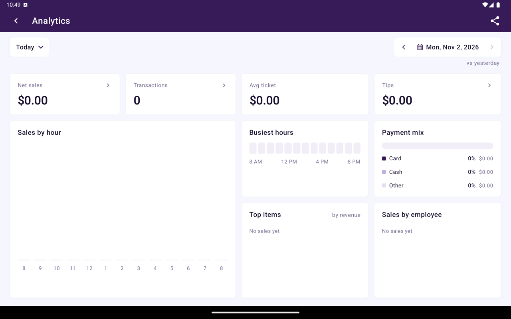

**Analytics** shows sales performance for the location this device belongs to, and lets you share the summary as a PDF.

<Frame caption="Analytics on Taliup POS.">
  
</Frame>

## Before you start

- The **Reports** feature must be enabled for the business in Taliup HQ. Without it, Taliup POS shows a feature access message.
- Your role needs the **View Analytics** permission. Without it, you see *You do not have permission to access Analytics.*
- Analytics loads from Taliup HQ, so the device must be online.

## How to get here

From Home, tap **Analytics**.

## Period

Choose **Today**, **Week**, **Month**, or **Year**. Use **Previous** and **Next** to step through periods. Each figure is compared with the previous period.

## What you see

| Section | What it shows |
|---|---|
| **Net sales**, **Transactions**, **Avg ticket**, **Tips** | Headline figures for the period |
| **Sales by hour** / **day** / **week** / **month** | Sales over the period, with the best one marked |
| **Busiest hours** / **Busiest days** | When sales peak |
| **Top items** | Best sellers by revenue |
| **Payment mix** | Card, cash, and other |
| **Summary** | Gross sales, refunds, voids, payouts, net total, taxes, and each payment method. Amounts include taxes and tips |
| **Sales by employee** | Sales and tips per employee |

Tips count unless the sale was voided or fully refunded. A partial refund keeps its tip.

**Sales by employee** credits each sale and its tip to the sale's [Helped by](/taliup-pos/register/helped-by) employee. Without one, sales go to the cashier and tips to the employee who took the payment.

The figures cover the location this device is assigned to (the whole business when the device has no location). There is no location filter on this screen.

## Share the summary

<Steps>
  <Step title="Open Share">
    Tap **Share** at the top of Analytics. **Share summary** opens.
  </Step>
  <Step title="Choose how">
    - **Scan QR code** — scan it with your phone to open the summary as a PDF. The code works for 15 minutes.
    - **Email** — type an email address and send. Taliup POS shows **Summary sent to [email]**.
  </Step>
</Steps>

## Troubleshooting

| Situation | What to check |
|---|---|
| Permission denied | Ask a manager to add **View Analytics** to your role in Taliup HQ |
| Feature access message | The **Reports** feature is not enabled for the business — see [Get help](/taliup-pos/help/support) |
| **Something went wrong** | Retry; check the network; [get help](/taliup-pos/help/support) if it persists |
