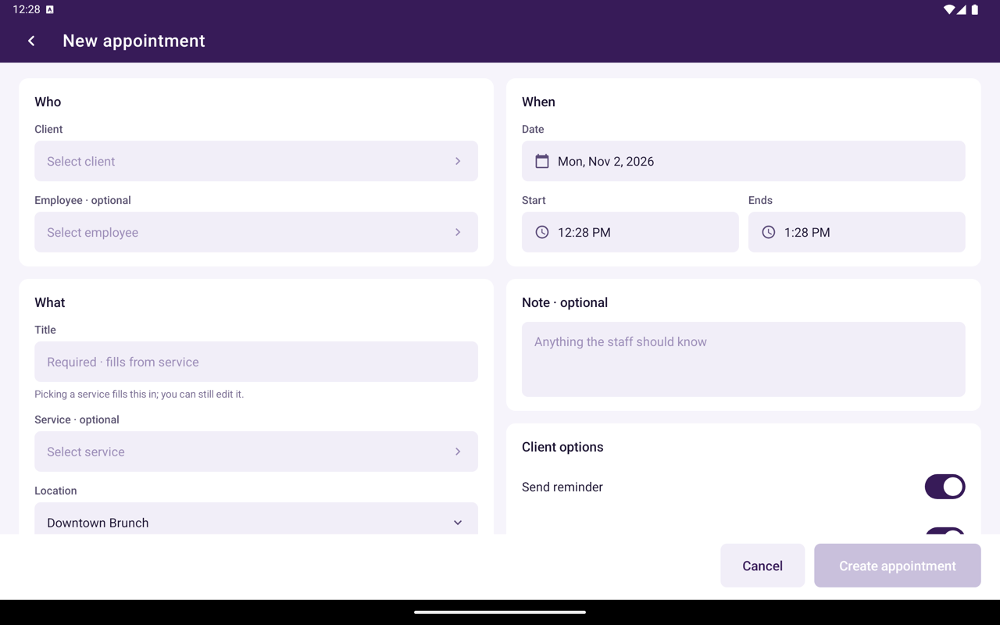

## Before you start

The **Calendar** feature must be enabled for the business in Taliup HQ. Picking a service also needs the **Services** feature.

## Create an appointment

<Steps>
  <Step title="Open a day">
    From **Calendar**, tap a day, then start a new appointment.
  </Step>
  <Step title="Fill in details">
    On **New appointment**, complete the fields below.
  </Step>
  <Step title="Save">
    Tap **Create appointment**.
  </Step>
</Steps>

<Frame caption="New appointment form with Who, What, When, Note, and Client options.">
  
</Frame>

### Fields

| Field | Notes |
|---|---|
| **Location** | The location for the appointment. Taliup POS saves the location you pick |
| **Title** | Required. Picking a service fills it in; you can still edit it |
| **Date** | The appointment day |
| **Start** / **Ends** | End must be after the start. With a service, the end time follows the service duration |
| **Client** | **Select client** |
| **Service · optional** | Requires the **Services** feature |
| **Employee · optional** | **Select employee**, or **Leave unassigned** |
| **Note · optional** | Anything the staff should know |
| **Send reminder** | On / off |
| **Client can confirm** | On / off |
| **Client can cancel** | On / off |

Services can last up to 8 hours. Set the duration on the service in Taliup HQ.

## Time conflicts

When you save, Taliup POS checks whether the employee already has an appointment at that time. If they do, **Time conflict** opens:

| Choice | What happens |
|---|---|
| **Change time** | Go back and pick another time |
| **Book anyway** | Save it. Both appointments overlap on the day view |

## Edit or delete

Tap an appointment to open it.

| Action | How |
|---|---|
| Save changes | Tap **Edit appointment**, change the fields, then **Save changes** |
| Delete | Tap delete, then confirm **Delete this appointment?** The client is not notified automatically |

## Related

- [Clients](/taliup-pos/clients) — client records and client activity **Appointments**
- [Services](/taliup-pos/catalog/services) — service catalog used by the picker
