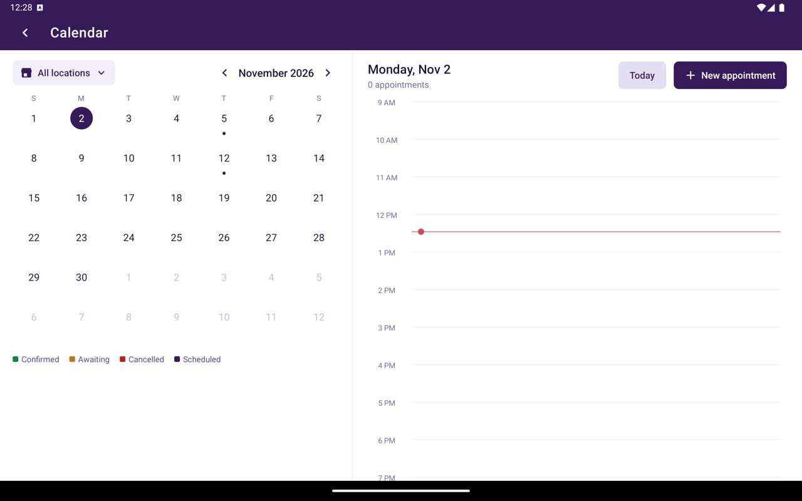

Home tile **Calendar** opens the appointment calendar.

## Before you start

The **Calendar** feature must be enabled for the business in Taliup HQ. If it is not, Taliup POS shows a feature access message. The calendar loads from Taliup HQ, so the device must be online.

<Frame caption="Calendar month grid.">
  
</Frame>

## How to get here

From Home, tap **Calendar**.

## Views

| View | How it works |
|---|---|
| **Month** | Default grid with weekday initials **S M T W T F S**; swipe to change months |
| **Day** | Tap a day to open the day timeline and week strip; swipe weeks |

Use **Today** in the app bar to jump to the current date. In landscape, month and day can appear side by side.

## Location filter

Use the location spinner. First option: **All locations**, then each location name.

## Appointments on the day view

Appointment chips show the appointment **title**. Tap a chip to open it. Create new ones with **New Appointment** — see [Appointments](/taliup-pos/calendar/appointments).

This calendar is for **appointments**, not employee shift scheduling.
