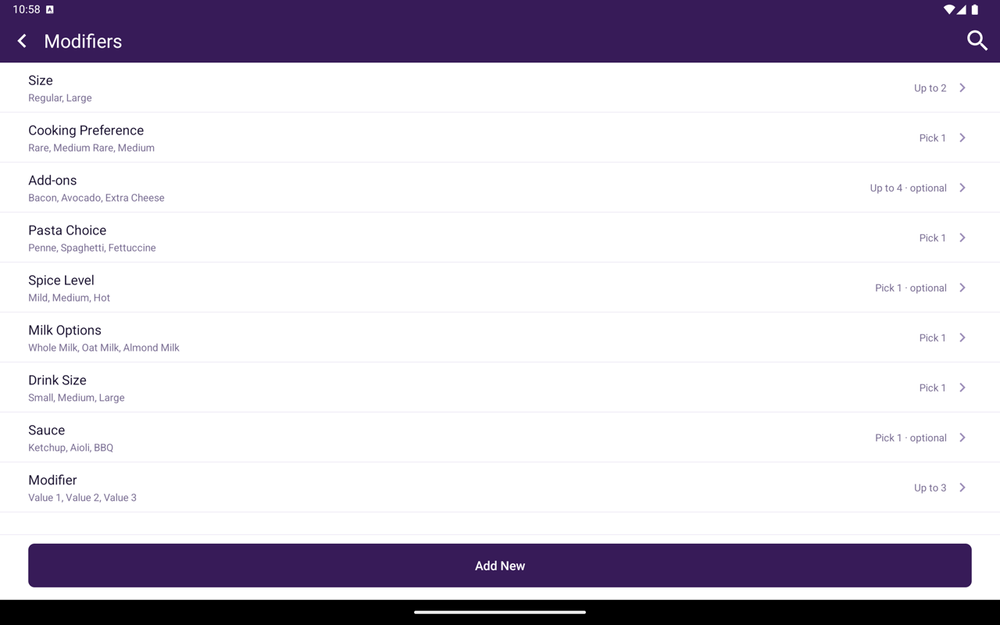

Labeled **Attributes** or **Modifiers** depending on industry type. These are option groups staff select when adding an item in Register (for example size, toppings, or add-ons).

<Frame caption="Attributes/Modifiers list showing Name and Is It Required.">
  
</Frame>

## How to get here

Home → **Menu** / **Catalog** → **Attributes** or **Modifiers**.

## Add an attribute or modifier group

<Steps>
  <Step title="Tap Add New">
    Open the create form.
  </Step>
  <Step title="Configure the group">
    Enter **Name** and **Max.** Choose **Exactly One** or **Combination**, and **Required** or **Not Required**.
  </Step>
  <Step title="Add values">
    Under **Values**, add each option with **Value**, **Price**, quantity +/- controls, and **Single** / **Not Single** as needed. Tap **Add** for more values.
  </Step>
  <Step title="Save">
    Confirm to create the group.
  </Step>
</Steps>

List columns: **Name**, **Is It Required?**

Open a row to edit, save, or delete. Attach groups to products from the product editor’s **Attributes** / **Modifiers** tab.

## Sides

Restaurants that allow half-and-half toppings see a **Sides** switch on each value. Turn it on for options a customer can put on one half of the item, such as pizza toppings. In Register, those options then offer **Left half**, **Whole**, or **Right half**. See [Half-and-half options](/taliup-pos/register/add-items#half-and-half-options-sides).

The switch appears only when **Half Pizza Toppings** is on in Taliup HQ online ordering **Preferences**. Sides work on **Combination** groups only. The same setting is the **Side Selection** column on modifiers in Taliup HQ.
