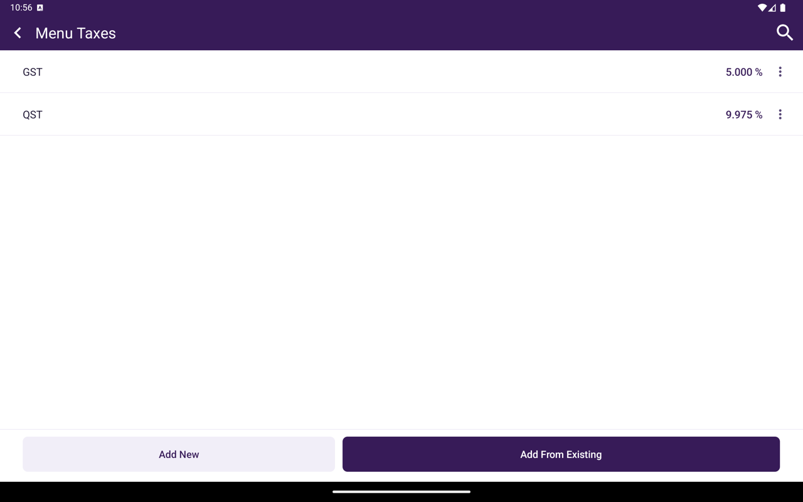

This section is labeled **Menu Taxes** for restaurants and **Catalog Taxes** otherwise. It manages taxes assigned to the current menu/catalog (separate from the global [Taxes](/taliup-pos/catalog/taxes) library).

<Frame caption="Menu/Catalog Taxes list with Name and Value.">
  
</Frame>

## Before you start

Requires the **Catalogs** feature and the **View Catalogs** permission. Adding or removing taxes on the menu or catalog needs **Update Catalogs**. Creating a tax needs **Add Taxes**, editing it **Update Taxes**, and deleting it **Delete Taxes**.

## How to get here

Home → **Menu** / **Catalog** → **Menu Taxes** or **Catalog Taxes**.

## What you can do

| Action | How |
|---|---|
| Search | Filter the list |
| Create | **Add New** — Name, Description, **Percentage** or **Fixed Amount**, Value → Save |
| Add existing | **Add From Existing** |
| Remove assignment | Press and hold → **Remove from Menu** / **Remove from Catalog** |
| Edit / delete tax | Open a tax → edit fields or **Delete** |

List columns: **Name**, **Value**.
