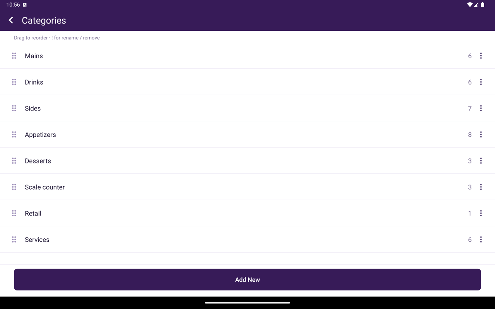

Use **Categories** to group products or menu items so staff can browse them in Register.

<Frame caption="Categories list.">
  
</Frame>

## Before you start

Requires the **Catalogs** feature and the **View Catalogs** permission. Adding, renaming or removing categories and their items needs **Update Catalogs**.

## How to get here

Home → **Menu** / **Catalog** → **Categories**.

## Manage categories

| Action | How |
|---|---|
| Add | Tap **Add New**, enter **Category Name**, confirm |
| Rename | Press and hold → **Rename Category** |
| Delete | Press and hold → **Remove Category**, then confirm |

## Manage items in a category

Open a category to see its items (**Name**, **Price**).

- **Add New** — create a product/item in this category
- **Add From Existing** — attach an existing product/item
- Press and hold → **Remove from Category**
- Search within the category when available

## Related

- [Products / Items](/taliup-pos/catalog/products)
- [Add items in Register](/taliup-pos/register/add-items)
