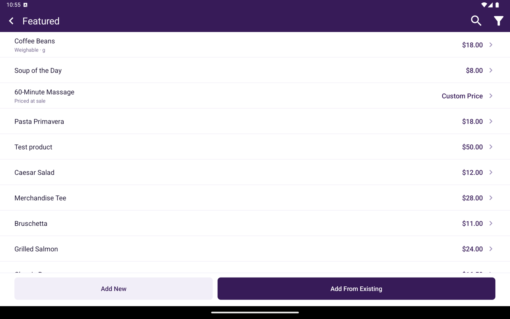

Use **Featured** to choose which products or menu items appear in the featured list used from Register.

<Frame caption="Featured list with Name and Price.">
  
</Frame>

## Before you start

Requires the **Catalogs** feature and the **View Catalogs** permission. Adding or removing featured items also needs **Update Catalogs**; creating a new product needs **Add Products**.

## How to get here

Home → **Menu** / **Catalog** → **Featured**.

## What you can do

| Action | How |
|---|---|
| Search | Use search in the list |
| Create | Tap **Add New**, enter Name, Description, Custom Price, Price, Sku (products), then confirm |
| Add existing | Tap **Add From Existing** and pick an item |
| Remove from featured | Press and hold a row → **Remove from Featured** |

List columns: **Name**, **Price**. Hint: *Press and hold to view item options.*

Editing an item opens the product editor (**General**, **Attributes**/**Modifiers**, **Taxes**) — see [Products / Items](/taliup-pos/catalog/products).
