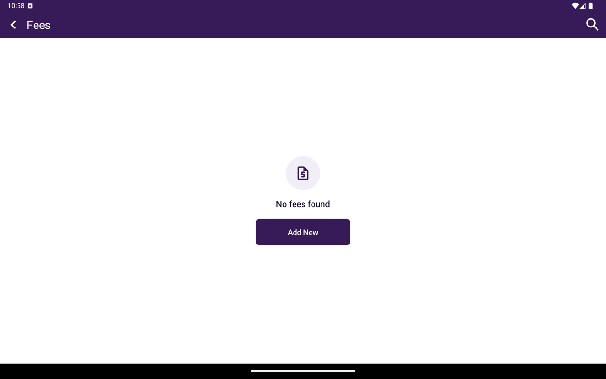

Use **Fees** to define fees staff can apply during a sale.

<Frame caption="Fees list with Name, Value, Applied To.">
  
</Frame>

## Before you start

Requires the **Catalogs** and **Fees** features and the **View Fees** permission. Creating or editing needs **Manage Fees**, and deleting needs **Delete Fees**.

## How to get here

Home → **Menu** / **Catalog** → **Fees**.

## Create a fee

Fees follow the same pattern as discounts:

| Field | Notes |
|---|---|
| **Name** | Required (instead of Disc. Code) |
| Type | **Percentage** or **Fixed Amount** |
| **Value** | Required |
| **Applied Before Tax?** | YES/NO |
| Level | **Order Level** or **Item Level** |
| **Applied Catalog** / **Applied Menu** | Required |
| **Applied Category** | Required for item-level fees |

Use search, **Add New**, edit, or **Delete**. Apply fees from Register [Options](/taliup-pos/register/options) → **Add Order Fees**.
