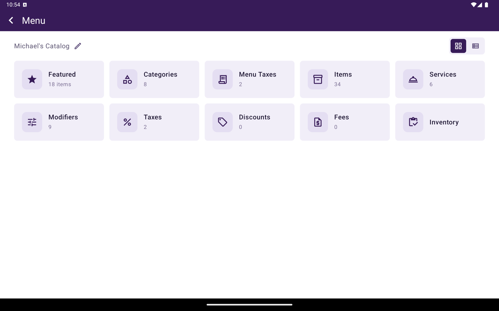

**Menu** (restaurants) and **Catalog** (other industry types) are the same Home section with different labels. Use it to build and maintain what you sell. Selling happens in [Register](/taliup-pos/register).

<Frame caption="Menu/Catalog home grid with all section buttons.">
  
</Frame>

## Before you start

- The **Catalogs** feature must be enabled for the business in Taliup HQ. Without it, Taliup POS shows a feature access message when you tap **Menu** / **Catalog**.
- **Services**, **Discounts**, **Fees** and **Inventory** each need their own feature (**Services**, **Discounts**, **Fees**, **Inventory**). A section whose feature is off shows that the feature is not available.
- Each section also needs role permissions, listed on its page. Renaming the menu or catalog needs **Update Catalogs**.
- The Menu / Catalog section loads from Taliup HQ, so the device must be online.

## How to get here

From Home, tap **Menu** or **Catalog**.

The app bar shows the current menu/catalog name. You can rename it (**Catalog Name** / **Menu Name** → **Rename Catalog** / **Rename Menu**).

## Sections

These match the buttons on the Menu/Catalog grid:

<CardGroup cols={2}>
  <Card title="Featured" href="/taliup-pos/catalog/featured">Highlight items for quick access.</Card>
  <Card title="Categories" href="/taliup-pos/catalog/categories">Organize items into categories.</Card>
  <Card title="Menu / Catalog taxes" href="/taliup-pos/catalog/catalog-taxes">Taxes assigned to this menu/catalog.</Card>
  <Card title="Products / Items" href="/taliup-pos/catalog/products">Create and edit sellable products or menu items.</Card>
  <Card title="Services" href="/taliup-pos/catalog/services">Manage bookable services.</Card>
  <Card title="Attributes / Modifiers" href="/taliup-pos/catalog/attributes">Attributes (retail) or modifiers (restaurant).</Card>
  <Card title="Taxes" href="/taliup-pos/catalog/taxes">Global tax rates.</Card>
  <Card title="Discounts" href="/taliup-pos/catalog/discounts">Discount definitions.</Card>
  <Card title="Fees" href="/taliup-pos/catalog/fees">Fee definitions.</Card>
  <Card title="Inventory" href="/taliup-pos/catalog/inventory">Stock, Sold by / Weighable, raw materials, and units.</Card>
</CardGroup>

## Labels by industry

| Concept | Other industries | Restaurant |
|---|---|---|
| Home title | Catalog | Menu |
| Grid taxes | Catalog Taxes | Menu Taxes |
| Sellable goods | Products | Items |
| Options on items | Attributes | Modifiers |
| Applied spinner | Applied Catalog | Applied Menu |

