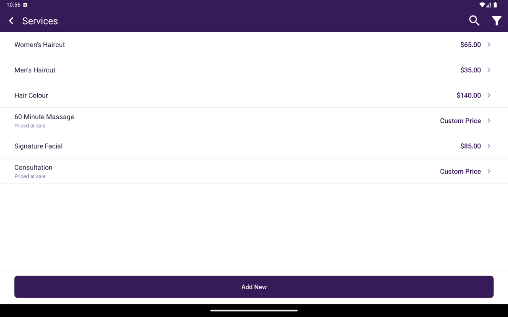

Use **Services** for bookable or service-style offerings.

<Frame caption="Services list.">
  
</Frame>

## Before you start

Requires the **Catalogs** and **Services** features and the **View Products** permission. Creating or editing a service needs **Update Products**.

## How to get here

Home → **Menu** / **Catalog** → **Services**.

## Add or edit a service

| Field | Notes |
|---|---|
| **Name** | Required |
| **Description** | Optional |
| **Custom Price** / **Price** | Same pattern as products |
| **Allow Customers to Book Appointments** | YES/NO |
| **Duration** | **N/A** or 15–120 minutes. Taliup HQ offers longer durations, up to 8 hours |

The edit screen uses **General**, **Attributes**/**Modifiers**, and **Taxes** tabs (SKU is not used for services). Use search and **Add New** on the list (**Name**, **Price** columns).
