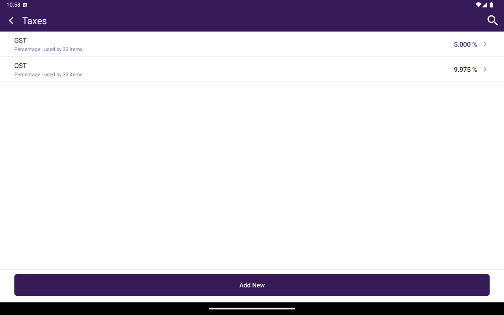

**Taxes** is the global tax library. Assign taxes to a specific menu/catalog from [Menu / Catalog taxes](/taliup-pos/catalog/catalog-taxes), or to individual products from the product editor.

<Frame caption="Taxes list with Name and Value.">
  
</Frame>

## Before you start

Requires the **Catalogs** feature and the **View Taxes** permission. Adding a tax needs **Add Taxes**, editing needs **Update Taxes**, and deleting needs **Delete Taxes**.

## How to get here

Home → **Menu** / **Catalog** → **Taxes**.

## Add or edit a tax

| Field | Notes |
|---|---|
| **Name** | Required |
| **Description** | Optional |
| Type | **Percentage** or **Fixed Amount** |
| **Value** | Required |

Use search, **Add New**, open a row titled **Tax** to edit, or **Delete** after confirmation.

List columns: **Name**, **Value**.
