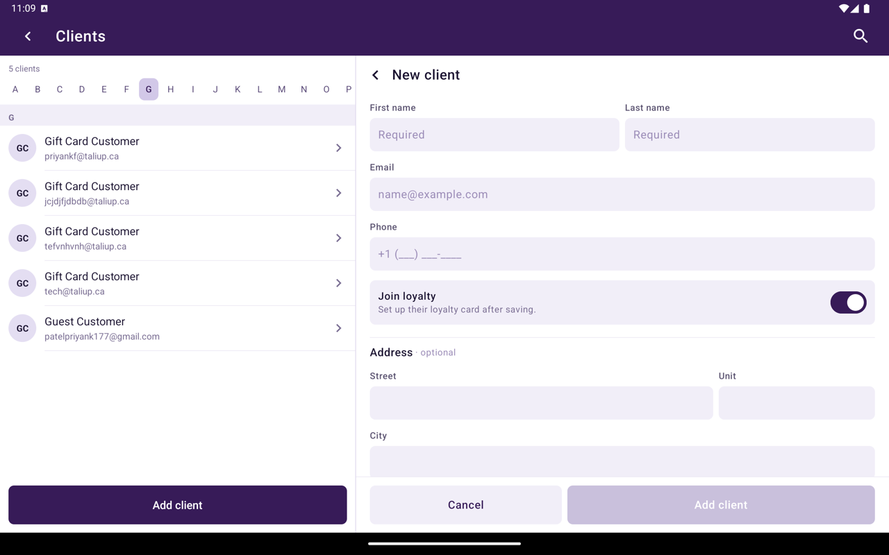
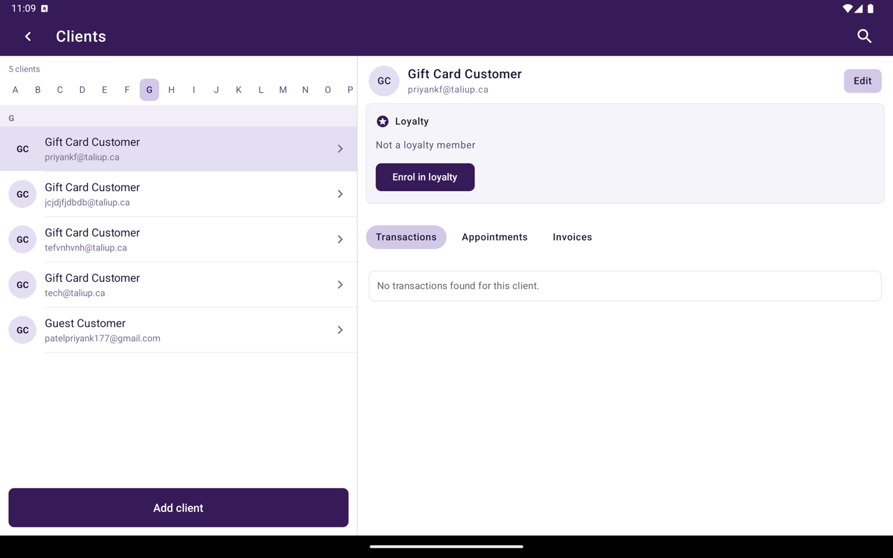

## Create a client

<Steps>
  <Step title="Open Clients">
    From Home, tap **Clients**, then **Add New**.
  </Step>
  <Step title="Enter details">
    On **New Client**, fill in:

    | Field | Required |
    |---|---|
    | **First Name** | Yes |
    | **Last Name** | Yes |
    | **Email** | Yes |
    | **Phone** | No |
    | **Address**, **Unit #**, **City**, **Region**, **Country**, **Postal Code** | No |
  </Step>
  <Step title="Save">
    Tap **Add Client**.
  </Step>
</Steps>

<Frame caption="New Client form.">
  
</Frame>

## Client record

Tap a client to open their record beside the list. **Edit** changes name, contact, and address.

<Frame caption="Client record with Loyalty and Transactions, Appointments, and Invoices.">
  
</Frame>

| Section | What it lists |
|---|---|
| **Loyalty** | Membership, or **Enrol in loyalty** if they are not a member |
| **Transactions** | Sales for this client |
| **Appointments** | Booked appointments |
| **Invoices** | Link to Pay invoices |

Empty sections say no records were found for this client.

If you delete a client in **Taliup HQ** and add them again with the same email, HQ asks to [restore the previous client](/taliup-hq/features/clients#restore-a-deleted-client) so invoices and other history come back.

## Related

- [Attach from Register](/taliup-pos/clients/attach-from-register)
- [Link To Pay](/taliup-pos/link-to-pay)
- [Calendar](/taliup-pos/calendar)
