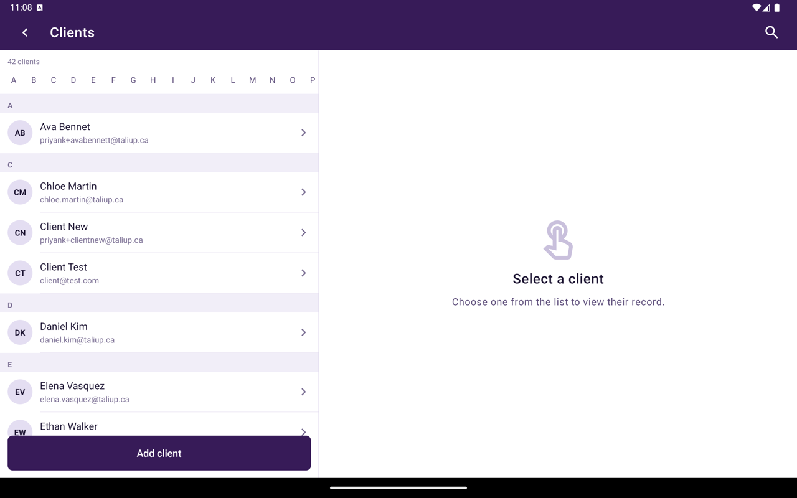

**Clients** stores customer records you can attach to Register orders and review later.

## Before you start

- The **Clients** feature must be enabled for the business in Taliup HQ. If it is not, Taliup POS shows a feature access message.
- Your role needs the **View Clients** permission to see the list. Adding or changing clients needs **Manage Clients**.
- Clients load from Taliup HQ, so the device must be online.

<Frame caption="Clients list. Tap a name to open the record.">
  
</Frame>

## How to get here

From Home, tap **Clients**.

## List

| Element | Details |
|---|---|
| Columns | **Name**, **Email** |
| Search | App bar search |
| Primary action | **Add New** |

Tap a row to open the client portal. See [Create and edit](/taliup-pos/clients/create-and-edit) and [Attach from Register](/taliup-pos/clients/attach-from-register) (including **Past favorites** when that setting is on).
