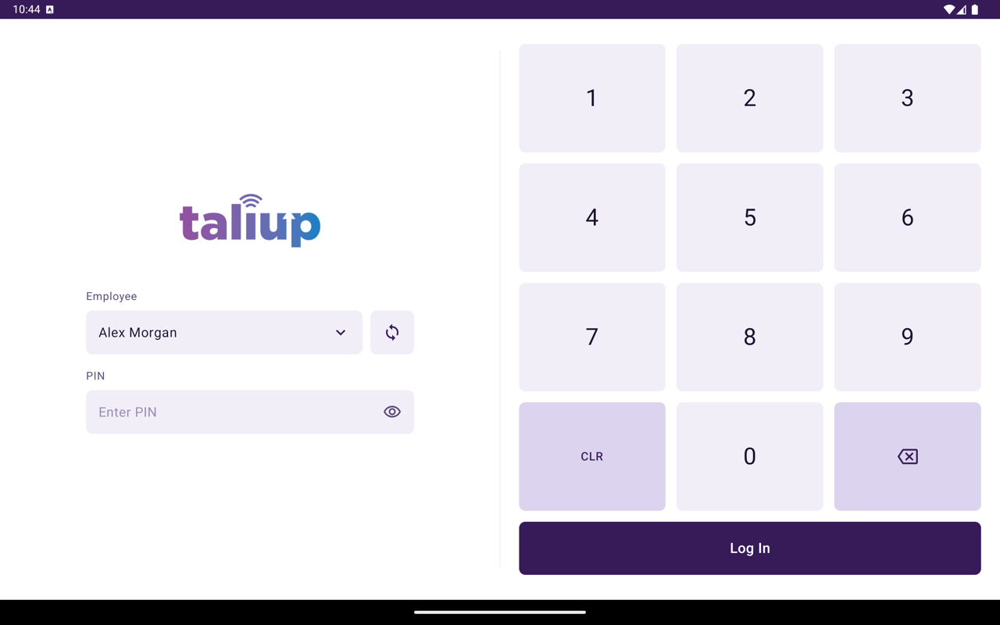

The first time Taliup POS opens on a terminal, it links the terminal to your business and then asks an employee to sign in. Which screens you see depends on the terminal.

<Frame caption="Sign-in screen with the employee list and PIN pad.">
  
</Frame>

## Before you start

- Your business and this terminal are set up in Taliup HQ. Your ISO or partner usually does this.
- At least one employee exists for the business, and you know your PIN.
- The terminal is connected to the internet.

## Set up and sign in

<Steps>
  <Step title="Activate the device (if asked)">
    On PAX terminals installed from PAXSTORE and on Poynt terminals, Taliup POS reads the device identity on its own and skips this step. Otherwise it shows **Enter your Device ID to activate**: type the **Device ID** listed in Taliup HQ → **Devices**, then tap **Next**. See [Activate a device](/taliup-pos/activate-device).
  </Step>
  <Step title="Select the card reader (if asked)">
    If Taliup POS asks you to select your card reader device, choose the reader that takes card payments for this terminal — for an all-in-one PAX A920 Pro, choose **PAX A920Pro** — then tap **Next**. You can change it later in [Device settings](/taliup-pos/settings/device).
  </Step>
  <Step title="Accept the terms (if asked)">
    If your plan requires it, read the **Terms & Conditions**, check **I have read and agree**, and tap **Accept & Continue**. If **Software Subscription Required** appears, scan the QR code with your phone to subscribe, then tap **I've Paid — Verify & Continue**.
  </Step>
  <Step title="Sign in">
    Choose your name under **Employee**, enter your **PIN**, and tap **Log In**.
  </Step>
  <Step title="Continue">
    You land on the [Home screen](/taliup-pos/home-screen), or on Register if this terminal is set to open there.
  </Step>
</Steps>

## Demo mode

When your ISO or partner sets up a demo, the terms or subscription screen has **Enter Demo Mode** in the **⋮** menu. Enter the demo passcode they gave you. Demo payments cannot exceed $1.00. To leave, go to Home → **Settings** → **Tools** → **Exit Demo Mode**.

## Check the setup

Run a small card sale and confirm it appears under **Transactions** and in Taliup HQ. See [Take payment](/taliup-pos/register/take-payment). If the terminal hands payments to a Companion app, check the [Companion connection](/taliup-pos/settings/device#companion-connection) first.

## After you sign in

The first time you sign in after this version is installed, [Getting started](/taliup-pos/settings/getting-started) may open. It walks you through the card reader, receipt printer, a first sale and Settings. Reopen it from Home → **Settings** → **Tools** → **Getting started**.

If the business tracks time, clock in from Home. Clocking in is separate from signing in. See [Clock in and out](/taliup-pos/clock-in-out).

## Troubleshooting

| Situation | What to check |
|---|---|
| The employee list is empty | The terminal is not linked to the business in Taliup HQ, or the business has no employees. Ask your ISO or partner to finish the setup. |
| **Incorrect credentials** | Check that you picked the right employee and PIN, then try again. |
| The device ID is not accepted | Check the **Device ID** in Taliup HQ → **Devices** and that the terminal is online. |
| The terminal returns to **Terms & Conditions** or **Software Subscription Required** | The business's terms or software subscription need attention. Complete the screen, or contact the business owner. |
| The app asks for an update | Install the required version, then reopen Taliup POS. |

For more, see [Troubleshooting](/taliup-pos/help/troubleshooting) or [Get help](/taliup-pos/help/support).

## Next

- [Sign in and out](/taliup-pos/sign-in-and-out)
- [Home screen](/taliup-pos/home-screen)
- [Register](/taliup-pos/register)
