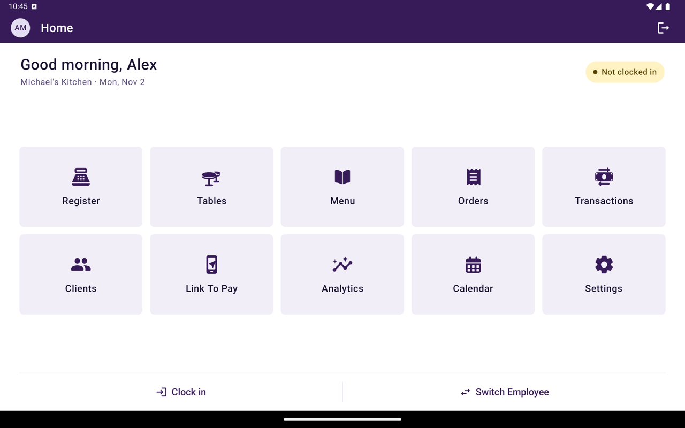

Home is the main screen after you sign in. Each tile opens a section of Taliup POS. Which tiles appear, and whether you can open them, depends on the features your business has and on your role's permissions.

<Frame caption="Home screen tile grid.">
  
</Frame>

## Sections

| Tile | What it is for | Needs |
|---|---|---|
| **Register** | Ring up sales and take payments | Nothing extra |
| **Tables** | Seat guests and manage table orders | **Table Management** feature — the tile is hidden without it. [Tables](/taliup-pos/tables) |
| **Menu** / **Catalog** | Manage what you sell | **Catalogs** feature. [Catalog](/taliup-pos/catalog) |
| **Orders** | Find open or past orders | **Catalogs** feature. [Orders](/taliup-pos/orders) |
| **Transactions** | Search payments, void, refund, reprint, End of Day | **Manage Transactions** permission. [Transactions](/taliup-pos/transactions) |
| **Clients** | Customer records | **Clients** feature. [Clients](/taliup-pos/clients) |
| **Link To Pay** | Payment links | **Link To Pay** feature. [Link To Pay](/taliup-pos/link-to-pay) |
| **Analytics** | Sales charts | **Reports** feature and **View Analytics** permission. [Analytics](/taliup-pos/analytics) |
| **Calendar** | Appointments | **Calendar** feature. [Calendar](/taliup-pos/calendar) |
| **Settings** | Settings for this terminal | Nothing extra. [Settings](/taliup-pos/settings) |

Restaurants see **Menu**; other industry types see **Catalog**.

## When a tile does not open

- **Feature not on your plan** — a **Feature access** sheet explains that the feature is not enabled. When your plan allows add-ons, it says you can add the feature in Taliup HQ from **Settings** → **Marketplace**.
- **Permission missing** — Taliup POS shows **You do not have permission to access** followed by the section name. Ask a manager to update your role. See [Permissions](/taliup-pos/permissions).
- **No internet on a WEB-SRM terminal** — a red offline banner appears and the tiles that need Taliup HQ are dimmed. **Register**, **Orders** and **Settings** stay available. See [Working offline](/taliup-pos/offline).

## Top bar

| Control | What it does |
|---|---|
| Your initials | Opens your profile (**View Profile**), where you can sign out |
| AI assistant icon | Opens the AI assistant. Shown only when the **AI Assistant** feature is on for your business. See [AI assistant](/taliup-pos/help/assistant). |
| **Log Out** icon | Sends Taliup POS to the background. It does not sign you out. |

See [Sign in and out](/taliup-pos/sign-in-and-out).

## Shift and employee actions

Below the greeting, a chip shows **Clocked in** with your shift time, or **Not clocked in**. At the bottom of Home:

- **Clock in** / **Clock out** — records your shift. Available when the business has the **Timesheets** feature. See [Clock in and out](/taliup-pos/clock-in-out).
- **Switch Employee** — hands the terminal to another employee without closing the app.

## App updates

- When a newer optional version exists, a banner shows **New update (v…) is available!**
- When an update is required, a dialog explains how to install it from the PAXSTORE app (**My Apps** → **App Update** → **Update** on Taliup POS). Install it before you continue.

## Next

Start with [Register](/taliup-pos/register) for sales, or [Settings](/taliup-pos/settings) to set up this terminal.
