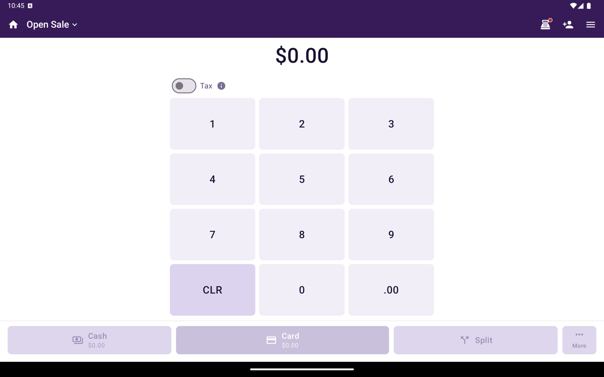

Taliup POS is the point-of-sale application your staff use after the merchant and devices are set up in Taliup HQ. Documentation follows the same sections as the Home screen so you can find topics the same way you open them in the app.

<Frame caption="Taliup POS Register screen.">
  
</Frame>

## Before you start

Your ISO or partner sets up the business in Taliup HQ first:

1. Create the business and its employees
2. Register each terminal
3. Configure the plan, tips and other business settings

See [Taliup HQ](/taliup-hq) for onboarding. When that is done, continue with [First login](/taliup-pos/first-login).

## Browse by Home section

<CardGroup cols={2}>
  <Card title="Register" icon="cash-register" href="/taliup-pos/register">
    Open a sale, add items, take payment, and use the options side menu.
  </Card>
  <Card title="Tables" icon="chair" href="/taliup-pos/tables">
    Seat guests and manage table orders when table management is enabled.
  </Card>
  <Card title="Menu / Catalog" icon="book-open" href="/taliup-pos/catalog">
    Featured, categories, products or items, taxes, discounts, fees, and inventory.
  </Card>
  <Card title="Orders" icon="receipt" href="/taliup-pos/orders">
    Find open or past orders and reopen them in Register.
  </Card>
  <Card title="Transactions" icon="credit-card" href="/taliup-pos/transactions">
    Search payments, void, refund, and reprint receipts.
  </Card>
  <Card title="Clients" icon="users" href="/taliup-pos/clients">
    Create customers and attach them to Register orders.
  </Card>
  <Card title="Link To Pay" icon="link" href="/taliup-pos/link-to-pay">
    Manage payment links, reminders, and recorded payments.
  </Card>
  <Card title="Analytics" icon="chart-line" href="/taliup-pos/analytics">
    Total, itemized, and employee sales charts.
  </Card>
  <Card title="Calendar" icon="calendar" href="/taliup-pos/calendar">
    Create and manage appointments.
  </Card>
  <Card title="Settings" icon="gear" href="/taliup-pos/settings">
    Receipt preferences, Register defaults, printers, card reader, and tools.
  </Card>
</CardGroup>

<Note>
  Restaurants see **Menu**; other industry types see **Catalog**. The features are the same — only the labels change.
</Note>

Some tiles appear only when your business has the matching feature, and some sections need a role permission. See [Home screen](/taliup-pos/home-screen) and [Permissions](/taliup-pos/permissions).

## Get help

- [Troubleshooting](/taliup-pos/help/troubleshooting) — common problems and fixes.
- [AI assistant](/taliup-pos/help/assistant) — ask how to do something in Taliup POS, when your business has it.
- [Get help](/taliup-pos/help/support) — documentation and support contacts.

## Québec merchants — WEB-SRM

After the device is set up, enrol Taliup POS with Revenu Québec's WEB-SRM before you take sales. Taliup POS is the sales recording system (SRS / MEV) for that connection.

[Enrol Taliup POS with WEB-SRM →](/taliup-pos/web-srm)
