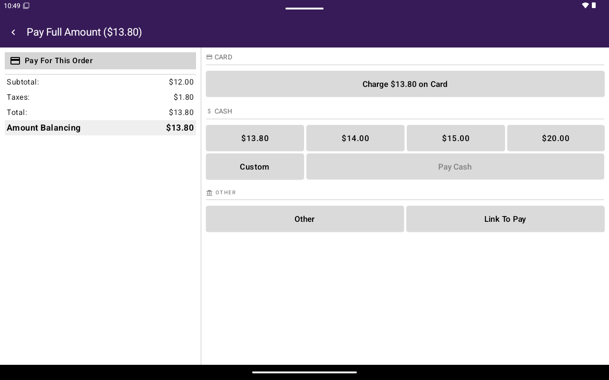

## Before you start

- The **Link To Pay** feature must be enabled for the business in Taliup HQ, with Link To Pay among the merchant's payment types.
- Your role needs the **Manage Link to Pay** permission.
- **Link To Pay** is not offered while a guest payment is in progress on a table order.

## From Register payment

When Link To Pay is enabled for the merchant, the payment screen can show **Link To Pay** under other methods.

<Steps>
  <Step title="Build the sale">
    Add items or an Open Sale amount in [Register](/taliup-pos/register), then tap **Pay**.
  </Step>
  <Step title="Choose Link To Pay">
    Tap **Link To Pay**.
  </Step>
  <Step title="Confirm">
    Confirm sending when prompted (**Link To Pay** / proceed to send to the selected client contact).
  </Step>
</Steps>

Attach a [client](/taliup-pos/clients/attach-from-register) first when the flow requires a customer email or phone.

<Frame caption="Register payment with Link To Pay option.">
  
</Frame>

## New Invoice form (fields)

The POS also includes a **New Invoice** / **Edit Invoice** form used for full invoice creation (also related to HQ invoicing). Key fields:

| Section | Fields |
|---|---|
| Header | **Invoice Number**, **Client**, **Invoice Summary**, **Invoice Message**, **Location** |
| Timing | **Send Invoice Immediately**, **Send Date**, **Due Date** |
| **Items** | **Add Item**, **Edit Attribute** |
| **Total** | **Subtotal:**, **Add Discount**, **Total:** |
| Payment | **Payment Details**, **Recurring Payment**, **Add Link To Pay the Invoice** |
| **Communications** | **Send Invoice Via Email**, **Send Invoice Via Invoice As SMS** |

Footer actions include **draft** and **create invoice** (or **update invoice** / **update draft** when editing).

Validation examples: invoice number, client, and location required; SMS requires the client to have a phone number.

For HQ-side invoicing setup, see [Invoicing](/taliup-hq/features/invoicing).
