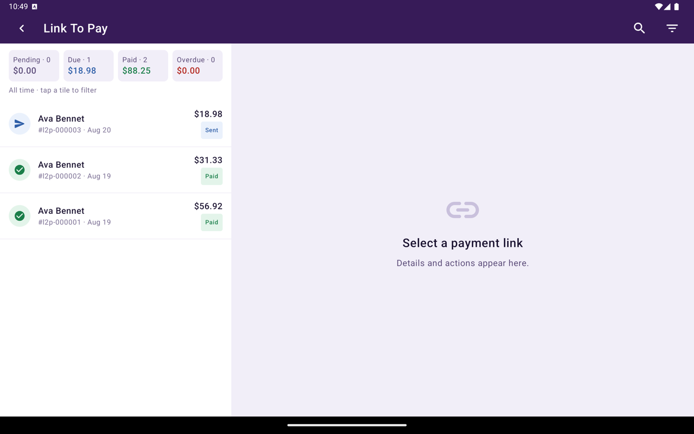

**Link To Pay** lets you review payment links/invoices, resend them, record offline payments, refund, and delete.

## Before you start

- The **Link To Pay** feature must be enabled for the business in Taliup HQ, with Link To Pay among the merchant's payment types. If it is not, Taliup POS shows: **To enable Link To Pay, please contact your Customer Support for details.**
- Your role needs **View Link to Pay** to see the list. Sending, resending and refunding need **Manage Link to Pay**; deleting needs **Delete Link to Pay**.

<Frame caption="Link To Pay list with PENDING / DUE / PAID / OVERDUE summary cards.">
  
</Frame>

## How to get here

From Home, tap **Link To Pay**.

## Summary cards

At the top of the list:

| Card | Meaning |
|---|---|
| **PENDING** | Pending amount / count (all time) |
| **DUE** | Due amount / count |
| **PAID** | Paid amount / count |
| **OVERDUE** | Overdue amount / count |

## List rows

Each row shows created date, client name, `#invoiceNumber`, status, amount, and **Due on …** or **No Due Date**.

Statuses include **DRAFT**, **PENDING**, **SENT**, **PAID**, **OVERDUE**, **REFUNDED**.

Tap a row to expand actions. See [Manage Link To Pay](/taliup-pos/link-to-pay/manage).

## Create

You can send a Link To Pay during Register payment when L2P is available. See [Create and send](/taliup-pos/link-to-pay/create-and-send). Invoices can also be created from Taliup HQ — see [Invoicing](/taliup-hq/features/invoicing).

## Related

- [Clients](/taliup-pos/clients)
- [Take payment](/taliup-pos/register/take-payment)
