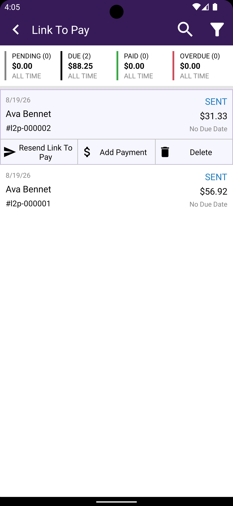

## Before you start

The **Link To Pay** feature must be enabled for the business in Taliup HQ. Each action also needs a role permission:

| Action | Permission |
|---|---|
| Search and filter | **View Link to Pay** |
| **Resend Link To Pay**, **Send Reminder**, **Refund** | **Manage Link to Pay** |
| **Delete** | **Delete Link to Pay** |

## Search and filters

On **Link To Pay**, use search in the app bar, or open **Filter Link To Pay**:

| Section | Options |
|---|---|
| **DATE RANGE** | **From:** / **To:** |
| **CLIENT** | Client spinner |
| Status | **All**, **draft**, **pending**, **sent**, **paid**, **overdue**, **refunded** |

**Reset Filters**, then **Save** or **Cancel**.

## Row actions

Tap a row to expand actions:

| Action | When it appears | What it does |
|---|---|---|
| **Resend Link To Pay** | **SENT** | Resends the payment link |
| **Send Reminder** | **OVERDUE** | Sends a past-due reminder |
| **Add Payment** | **SENT** or **OVERDUE** | Record an offline payment |
| **Refund** | **PAID** | Confirm **Proceed to refund this Link To Pay …?** |
| **Delete** | Always | Confirm **Proceed to deleting this Link To Pay?** |

<Frame caption="Expanded Link To Pay row actions.">
  
</Frame>

## Add Payment

On **Add Payment**:

1. Enter **AMOUNT ($)**.
2. Choose **Payment Method** (**CHEQUE** or **OTHER**).
3. Optional **Notes**.
4. Set **Send Receipt To Customer** (**YES** / **NO**).
5. Tap **Record Payment**.

## Related

- [Create and send](/taliup-pos/link-to-pay/create-and-send)
- [Clients](/taliup-pos/clients)
