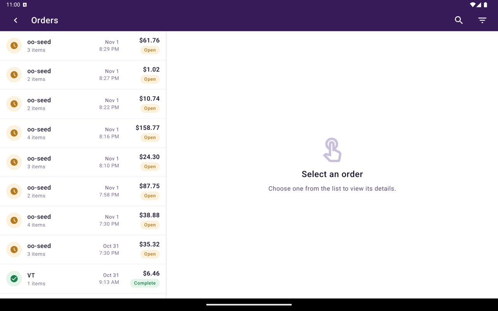

**Orders** lists open and past orders so you can reopen them in Register, cancel open orders, or reprint receipts.

<Frame caption="Orders list with Name, Date/Time, Total, and status chips.">
  
</Frame>

## Before you start

**Orders** is part of the catalog features: it needs the **Catalogs** feature for the business in Taliup HQ. Without it, Taliup POS shows a feature access message.

## How to get here

From Home, tap **Orders**.

## What’s on the list

| Column | Shows |
|---|---|
| **Name** | Order name / identifier |
| **Date/Time** | When the order was created or updated |
| **Total** | Order total |

Rows show status chips such as **Open**, **Complete**, or **Cancelled**.

Use search and [filters](/taliup-pos/orders/find-and-reopen) to narrow the list. Pull down to refresh.

An employee's list includes orders they rang up and orders where they are [Helped by](/taliup-pos/register/helped-by). On an order they only helped on, they see their own payments only.

## Sync sales to QuickBooks

Once [QuickBooks is set up in Taliup HQ](/taliup-hq/merchant/quickbooks), tap **Sync Sales** at the bottom of **Orders**. In landscape, close the order details to see the button. Syncing from the register requires the **Quickbooks** feature and your POS role’s **Quickbooks Sync** permission.

## Common actions

<CardGroup cols={2}>
  <Card title="Find and reopen" href="/taliup-pos/orders/find-and-reopen">
    Search, filter by status, and open an order in Register.
  </Card>
  <Card title="Past order actions" href="/taliup-pos/orders/past-order-actions">
    Print receipts, send to kitchen, and review totals.
  </Card>
</CardGroup>

## Related

- [Register](/taliup-pos/register)
- [Helped by](/taliup-pos/register/helped-by)
- [Receipt barcode](/taliup-pos/register/receipt-barcode)
- [Tables](/taliup-pos/tables)
