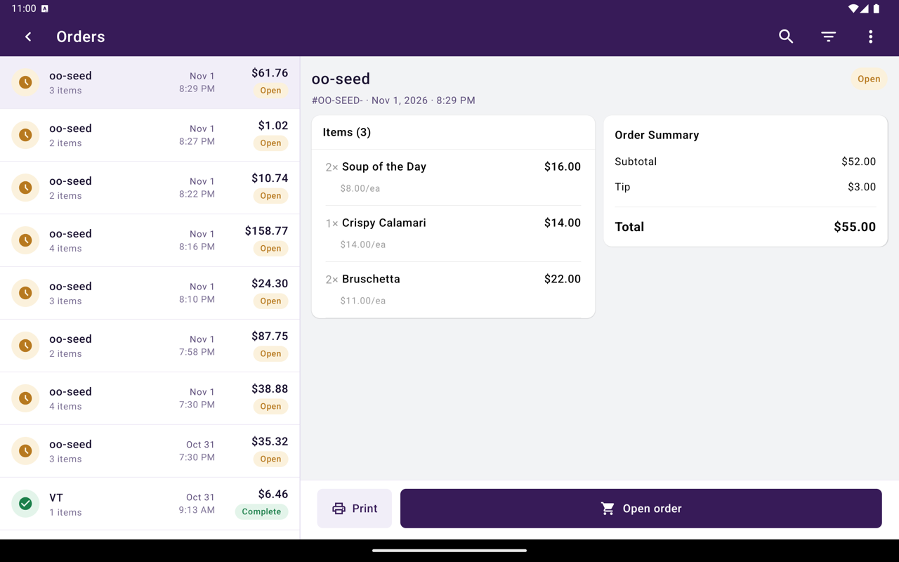

Open any order to review totals and use print actions. Bottom actions like **Open In Register** apply only to open orders — see [Find and reopen](/taliup-pos/orders/find-and-reopen).

<Frame caption="Order Details with totals and print menu.">
  
</Frame>

## Review totals

Order Details can show:

- **Subtotal:**
- Tax, discount, and fee totals
- **Card price adjustment:** (when dual pricing applies)
- **Tip:**
- **Total:**
- Refund / net amounts when applicable
- **Note**

## Print and kitchen

Tap the print control in the header to open receipt options:

| Option | Notes |
|---|---|
| **Print Merchant Receipt** | Merchant copy |
| **Print Customer Receipt** | Customer copy |
| **Send To Kitchen Printer** | Restaurants only |

Printer setup is under [Settings → Printers](/taliup-pos/settings/printers).

<Note>
  On a [WEB-SRM](/taliup-pos/web-srm) device, the print menu offers **Merchant copy** and **Customer copy**, and both are recorded with Revenu Québec. Order Details also offers **Correct Order** on paid orders, and **Cancel order** and **Fail to pay** on open orders. See [Bills and receipts](/taliup-pos/web-srm/billing) and [Cancel, correct, and refund](/taliup-pos/web-srm/cancel-and-correct).
</Note>

## Tip adjust

An **Adjust Tip** control exists in the product for some order/payment scenarios, but it is not currently shown on Order Details. Tip changes that are available today are handled from [Transaction details](/taliup-pos/transactions/details) when tip adjust is enabled and the payment is eligible.

## Related

- [Find and reopen](/taliup-pos/orders/find-and-reopen)
- [Transactions → Reprint](/taliup-pos/transactions/reprint)
