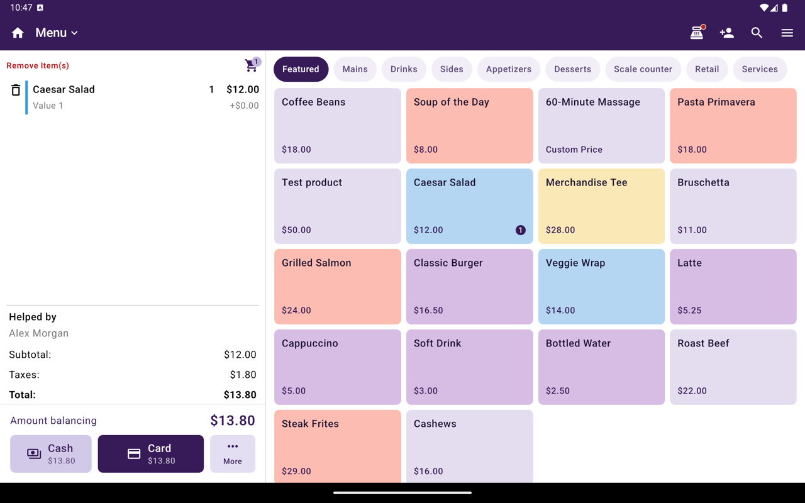

The **Cart** shows everything on the current order before you take payment.

<Frame caption="Register cart with line items and totals.">
  
</Frame>

## How to get here

- Portrait: tap the strip above the tender keys, which shows the item count and total.
- Landscape: the cart panel is often already visible beside Open Sale or Menu/Catalog.
- After adding items, review the cart before you charge the order.

## What the cart shows

Typical summary rows include:

- Subtotal
- Taxes
- Discounts
- Fees
- Surcharge (when configured for the merchant)
- Total

Line items can show status labels such as **Paid** or **Printed** when relevant.

When you set [Helped by](/taliup-pos/register/helped-by) on the sale, the cart shows a **Helped by** block above the totals.

## Edit the cart

| Action | How |
|---|---|
| Edit an unpaid item | Tap the item to reopen the add-to-cart / edit screen |
| Remove one item | Use the delete control on the line, then confirm |
| Remove several items | Tap **Remove Item(s)**, select lines, then **Remove (N)** or **Cancel** |

## Table guests

On table orders, use the guest header to open guest options:

| Scope | Options |
|---|---|
| **Whole Table** | **Move Items**, **Split Items** |
| Individual guest | **Print Bill**, **Pay**, **Move Items**, **Split Items** |

If you try to act on a guest with no items, Taliup POS shows that the guest has no items.

Paying a single guest opens the same payment screen scoped to that guest’s balance. See [Take payment](/taliup-pos/register/take-payment). For step-by-step moving, splitting and individual bills, see [Split a table bill by guest](/taliup-pos/register/guests-and-bills).

## Charge, save or change the order

- The tender keys at the bottom (**Cash**, the card key, **Split**, **More**) charge the order. See [Take payment](/taliup-pos/register/take-payment).
- To keep the order and finish it later, open **Order actions** → **Save Order**.
- To take money off the order or an item, see [Apply discounts](/taliup-pos/register/apply-discounts).
- To attach a client, see [Attach a client from Register](/taliup-pos/clients/attach-from-register).

For bills, kitchen, cancel and other tools, see [Order actions](/taliup-pos/register/options).

## Related

- [Add items](/taliup-pos/register/add-items)
- [Helped by](/taliup-pos/register/helped-by)
- [Scale barcodes](/taliup-pos/register/scale-barcodes)
- [Take payment](/taliup-pos/register/take-payment)
- [Tables](/taliup-pos/tables)
