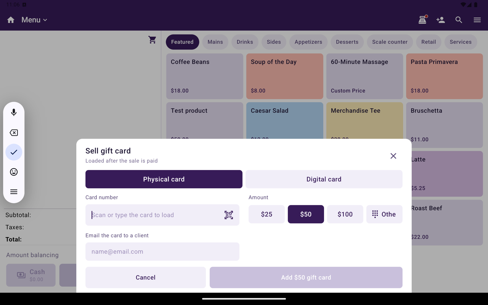

Sell physical or digital gift cards, reload them, check a balance, and accept a gift card as payment. One gift card program covers all of a merchant's locations, so a card sold at one store works at the others.

Gift cards are turned on per location in Taliup HQ. See [Gift Cards in Taliup HQ](/taliup-hq/features/gift-cards).

<Note>
  Gift cards need a connection to Taliup HQ and are unavailable offline. If the location is not activated, Taliup POS shows **Gift cards are not activated for this location.**
</Note>

## Where to find gift card actions

In Register, open **Order actions**. The **Gift Cards** section lists:

| Action | What it does | When it appears |
|---|---|---|
| **Sell gift card** | Adds a new card to the sale | Menu / Catalog, not table orders |
| **Load a batch** | Adds several cards with the same amount | Menu / Catalog, not table orders |
| **Reload gift card** | Adds value to an active card | Menu / Catalog, not table orders |
| **Gift card balance** | Checks a card's balance. Nothing is charged | Always, including Open Sale |
| **Retry gift card load** | Loads cards that were paid for but not loaded | When a load failed |

## Sell a gift card

<Frame caption="Sell gift card with Physical card, amount presets, and Add gift card.">
  
</Frame>

<Steps>
  <Step title="Open Sell gift card">
    From **Order actions**, tap **Sell gift card**.
  </Step>
  <Step title="Choose the card type">
    - **Physical card** — scan or type the card number.
    - **Digital card** — a card number is assigned automatically and emailed once the sale is paid. Attach a client with an email address first.
  </Step>
  <Step title="Choose the amount">
    Pick a preset or **Other amount**. The amount must be between the minimum and maximum shown.
  </Step>
  <Step title="Email the card (optional)">
    With a client attached, turn on **Email the card** to send it to the client's email.
  </Step>
  <Step title="Add it and take payment">
    Tap **Add [amount] gift card**. The card is a line in the cart with no tax. It is loaded once the customer has paid.
  </Step>
</Steps>

- A gift card cannot pay for a gift card. Use another payment method for that sale.
- A sale with a gift card cannot be saved for later. Pay it now.

As soon as you enter a physical card number, Taliup POS checks it with Taliup HQ. **Add** stays disabled until the card is a blank card from this store's program. Taliup POS shows the reason when it refuses the card:

| Message | What to do |
|---|---|
| **This card is already active. Use “Reload gift card” to add value to it.** | Reload instead of selling |
| **This card belongs to another store and can't be sold here.** | Use a card from this merchant's program |
| **This card isn't part of this store's gift card program.** | Scan a different card |
| **Can't check this card right now.** | Check the connection and try again |

### Load a batch

**Load a batch** puts the same amount on several cards in one sale. Choose how the cards are identified:

| Mode | How |
|---|---|
| **Each card** | Scan or type every card |
| **First and last** | Scan the first card and the last. Every card in between is loaded |
| **Card set** | Enter the card set number |

The cards are loaded after the sale is paid.

## Reload a gift card

1. From **Order actions**, tap **Reload gift card**.
2. Scan or type the card. Taliup POS shows the current balance.
3. Pick the amount, then tap **Reload [amount]**.
4. Take payment. The value is added once the sale is paid.

Only active cards can be reloaded. Sell a new card if the card is not active.

## Check a balance

From **Order actions**, tap **Gift card balance**, then scan or type the card. This is a lookup only. Nothing is charged.

## Pay with a gift card

<Steps>
  <Step title="Choose Gift card">
    On the payment screen, tap **Gift card**. If it is not shown, open **More payment types**.
  </Step>
  <Step title="Find the card">
    Scan the card or type its number, then tap **Check balance**.
  </Step>
  <Step title="Apply">
    Tap **Apply [amount]**. If the card covers the whole sale, it is **Paid in full**.
  </Step>
</Steps>

If the card covers only part of the sale, the rest stays to pay with another tender, as a split payment.

The gift card tender also works on Open Sale, including for merchants who use Open Sale only.

## Refunds

When you refund a sale paid by gift card, the amount goes back onto the same card. Taliup POS shows the amount refunded to the card.

## Receipts

Receipts show the gift card used and its remaining balance. When a card is sold or reloaded, the receipt shows the card loaded.

## If a card was not loaded

If the sale is paid but a card could not be loaded (for example, Taliup HQ could not be reached), the sale is still complete. Open **Order actions**, tap **Retry gift card load**. The list comes from Taliup HQ and covers the last 30 days.

| Status | What you can do |
|---|---|
| Still loading | **Retry now**. HQ also finishes pending loads on its own |
| Declined or cancelled | **Refund** — the customer is owed the card amount back |
| **Refund pending** | Finish the refund for that card |

A pending card shows **HQ hasn’t finished loading this card yet.** The customer has already paid. The receipt prints once the card is settled.

Gift cards need a connection. Offline, Taliup POS shows **Connect to the internet to sell, reload, check or refund gift cards.**

## Related

- [Gift Cards in Taliup HQ](/taliup-hq/features/gift-cards)
- [Take payment](/taliup-pos/register/take-payment)
- [Loyalty](/taliup-pos/register/loyalty)
